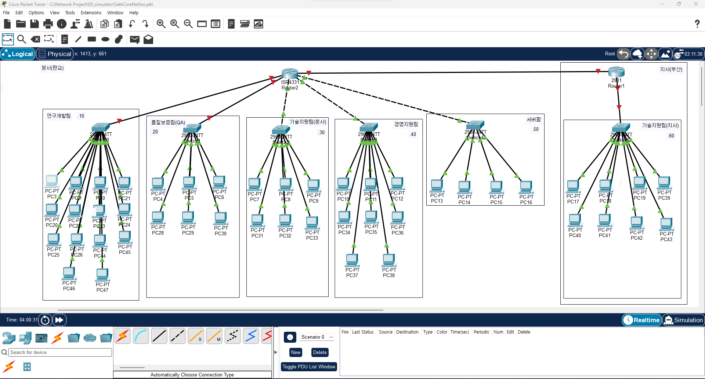

# 2일차 작업 계획서

- 날짜: 2026-11-01

## 1. 목표

- 프로젝트 계획서 3번 연결 요구사항 - 부서마다 네트워크를 나눈다 / 본사와 지사 사이를 연결한다
- 각 부서별로 독립된 서브넷(VLAN)을 설계하고 PC에 IP를 할당한다. 스위치에 VLAN을 실제로 적용하고, 라우터와 본사-지사 WAN 링크까지 설정해서 회사 전체(본사 5개 부서 + 지사)가 서로 통신 가능한 상태까지 만든다.

## 토폴로지 구성도

## 2. 작업 대상

| 대상 | 무엇을 |
|------|--------|
| 연구개발팀 PC (14대) | VLAN 10, 192.168.10.0/24 대역 IP 할당 |
| 품질보증팀(QA) PC (6대) | VLAN 20, 192.168.20.0/24 대역 IP 할당 |
| 기술지원팀(본사) PC (6대) | VLAN 30, 192.168.30.0/24 대역 IP 할당 |
| 경영지원팀 PC (8대) | VLAN 40, 192.168.40.0/24 대역 IP 할당 |
| 서버팜(고객지원 포털, 소스코드 서버, 테스트 서버, 파일 서버) | VLAN 50, 192.168.50.0/24 대역 IP 할당 |
| 기술지원팀(지사, 부산) PC (8대) | VLAN 60, 192.168.60.0/24 대역 IP 할당 |
| 본사-지사 WAN 링크 (Router0 - Router1) | 192.168.100.0/30 대역 IP 설정, 라우팅 설정 |

## 3. 작업 내용

1. 부서별로 192.168.X.0/24 대역을 하나씩 배정한다.
2. 스위치에서 부서별 VLAN을 실제로 만들고(`vlan`, `switchport access vlan`), 각 VLAN에 위 표의 대역을 배정한다.
3. 각 부서 PC에 배정된 대역의 IP, 서브넷 마스크, 게이트웨이를 정적으로 할당한다.
4. 각 VLAN의 게이트웨이 IP를 라우터 인터페이스에 설정하고 `no shutdown`으로 활성화한다.
5. 같은 부서(같은 VLAN) 안의 PC끼리 통신이 되는지 ping으로 확인한다.
6. 본사-지사 WAN 링크(Router0 - Router1)에 192.168.100.0/30 대역 IP를 설정한다.
7. 라우터 사이에 정적 라우팅(`ip route`)을 설정해서 본사와 지사 서브넷이 서로 경로를 알도록 만든다.
8. 회사 전체(본사 5개 부서 + 지사 + 서버팜)에서 서로 ping이 가능한지 전체 테스트한다.

## 4. 확인 방법

| 확인할 것 | 방법 | 기대하는 결과 |
|-----------|------|---------------|
| PC의 IP 할당 상태 | `ipconfig`(또는 PC 설정 화면)로 IP·서브넷 마스크(255.255.255.0)·게이트웨이 확인 | 설계한 대역대로 IP가 정확히 할당되어 있다 |
| 같은 부서 PC 간 통신 | 같은 VLAN 안 다른 PC로 ping | 패킷 신호가 정상적으로 수신 및 발신이 가능하다 |
| 게이트웨이 응답 | 각 VLAN의 게이트웨이 IP로 ping | 응답(Reply) 정상 수신 |
| 본사-지사 WAN 링크 상태 | Router0에서 Router1의 WAN IP로 ping | 응답(Reply) 정상 수신 |
| 다른 부서·지사 PC 간 통신 | 다른 VLAN(부서) PC로, 또는 지사 PC로 ping | 라우팅이 끝났으므로 이번 회차에서는 성공해야 정상이다 (부서 간을 일부러 막는 건 다음 회차에서 ACL로 적용) |

## 5. 되돌리는 방법

- 변경한 PC의 IP를 작업 전 상태(DHCP 자동 할당 또는 기록해둔 원래 IP)로 되돌린다.
- 스위치·라우터의 VLAN 설정을 변경했다면, 저장해둔 이전 설정 파일(startup-config 백업)로 복원한다.

## 6. 결과 (개인 실습이 끝날 때 채운다)

- 한 일: 본사 5개 부서(연구개발/QA/기술지원/경영지원/서버팜) 스위치와 지사 1개 부서(기술지원) 스위치, 라우터 2대로 토폴로지를 구성했다. 부서별로 192.168.X.0/24 대역을 배정하고, 전체 PC·서버에 IP·서브넷마스크·게이트웨이를 정적으로 할당했다.
- 확인 결과: 같은 스위치(같은 부서) 안의 PC끼리는 ping이 정상적으로 성공했다.
- 막힌 곳과 어떻게 풀었나: 처음에는 PC들이 서로 체인처럼 연결된 것으로 보여서 ping 실패를 의심했으나, 실제로는 전부 같은 스위치에 직접 연결되어 있었고 화면 배치상 그렇게 보였던 것뿐이었다.
- 다음 회차에 이어서 할 일: 스위치에 VLAN을 실제로 적용(`vlan`, `switchport access vlan`), 라우터 게이트웨이 설정, 본사-지사 WAN 링크 및 정적 라우팅 설정, 부서 간·지사 간 통신 테스트.

## 7. 서브네팅 값 정리

### 7-1. 실제로 적용한 대역 (패킷트레이서에 반영됨)

부서마다 /24를 하나씩 배정했다. 부서별 필요 인원수 대비 주소가 많이 남는 방식이라 효율적이지 않다.

| 대상 | 네트워크 주소 (프리픽스) | 서브넷 마스크 | 호스트 주소 범위 | 브로드캐스트 주소 |
|------|---------------------------|----------------|--------------------|---------------------|
| 연구개발팀 | 192.168.10.0/24 | 255.255.255.0 | 192.168.10.1 - 192.168.10.254 | 192.168.10.255 |
| 품질보증팀(QA) | 192.168.20.0/24 | 255.255.255.0 | 192.168.20.1 - 192.168.20.254 | 192.168.20.255 |
| 기술지원팀(본사) | 192.168.30.0/24 | 255.255.255.0 | 192.168.30.1 - 192.168.30.254 | 192.168.30.255 |
| 경영지원팀 | 192.168.40.0/24 | 255.255.255.0 | 192.168.40.1 - 192.168.40.254 | 192.168.40.255 |
| 서버팜 | 192.168.50.0/24 | 255.255.255.0 | 192.168.50.1 - 192.168.50.254 | 192.168.50.255 |
| 기술지원팀(지사) | 192.168.60.0/24 | 255.255.255.0 | 192.168.60.1 - 192.168.60.254 | 192.168.60.255 |
