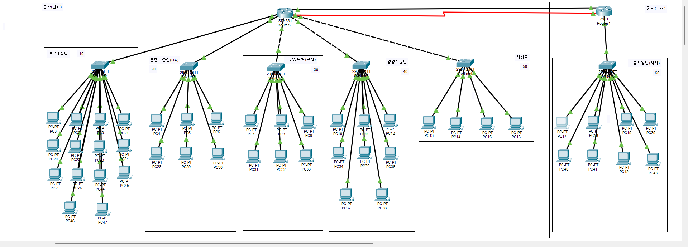

# 3일차 작업 계획서

- 날짜: 2026-11-07

## 토폴로지 구성도

## 1. 목표

- 프로젝트 계획서 3번 연결 요구사항 - 본사와 지사 사이: 지사 기술지원팀은 본사의 티켓 시스템과 파일 서버를 쓴다.
- 2일차에서 부서별로 나눠놓은 VLAN을 스위치에 적용하고, 라우터를 거쳐 부서 간·본사-지사 간 통신이 되게 만든다.
- 연구개발팀은 요구사항상 다른 부서와 통신하면 안 되지만, 오늘은 먼저 전체 라우팅을 연결하고 접근 제한(ACL)은 이후 보안 작업 단계에서 별도로 적용한다.

## 2. 작업 대상

| 대상 | 무엇을 |
|------|--------|
| 본사 스위치 5대(연구개발/QA/기술지원/경영지원/서버팜) | VLAN 생성과 이름 지정, 액세스 포트 할당(`vlan`, `switchport access vlan`), 관리 IP와 텔넷, 비밀번호, 미사용 포트 shutdown |
| 지사(부산) 스위치 | 위와 같은 설정 |
| 본사 라우터 | 부서 전용 포트로 게이트웨이 IP 설정. 온보드 포트(연구개발, QA)는 포트에 직접 IP, NIM-ES2-4 모듈 포트(기술지원, 경영지원, 서버팜, WAN)는 VLAN과 SVI(`interface vlan X`)로 IP 설정 |
| 지사 라우터 | 지사 부서 게이트웨이 IP와 WAN 포트 IP 설정 |
| 본사-지사 WAN 링크 | VLAN 70, 192.168.70.0/24 할당(본사 .1, 지사 .2) |
| 본사·지사 라우터 | 정적 라우팅(`ip route`)으로 상대 네트워크 대역 등록 |
| 본사·지사 스위치·라우터 전체 | 호스트네임, `no ip domain-lookup`, 설정 저장(`copy running-config startup-config`) |
| 수업 과제 | 본사 스위치 5대 체인 트렁크, 라우터 서브인터페이스(Router-on-a-Stick), VTP 서버/클라이언트를 적용·검증한 뒤 원래 구성으로 복원 |

## 3. 작업 내용

1. 본사 라우터에 부서 게이트웨이 IP를 설정한다. 연구개발·QA는 포트에 직접, 기술지원·경영지원·서버팜은 포트를 VLAN에 넣고 SVI에 설정한다.
2. `show cdp neighbors`로 실제 배선을 확인해 본사-지사 WAN 링크(VLAN 70)를 설정한다.
3. 지사 라우터에 지사 부서 게이트웨이 IP를 설정한다.
4. 본사 라우터에는 지사 대역(1줄), 지사 라우터에는 본사 대역(5줄)으로 가는 정적 라우팅을 추가한다.
5. 스위치마다 VLAN을 생성해 이름을 붙이고, connected 포트(PC 포트와 라우터 업링크)를 해당 VLAN의 액세스 포트로 지정한다.
6. 스위치에 관리 IP, 텔넷(vty), 비밀번호를 설정하고 장비 호스트네임과 `no ip domain-lookup`을 적용한다.
7. 미사용 포트를 shutdown 하고 전체 장비의 설정을 저장한다.
8. 수업 과제를 적용하고 검증한 뒤 원래 구성으로 되돌린다. 본사 스위치 5대를 체인 트렁크로 잇고, 본사 라우터 서브인터페이스와 VTP(서버 1대, 클라이언트 4대)를 구성한다.
9. 본사 5개 부서 + 지사 1개 부서, 총 6개 네트워크 간 통신을 ping으로 확인한다.

## 4. 확인 방법

| 확인할 것 | 방법 | 기대하는 결과 |
|-----------|------|---------------|
| VLAN 설정 상태 | 스위치에서 `show vlan brief` | 포트별로 설계한 VLAN과 이름이 적용되어 있다 |
| 라우터 게이트웨이 상태 | 라우터에서 `show ip interface brief` | 부서 게이트웨이와 WAN(SVI 포함)이 up/up이고 설계한 IP를 갖고 있다 |
| 정적 라우팅 테이블 | 라우터에서 `show ip route` | 상대 지사·본사 네트워크 대역이 라우팅 테이블에 올라와 있다 |
| 부서 간 통신(본사 내부) | 본사 부서 PC끼리 서로 ping | 라우터를 거쳐 패킷이 정상적으로 송수신된다 |
| 본사-지사 간 통신 | 본사 PC ↔ 지사 PC ping (양방향) | WAN 링크와 정적 라우팅을 거쳐 패킷이 정상적으로 송수신된다 |
| 스위치 텔넷 | 부서 PC에서 `telnet <관리 IP>` | 비밀번호를 묻고 접속된다 |
| 수업 과제(트렁크, VTP) | `show vtp status`, `show interfaces trunk` | 5대의 MD5 digest가 같고 트렁크 포트가 802.1q trunking 상태이다 |
| 설정 저장 상태 | `show startup-config` | running-config와 동일한 내용이 저장되어 있다 |

## 5. 되돌리는 방법

- 스위치·라우터에서 추가한 VLAN, SVI, 정적 라우팅 설정을 하나씩 `no` 명령으로 제거한다.
- 수업 과제는 서브인터페이스를 먼저 지우고 물리 포트와 SVI에 주소를 다시 준 뒤, 스위치는 `vtp mode transparent`로 바꾼 다음 VLAN을 삭제한다(순서가 바뀌면 삭제가 다른 스위치로 전파된다).
- 저장해둔 이전 설정 파일(startup-config 백업)이 있다면 그 상태로 복원한다.

## 6. 결과

- 한 일:
  - 본사 스위치 5대와 지사 스위치 VLAN 생성, 액세스 포트 할당(라우터 방향 포트 포함), 이름 지정, 관리 IP, 텔넷, 미사용 포트 shutdown 완료.
  - 본사 라우터는 부서 전용 포트 + VLAN + SVI(interface vlan X) 방식으로 게이트웨이 IP 설정.
  - 지사 라우터 WAN 링크 연결, 본사·지사 양쪽 정적 라우팅 설정.
  - 수업 과제(체인 트렁크, 본사 라우터 서브인터페이스, VTP 서버 SC-SW-RND/클라이언트 4대)를 별도로 적용·검증한 뒤 전부 원래 구성(부서별 전용 포트 + VLAN + SVI)으로 되돌림.
- 확인 결과:
  - `show vlan brief`, `show interfaces trunk`로 VLAN·트렁크 적용 상태 확인.
  - `show ip interface brief`로 모든 부서 게이트웨이(연구개발/QA/기술지원본사/경영지원/서버팜/WAN) up/up 확인.
  - 본사 5개 부서 + 지사 1개 부서 간 일부 구간 ping으로 통신 확인(6개 네트워크 전체 조합 ping 표는 ACL 작업 때 전후 비교로 만들 예정).
  - 수업 과제 적용 상태 캡처 8종 확보 후, 원래 구성으로 되돌리고 ping 4/4로 재검증 완료.
- 막힌 곳과 어떻게 풀었나:
  - 본사 라우터가 부서별 전용 포트 구조라 서브인터페이스 방식 대신 SVI 방식으로 진행했고, 서브인터페이스는 수업 과제로 적용했다.
  - NIM-ES2-4 모듈 포트에 `ip address`를 바로 할당하려다 `% Incomplete command` 발생 — VLAN 생성 후 SVI에 IP를 넣는 방식으로 전환해서 해결.
  - 본사 WAN 포트가 설계(Gi0/0/2)와 다르게 Gi0/1/3에 연결되어 있었다 — `show cdp neighbors`로 실제 배선을 확인해 Gi0/1/3 기준으로 설정.
  - 2960 스위치에서 `switchport trunk encapsulation dot1q` 입력 시 `% Invalid input` — 2960은 802.1Q 전용이라 해당 명령어 자체가 없음을 확인, `switchport mode trunk`만 사용.
  - 수업 과제 적용 시 라우터 서브인터페이스가 기존 IP/SVI와 겹쳐서 `% overlaps with` 에러 발생 — 기존 설정을 먼저 제거한 뒤 새 설정을 넣는 순서로 수정해서 해결.
- 다음 회차에 이어서 할 일:
  - 4일차: 기존 정적 라우팅은 그대로 유지한 채, 본사-지사 간 회선 이중화(백업 경로) 구성.
