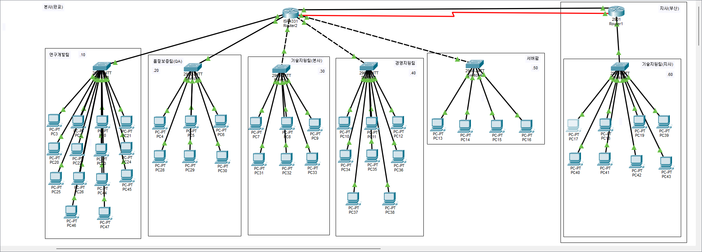

# 3일차 작업 계획서

- 날짜: 2026-11-07

## 1. 목표

- 프로젝트 계획서 3번 연결 요구사항 - 본사와 지사 사이: 지사 기술지원팀은 본사의 티켓 시스템과 파일 서버를 쓴다.
- 2일차에서 부서별로 나눠놓은 VLAN에 라우터로 가는 길을 열어서, 라우터를 거쳐 부서 간·본사-지사 간 통신이 되게 만든다.
- 연구개발팀은 요구사항상 다른 부서와 통신하면 안 되지만, 오늘은 먼저 전체 라우팅을 연결하고 접근 제한(ACL)은 이후 보안 작업 단계에서 별도로 적용한다.

## 토폴로지 구성도

아래는 4일차 기준 현재 전체 구조 캡처. 본사-지사 간 백업 회선(시리얼)은 4일차에 추가된 것이고, 3일차 시점에는 없었음.

## 업데이트 (실제 작업 중 확인된 내용)

실제 토폴로지를 보니 본사 라우터(SC-HQ-R1)는 부서마다 전용 물리 포트로 연결되어 있는 구조였다. 그래서 아래 "2. 작업 대상"/"3. 작업 내용"에 적힌 서브인터페이스+Router-on-a-Stick+트렁크 방식 대신, 실제로는 **부서별 전용 포트 + VLAN+SVI(interface vlan X)** 방식으로 게이트웨이 IP를 설정했다. (온보드 포트인 연구개발/QA는 포트에 바로 IP 할당, NIM-ES2-4 모듈 포트인 기술지원본사/경영지원/서버팜/WAN은 VLAN 생성 후 SVI로 IP 할당)

서브인터페이스+트렁크 방식은 오늘 별도로 받은 수업 과제(본사 라우터-스위치 연결을 연구개발팀 스위치 1개만 남기고 나머지는 끊은 뒤, 스위치끼리 연결해서 트렁크로 VLAN 통신시키는 것)에서 그대로 적용하기로 했고, 이 작업은 오늘 맨 마지막에 진행한다. 아래 표/내용은 원래 세운 계획으로 남겨두고, 실제 진행 상황은 결과 섹션과 `3일차_명령어_로그.md`에 기록한다.

## 2. 작업 대상 (원래 계획)

| 대상 | 무엇을 |
|------|--------|
| 본사 스위치 5대(연구개발/QA/기술지원/경영지원/서버팜) | VLAN 생성 및 액세스 포트 할당(`vlan`, `switchport access vlan`), 라우터 방향 포트는 트렁크로 설정 |
| 지사(부산) 스위치 | VLAN 생성 및 액세스 포트 할당, 라우터 방향 포트 트렁크 설정 |
| 본사 라우터 | 서브인터페이스별로 각 부서 VLAN의 게이트웨이 IP 설정(Router-on-a-Stick), `encapsulation dot1Q` 적용 |
| 지사 라우터 | 지사 부서 VLAN의 게이트웨이 IP 설정 |
| 본사-지사 WAN 링크 | 라우터 간 WAN 포트에 IP 할당 및 연결 |
| 본사·지사 라우터 | 정적 라우팅(`ip route`) 설정으로 상대 지사의 네트워크 대역을 알 수 있게 함 |
| 본사·지사 스위치·라우터 전체 | 설정 완료 후 `copy running-config startup-config`로 설정 저장 |

## 3. 작업 내용 (원래 계획)

1. 스위치마다 2일차에서 설계한 VLAN을 실제로 생성하고, 부서 PC가 연결된 포트를 해당 VLAN의 액세스 포트로 지정한다.
2. 스위치와 라우터를 연결하는 포트는 트렁크로 설정해서 여러 VLAN의 트래픽이 한 선으로 지나갈 수 있게 한다.
3. 본사 라우터에 VLAN 개수만큼 서브인터페이스를 만들고, 각 서브인터페이스에 해당 부서의 게이트웨이 IP(예: 192.168.10.1)를 설정한다.
4. 지사 라우터에도 지사 부서 VLAN의 게이트웨이 IP를 설정한다.
5. 본사 라우터와 지사 라우터를 WAN 링크로 연결하고 양쪽에 IP를 할당한다.
6. 본사 라우터에는 지사 네트워크 대역으로 가는 정적 라우팅을, 지사 라우터에는 본사 네트워크 대역들로 가는 정적 라우팅을 추가한다.
7. 각 부서 PC의 게이트웨이가 정상적으로 라우터를 가리키는지 확인한다.
8. 본사 5개 부서 + 지사 1개 부서, 총 6개 네트워크를 빠짐없이 서로 한 번씩 ping으로 테스트해서 모든 조합에서 라우터를 거친 통신이 되는지 확인한다.
9. 모든 통신이 확인되면 스위치·라우터의 설정을 저장해서 재부팅해도 유지되게 한다.

## 4. 확인 방법

| 확인할 것 | 방법 | 기대하는 결과 |
|-----------|------|---------------|
| VLAN·트렁크 설정 상태 | 스위치에서 `show vlan brief`, `show interfaces trunk` | 포트별로 설계한 VLAN이 올바르게 적용되어 있다 |
| 라우터 서브인터페이스 상태 | 라우터에서 `show ip interface brief` | 각 서브인터페이스가 up/up 상태이고 설계한 게이트웨이 IP를 갖고 있다 |
| 정적 라우팅 테이블 | 라우터에서 `show ip route` | 상대 지사·본사 네트워크 대역이 라우팅 테이블에 올라와 있다 |
| 부서 간 통신(본사 내부) | 본사 5개 부서 PC끼리 서로 ping | 라우터를 거쳐 모든 조합에서 패킷이 정상적으로 송수신된다 |
| 본사-지사 간 통신 | 본사 PC ↔ 지사 PC ping (양방향) | WAN 링크와 정적 라우팅을 거쳐 패킷이 정상적으로 송수신된다 |
| 설정 저장 상태 | `show startup-config`로 저장된 설정 확인 | running-config와 동일한 내용이 startup-config에 저장되어 있다 |

## 5. 되돌리는 방법

- 스위치·라우터에서 추가한 VLAN, 트렁크, 서브인터페이스, 정적 라우팅 설정을 하나씩 `no` 명령으로 제거한다.
- 저장해둔 이전 설정 파일(startup-config 백업)이 있다면 그 상태로 복원한다.

## 6. 결과 (개인 실습이 끝날 때 채운다)

- 한 일:
  - 본사 스위치 5대(연구개발/QA/기술지원/경영지원/서버팜) VLAN 생성, 액세스 포트 할당, 라우터 방향 트렁크, 관리 IP, 텔넷, 미사용 포트 shutdown까지 완료.
  - 본사 라우터는 원래 계획(서브인터페이스+Router-on-a-Stick)이 아니라, 실제 토폴로지(부서별 전용 물리 포트)에 맞춰 부서 전용 포트+VLAN+SVI(interface vlan X) 방식으로 게이트웨이 IP 설정.
  - 지사 라우터 WAN 링크 연결, 본사·지사 양쪽 정적 라우팅 설정.
  - 수업 과제로 받은 트렁크/VTP 재구성(본사 스위치 5대를 체인 구조 RND-QA-TS-ADM-SRV로 물리 재배선, 본사 라우터 서브인터페이스, VTP 서버(SC-SW-RND)/클라이언트 4대 구성)을 별도로 적용·검증한 뒤, 전부 원래 설계(부서별 전용 포트+VLAN+SVI)로 되돌림.
- 확인 결과:
  - `show vlan brief`, `show interfaces trunk`로 VLAN·트렁크 적용 상태 확인.
  - `show ip interface brief`로 모든 부서 게이트웨이(연구개발/QA/기술지원본사/경영지원/서버팜/WAN) up/up 확인.
  - 본사 5개 부서 + 지사 1개 부서 간 전체 조합 ping 테스트 성공.
  - 트렁크/VTP 수업 과제 적용 상태 캡처 8종 확보 후, 원래 설계로 되돌리고 ping 4/4로 재검증 완료.
- 막힌 곳과 어떻게 풀었나:
  - NIM-ES2-4 모듈 포트에 `ip address`를 바로 할당하려다 `% Incomplete command` 발생 — VLAN 생성 후 SVI에 IP를 넣는 방식으로 전환해서 해결.
  - 2960 스위치에서 `switchport trunk encapsulation dot1q` 입력 시 `% Invalid input` — 2960은 802.1Q 전용이라 해당 명령어 자체가 없음을 확인, `switchport mode trunk`만 사용.
  - 트렁크 과제 적용 시 라우터 서브인터페이스가 기존 IP/SVI와 겹쳐서 `% overlaps with` 에러 발생 — 기존 설정을 먼저 제거한 뒤 새 설정을 넣는 순서로 수정해서 해결.
- 다음 회차에 이어서 할 일:
  - 4일차: 기존 정적 라우팅은 그대로 유지한 채, 본사-지사 간 회선 이중화(백업 경로) 구성.
