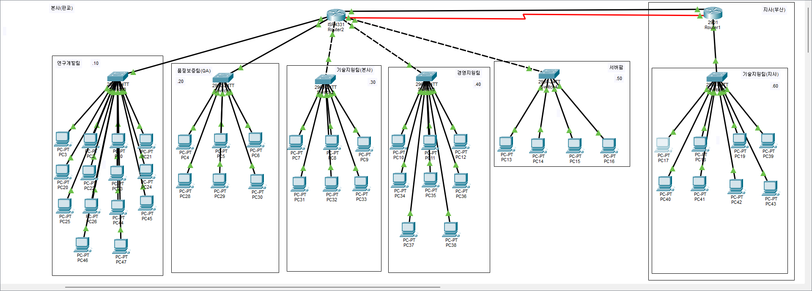

# 4일차 작업 계획서

- 날짜: 2026-11-08

## 토폴로지 구성도

## 1. 목표

- 프로젝트 계획서 3번 연결 요구사항 "본사와 지사 사이: 지사 기술지원팀은 본사의 티켓 시스템과 파일 서버를 쓴다"를 보면, 본사-지사 WAN 회선이 끊기면 지사가 이 서비스를 못 쓰게 된다. 오늘 수업에서 배운 "정적 라우팅 기반 회선 이중화"를 적용해서, 이 WAN 회선 하나가 끊겨도 지사 업무가 끊기지 않도록 만든다.
- 3일차에 만든 본사-지사 메인 설계(VLAN+SVI, 정적 라우팅)는 그대로 유지하고, 그 위에 백업 경로를 추가하는 방식으로 진행한다(기존 토폴로지·설계를 바꾸지 않는다).
- 동적 라우팅은 아직 수업 진도가 아니라서 이번에는 다루지 않고, 정적 라우팅 범위 안에서 회선 이중화만 구성한다.

## 2. 작업 대상

| 대상 | 무엇을 |
|------|--------|
| 본사 라우터(SC-HQ-R1) | NIM 2 슬롯에 NIM-2T 모듈 교체(기존 NIM 1은 그대로 유지), Serial0/2/0에 백업 회선 IP 설정 |
| 지사 라우터(SC-BR-R1) | 기존 WIC 슬롯(HWIC-2T)의 Serial0/3/0에 백업 회선 IP 설정 |
| 본사-지사 백업 회선 | 시리얼 케이블로 본사 Serial0/2/0 ↔ 지사 Serial0/3/0 연결, 192.168.80.0/30 대역 할당 |
| 본사·지사 라우터 | 기존 정적 라우팅은 그대로 두고, administrative distance 250짜리 floating static route(백업 경로) 추가 |
| 본사·지사 라우터 | 기존 WAN 회선을 일부러 끊어서 백업 경로로 자동 전환되는지, 복구 시 원래대로 돌아오는지 장애 테스트 |

## 3. 작업 내용

1. 본사 라우터 NIM 2 슬롯(미사용)에 NIM-2T 모듈을 꽂아서 Serial0/2/0, Serial0/2/1을 생성한다. 사용 중인 NIM 1 슬롯은 건드리지 않는다.
2. Packet Tracer에서 본사 Serial0/2/0과 지사 Serial0/3/0을 시리얼 케이블로 연결한다.
3. 양쪽 시리얼 인터페이스에 192.168.80.0/30 대역 IP를 설정하고 활성화(no shutdown)한다.
4. DCE 쪽을 확인하고(`show controllers`), 필요하면 clock rate를 설정한다.
5. 기존 정적 라우팅(AD 1)은 그대로 둔 채, 같은 목적지 대역으로 가는 백업 경로를 AD 250으로 추가한다(본사 1줄, 지사 5줄).
6. 지사 PC에서 본사로 지속 핑을 보내는 상태에서 본사 기존 WAN 포트(Gi0/1/3)를 shutdown해서, 백업 경로로 자동 전환되는지 확인한다.
7. 기존 WAN 포트를 다시 살려서(no shutdown), 원래 경로로 되돌아오는지 확인한다.

## 4. 확인 방법

| 확인할 것 | 방법 | 기대하는 결과 |
|-----------|------|---------------|
| 백업 회선이 물리적으로 연결됐다 | 양쪽 `show ip interface brief` | Serial0/2/0(본사)·Serial0/3/0(지사) up/up |
| 백업 경로가 설정에 들어갔다 | `show running-config \| include ip route` | 기존 경로(AD 1)와 백업 경로(AD 250)가 함께 보임 |
| 평소에는 백업 경로를 안 쓴다 | `show ip route static` | AD가 더 낮은 기존 경로만 라우팅 테이블에 보임 |
| 기존 회선 장애 시 자동 전환된다 | 본사 Gi0/1/3 shutdown 중 지사 PC `ping -t`, 양쪽 `show ip route static` | 핑이 잠깐만 끊기고 복구, 라우팅 테이블에 `[250/0]` 경로로 전환 |
| 복구 시 원래대로 돌아온다 | 본사 Gi0/1/3 no shutdown 후 양쪽 `show ip route static` | 다시 `[1/0]` 기존 경로로 복귀 |

## 5. 되돌리는 방법

- 백업 경로(`ip route ... 250`)는 해당 줄 앞에 `no`를 붙여서 제거한다.
- 백업 회선 인터페이스(Serial0/2/0, Serial0/3/0)는 `shutdown`으로 비활성화하거나 `no ip address`로 IP를 제거한다.
- NIM-2T 모듈을 뺄 경우 되돌리기 전에 반드시 설정을 저장해둔다(모듈 구성이 바뀌면 관련 인터페이스 설정이 날아갈 수 있음).

## 6. 결과

- 한 일:
  - 본사 라우터 NIM 2 슬롯에 NIM-2T 모듈 교체, Serial0/2/0·0/2/1 생성 확인. 기존 NIM 1(사용 중)은 그대로 유지.
  - 본사 Serial0/2/0 ↔ 지사 Serial0/3/0 시리얼 케이블 연결, 192.168.80.1/30(본사)·192.168.80.2/30(지사) IP 설정 완료.
  - DCE 쪽은 본사(SC-HQ-R1) 확인. NIM-2T 모듈 추가 시 clock rate 2000000이 기본값으로 이미 설정되어 있어서 별도 입력 불필요.
  - 기존 정적 라우팅은 그대로 둔 채, 본사 1줄·지사 5줄로 AD 250짜리 floating static route 추가. AD 값은 강사님 4일차 수업 자료와 맞춰서 250으로 선정(근거는 `4일차_명령어_로그.md` 3번 섹션에 정리).
  - 지사 PC에서 본사로 지속 핑을 보내는 상태에서 본사 Gi0/1/3을 shutdown해서 장애 테스트 진행, no shutdown으로 복구까지 확인.
- 확인 결과:
  - 양쪽 `show ip interface brief`에서 백업 회선 up/up 확인.
  - `show running-config | include ip route`로 양쪽 다 기존 경로(AD 1)와 백업 경로(AD 250)가 함께 설정되어 있는 것 확인.
  - 평상시에는 `show ip route static`에 AD가 더 낮은 기존 경로만 표시됨을 확인.
  - 본사 Gi0/1/3 shutdown 중 지속 핑 테스트에서 패킷 1개만 유실 후 바로 복구, 양쪽 라우팅 테이블에 백업 경로(`[250/0]`)가 올라온 것 확인.
  - 본사 Gi0/1/3 복구 후 본사는 즉시 기존 경로로 복귀, 지사는 ARP 미갱신으로 잠깐 백업 경로가 남아있었으나 `ping 192.168.70.1`로 ARP 재학습 후 기존 경로(`[1/0]`)로 복귀 확인.
- 막힌 곳과 어떻게 풀었나:
  - 기존 WAN 회선을 복구한 직후 지사 라우팅 테이블이 바로 기존 경로로 안 돌아와서 원인 확인 필요했음 — `show ip interface brief`, `ping`으로 물리/도달성은 정상임을 확인한 뒤, ARP 캐시 미갱신이 원인임을 파악. `ping`으로 ARP를 다시 학습시켜서 해결.
- 다음 회차에 이어서 할 일:
  - `03_설계도` 폴더에 전체 네트워크(VLAN 체계, IP 대역, 라우팅, 보안 설정, 회선 이중화 구조) 정리 문서 작성.
  - 추후 수업에서 동적 라우팅을 배우면, 지금 정적 라우팅 기반 회선 이중화를 동적 라우팅 기반으로 확장하는 것도 고려.
