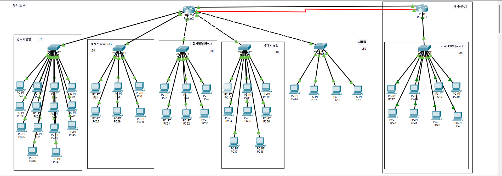

# 5일차 작업 계획서

- 날짜: 2026-11-21

## 토폴로지 구성도

## 1. 목표

- 지금은 본사와 지사 라우터에 경로를 손으로 적어 둔 정적 라우팅이라, 지사에 네트워크가 늘어나면 양쪽 라우터에 경로를 직접 추가해야 한다. 오늘 수업에서 배운 RIPv2를 적용해서 지사에 네트워크가 늘어나도 본사와 자동으로 연결되게 만든다.
- 4일차에 만든 예비 회선(시리얼, AD 250 정적 경로)은 그대로 유지하고, 주 회선 구간의 라우팅만 정적에서 RIPv2로 바꾼다.
- 사무실(PC) 쪽 포트에는 라우팅 정보가 나가지 않게 막는다. RIP 인증으로 허가되지 않은 라우터의 경로 주입을 막는 것도 시도한다.

## 2. 작업 대상

| 대상 | 무엇을 |
|------|--------|
| 본사 라우터(SC-HQ-R1) | 주 회선 정적 경로 삭제, RIPv2 설정, 예비 회선(Serial0/2/0)과 부서 LAN 쪽 인터페이스 passive |
| 지사 라우터(SC-BR-R1) | 주 회선 정적 경로 5줄 삭제, RIPv2 설정, 예비 회선(Serial0/3/0)과 사무실 LAN 쪽 인터페이스 passive |
| 지사 신규 네트워크(창고) | 지사 라우터에 루프백(Loopback0, 192.168.90.1/24)을 만들고, RIP 선언만 추가해서 본사가 자동으로 학습하는지 확인 |
| 예비 경로 | AD 250 정적 경로는 유지하고, 예비 경로의 마스크가 /24인지 확인. 창고용 예비 경로는 본사에 추가 |
| RIP 인증 | 시도했으나 Packet Tracer가 지원하지 않음 |

## 3. 작업 내용

1. 본사 1줄, 지사 5줄의 주 회선 정적 경로(AD 1)를 삭제한다. 예비 경로(AD 250)는 남긴다.
2. 두 라우터에 RIPv2를 설정한다(`version 2`, `no auto-summary`, 각 대역마다 `network` 선언).
3. 예비 회선(Serial0/2/0, Serial0/3/0)을 passive로 설정해서 RIP 광고가 예비 선으로 나가지 않게 한다.
4. 지사에 창고 네트워크(루프백)를 만들고, 지사 라우터의 `network 192.168.90.0` 한 줄만 추가해서 본사가 자동으로 학습하는지 확인한다.
5. 본사의 주 회선 포트를 내려서 예비 경로로 전환되는지, 새 네트워크(창고)도 예비 경로로 통신되는지 확인하고, 복구 때 경로가 돌아오는지 확인한다. 예비 경로가 /24인지 확인한다.
6. 사무실(LAN) 쪽 인터페이스를 passive로 설정한다. RIP 인증, 경로 필터(`distribute-list`), 유니캐스트 이웃(`neighbor`)을 시도해서 지원 여부를 확인한다.
7. 정적과 RIPv2의 항목별 비교를 `03_설계도/라우팅_비교.md`에 정리한다.

## 4. 확인 방법

| 확인할 것 | 방법 | 기대하는 결과 |
|-----------|------|---------------|
| 주 회선 정적 경로가 지워졌다 | 양쪽 `show running-config \| include ip route` | AD 1 경로는 없고 AD 250 예비 경로만 남음 |
| RIP으로 경로를 학습한다 | 양쪽 `show ip route` | `R` 표시 경로가 올라오고 ping 성공 |
| 예비 회선이 passive다 | `show ip protocols` | 예비 시리얼 인터페이스가 Passive Interface(s)에 표시 |
| 지사 신규 네트워크를 본사가 자동 학습한다 | 본사 `show ip route`, `show running-config \| include ip route`, 본사 PC에서 `ping 192.168.90.1` | 정적 경로 없이 `R 192.168.90.0/24`가 보이고 ping 성공 |
| 장애 시 예비 경로로 전환된다 | 주 회선 shutdown 중 지사 PC `ping -t`, 양쪽 `show ip route` | 예비 경로로 전환되고 통신 유지 |
| 장애 중 새 네트워크도 통신된다 | 본사 PC에서 `ping 192.168.90.1` | 예비 경로 추가 전에는 실패, 추가 후 성공 |
| 복구 시 원래 경로로 돌아온다 | 복구 후 양쪽 `show ip route` | R 경로 복귀, 예비 경로는 설정에 남고 표에서 물러남 |
| LAN 쪽이 passive다 | 양쪽 `show ip protocols` | LAN 포트들이 Passive Interface(s)에 표시되고 경로는 유지 |

## 5. 되돌리는 방법

- RIP 설정은 `no router rip`으로 제거한다.
- 삭제한 주 회선 정적 경로는 다시 입력한다(`ip route 192.168.60.0 255.255.255.0 192.168.70.2`, 지사는 192.168.10.0, 20.0, 30.0, 40.0, 50.0 대역을 192.168.70.1로).
- passive는 `router rip` 안에서 `no passive-interface <포트>`로 해제한다.
- 창고 루프백은 `no interface loopback 0`, 창고용 예비 경로는 본사에서 `no ip route 192.168.90.0 255.255.255.0 192.168.80.2 250`으로 제거한다.
- 인증은 적용되지 않았다. 만든 key chain은 `no key chain RIPKEY`로 제거한다.
- 설정을 바꾸기 전에 `copy running-config startup-config`로 저장해 둔다.

## 6. 결과

- 한 일:
  - 본사 1줄, 지사 5줄의 주 회선 정적 경로(AD 1)를 삭제하고 양쪽에 RIPv2를 설정했다.
  - 예비 회선(시리얼)과 사무실 LAN 쪽 포트(본사 5개, 지사 2개)를 passive로 설정했다.
  - 지사에 창고 네트워크(Loopback0, 192.168.90.1/24)를 만들고 `network` 한 줄만 추가해서 본사가 자동 학습하게 했다.
  - 장애 실험 중 발견한 창고용 예비 경로를 본사에 추가했다(`ip route 192.168.90.0 255.255.255.0 192.168.80.2 250`).
  - 정적과 RIPv2의 항목별 비교를 [라우팅 비교](../03_설계도/라우팅_비교.md)에 정리했다.
- 확인 결과:
  - 주 회선 정적 경로 삭제 후 양쪽이 `S [250/0]` 예비 경로로 전환되었다(예비 경로 6줄 모두 /24).
  - RIPv2 설정 후 `R [120/1]` 경로가 올라왔다. 시리얼로도 학습해서 같은 경로가 두 줄이었고, 시리얼 passive 후 주 회선 한 줄만 남았다.
  - 본사에 `R 192.168.90.0/24`가 자동 학습되었다. 본사 PC에서 `ping 192.168.90.1` 4/4 성공, 본사에 90 대역 정적 경로는 없다.
  - 주 회선 장애 중 140개 ping에서 유실 0, 예비 경로로 전환되었고 복구 때 양쪽 R 경로가 수동 조작 없이 돌아왔다.
  - LAN 쪽 passive를 `show ip protocols`로 확인했다(본사 5개, 지사 2개 포트).
- 막힌 곳과 어떻게 풀었나:
  - 장애 중 본사 PC에서 창고로 ping이 4/4 실패했다. 예비 경로가 정적이라 새 네트워크를 덮지 못하는 것이 원인이어서 본사에 예비 경로 한 줄을 추가해 해결했다.
  - `network 192.168.0.0` 한 줄로는 RIP이 켜지지 않았다. 클래스 기준이라 대역마다 선언해야 한다. ping은 예비 정적 경로 덕분에 성공했으므로 ping 성공만으로 RIP 동작을 판단하면 안 된다.
  - RIP 인증, 경로 필터(`distribute-list`), 유니캐스트 이웃(`neighbor`)은 Packet Tracer에서 명령이 인식되지 않아 검증하지 못했다.
  - 포트를 직접 내리는 방식이라 RIP의 느린 타이머(180초대)가 드러나지 않았고, 복구 시간과 복구 중 유실 수는 측정하지 못했다.
- 다음 회차에 이어서 할 일:
  - 6일차: RIP를 OSPF로 전환해 비교한다(`ospf` 브랜치).
  - LAN 쪽 ACL(UDP 520 차단)은 ACL 단계에서 시험한다.
