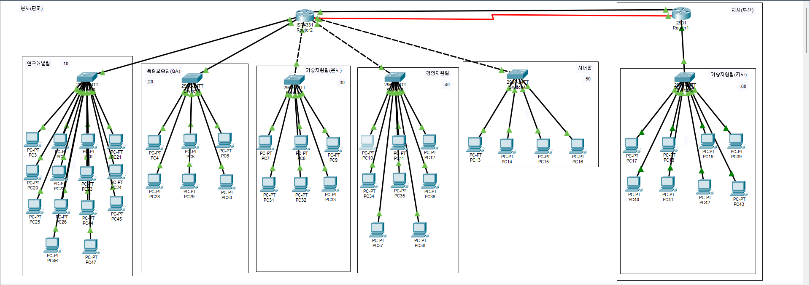
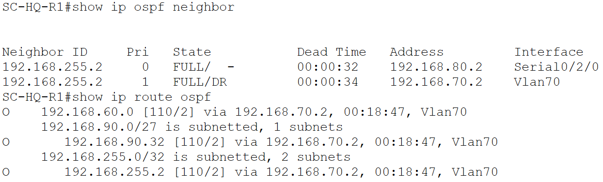
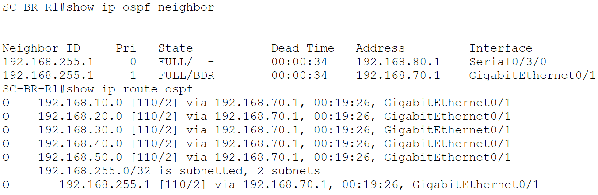
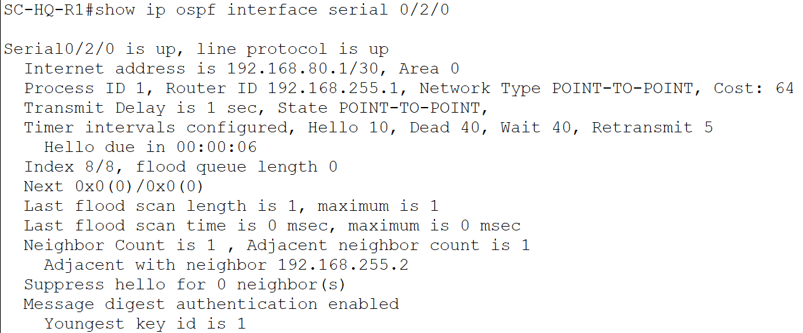
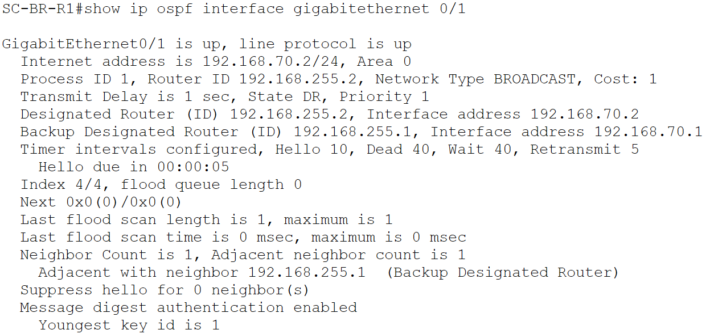

# 6일차 작업 계획서

- 날짜: 2026-11-22

## 토폴로지 구성도

## 1. 목표

- RIP는 회선 속도를 모르고 장애를 늦게 알아챈다. OSPF가 이 두 문제를 푸는지 실험한다.
- 실험은 `ospf` 브랜치에서 하고, RIP 상태(main)와 비교한 뒤 병합 여부를 정한다.
- 예비 정적 경로 없이 OSPF cost 차이만으로 예비 회선이 자동 백업이 되는지 확인한다.

## 2. 작업 대상과 설정값

| 장비 | 인터페이스 | 주소 | OSPF 선언 |
|------|-----------|------|-----------|
| SC-HQ-R1 | Loopback0 (라우터 ID) | 192.168.255.1/32 | `0.0.0.0` |
| | 부서 LAN 5개 | 192.168.10, 20, 30, 40, 50.0/24 | `0.0.0.255` |
| | Vlan70 (주 회선) | 192.168.70.1/24 | `0.0.0.255` |
| | Serial0/2/0 (예비 회선) | 192.168.80.1/30 | `0.0.0.3` |
| SC-BR-R1 | Loopback0 (라우터 ID) | 192.168.255.2/32 | `0.0.0.0` |
| | Loopback1 (창고) | 192.168.90.33/27 | `0.0.0.31` |
| | Gi0/0 (사무실) | 192.168.60.1/24 | `0.0.0.255` |
| | Gi0/1 (주 회선) | 192.168.70.2/24 | `0.0.0.255` |
| | Serial0/3/0 (예비 회선) | 192.168.80.2/30 | `0.0.0.3` |

- 삭제 대상: 양쪽 RIP, 본사 예비 정적 경로 2줄, 지사 예비 정적 경로 5줄, 지사 기존 Loopback0(192.168.90.1/24)

## 3. 작업 내용

1. main에 5일차 종료 상태를 커밋하고 `ospf` 브랜치를 만든다(`git switch -c ospf`).
2. RIP 기준선을 측정한다. 본사 `interface vlan 70`을 shutdown 하고 지사 PC의 `ping -t` 유실을 기록한다.
3. RIP와 예비 정적 경로를 지운다.
4. 루프백을 만들고 `router-id`를 정한다.
5. area 0 하나로 OSPF(프로세스 1)를 켠다.
6. 이웃, 경로, cost를 확인한다.
7. 장애 실험을 한다. 본사 Gi0/1/3 shutdown, Vlan70 shutdown 두 가지로 RIP 기준선과 비교한다.
8. `passive-interface default`로 사무실 쪽을 닫고 이웃 구간 두 곳만 연다.
9. 이웃 구간 두 곳에 MD5 인증을 건다. 구간마다 본사에만 먼저 걸어 이웃이 끊기는 것을 확인하고, 지사에 걸어 복구되는 것을 확인한다.
10. 문서를 갱신하고 RIP와 비교한 결과로 병합 여부를 정한다.

## 4. 확인 방법

| 확인할 것 | 방법 | 기대하는 결과 |
|-----------|------|---------------|
| RIP, 예비 정적 경로 삭제 | `show running-config \| include router rip\|ip route` | 결과 없음 |
| 라우터 ID | `show ip ospf \| include ID` | 192.168.255.1, 192.168.255.2 |
| 이웃 | `show ip ospf neighbor` | 주 회선, 시리얼 두 이웃 FULL |
| 경로 | `show ip route ospf` | `O` 경로만 있고 양쪽 PC ping 성공 |
| cost | `show ip ospf interface brief` | 이더넷 1, 시리얼 64(기본값 기준), 경로표에는 주 회선만 |
| 창고 마스크 | 본사 `show ip route 192.168.90.32` | `O 192.168.90.32/27` (/32로 보이면 Loopback1에 `ip ospf network point-to-point`) |
| 장애 전환 | 장애 중 지사 PC `ping -t`, `show ip route` | 시리얼 경유 `O` 경로로 전환, 통신 유지 |
| 감지 시간 | 2번 기준선과 7번 유실 수 | 표로 비교 |
| passive | `show ip protocols` | LAN 포트와 루프백이 Passive, 이웃 FULL 유지 |
| 인증 | 본사만 설정한 직후 `show ip ospf neighbor` | 이웃이 사라지고 지사 설정 후 FULL 복귀 |

## 5. 되돌리는 방법

- `ospf` 브랜치를 버리고 main의 `.pkt`로 돌아간다.
- 장비에서 되돌릴 때: `no router ospf 1`, 인터페이스의 `ip ospf ...` 제거, `no interface loopback 1`, 지사 Loopback0을 192.168.90.1/24로 복원, RIP와 예비 경로는 5일차 학습 문서의 명령으로 다시 입력.
- 설정을 바꾸기 전에 `copy running-config startup-config`로 저장한다.

## 6. 결과

- 양쪽 RIPv2와 예비 정적 경로를 제거하고, OSPF 프로세스 1의 `area 0`에 주 회선과 시리얼을 넣었다.
- 장애 시 비용 65인 시리얼로 전환했고, 주 회선이 복구되자 원래 경로로 돌아왔다. 물리 링크 단절부터 전환까지 걸린 정확한 시간은 미측정이다.

  

  

- Vlan70 종료 실험에서 지사 기준 RIPv2는 마지막 갱신 후 402초에서 475초 사이, OSPF는 마지막 Hello 후 약 9초에서 14초 사이에 예비 경로로 전환됐다. OSPF 이웃이 `DOWN`으로 바뀐 시점은 마지막 Hello 후 40초였다.
- `passive-interface default`로 주·예비 회선만 이웃을 맺도록 구성했다. 영역 방식과 비교한 뒤 네 인터페이스에 MD5를 적용하고 영역 공통 인증은 해제했다.

  

  

- 창고 루프백이 `/32`로 광고되는 문제는 `ip ospf network point-to-point`로 해결했다. 지사 OSPF 경로가 빠진 현상은 지사 프로세스를 초기화한 뒤 복구했다. 원인은 미확인이다.
- 양쪽 라우터 설정과 Packet Tracer 파일 저장 완료(실습자 확인). 실습 근거와 명령은 [6일차 학습문서](../04_학습문서/6일차_학습문서.md)에 정리했다.
- 최종 이웃, 경로 및 MD5 화면은 [최종 검증 캡처](../04_학습문서/6일차_학습문서.md#최종-검증-캡처)에 정리했다.
