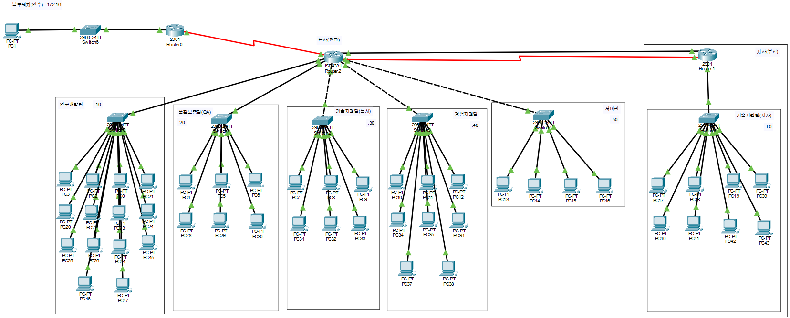

# 7일차 작업 계획서

- 날짜: 2026-11-28
- 브랜치: `eigrp`

## 토폴로지 구성도

## 1. 목표

- 세이프코어가 보안관제 기업 블루워치(BlueWatch, EIGRP 망)를 인수했다. 블루워치 관제 요원이 서버팜의 파일 서버로 탐지 룰과 분석 보고서를 주고받을 수 있게 본사에서 EIGRP와 OSPF를 연결한다.
- 블루워치에는 서버팜 경로만 넘긴다. 프로젝트 계획서 4번의 "제품 소스코드 / 기밀성"에 따라 연구개발팀 대역은 넘기지 않는다.
- 블루워치가 서버팜보다 좁은 경로를 광고해 트래픽을 빼 가는 경로 훼손을 재현하고, 막은 뒤 다시 시험한다.
- 연결 구간의 EIGRP를 MD5로 인증한다.

## 2. 작업 대상과 설정값

| 장비 | 인터페이스 | 주소 | 역할 |
|------|-----------|------|------|
| SC-HQ-R1 | Serial0/2/1 (DCE) | 172.16.20.1/30 | 블루워치 연결, EIGRP 20, 재분배 지점 |
| BW-R1 (2901, HWIC-2T 추가) | Serial0/3/0 | 172.16.20.2/30 | 본사 연결, EIGRP 20 |
| | Gi0/0 | 172.16.10.1/24 | 블루워치 LAN 게이트웨이 |
| BW-SW1 (2960) | | | 블루워치 LAN 스위치 |
| BW-PC1 | | 172.16.10.11/24 | 파일 서버 접속 시험 |
| 파일 서버 | | 192.168.50.11 | 서버팜 PC |

## 3. 작업 내용

1. 필터, 재분배, 인증 명령의 지원 여부를 확인한다.
2. 블루워치 장비를 추가하고 본사와 시리얼로 연결한다.
3. 본사와 BW-R1에 EIGRP 20을 설정한다.
4. 양방향 재분배를 설정하고, 블루워치에 연구개발 대역까지 넘어가는 것을 확인한다.
5. OSPF에서 EIGRP로의 재분배를 서버팜 대역 선언으로 바꿔 서버팜 경로만 넘긴다. 이 Packet Tracer는 경로 필터(`distribute-list`, `route-map`)를 지원하지 않는다.
6. BW-R1이 192.168.50.0/25를 광고해 경로 훼손을 재현하고, 본사 Serial0/2/1에 ACL을 걸어 빼앗긴 트래픽이 블루워치에 닿지 않게 한다.
7. 연결 구간에 EIGRP MD5 인증을 걸고, 한쪽만 설정, 양쪽 설정, 틀린 키를 시험한다.
8. 블루워치 회선과 주 회선 장애를 시험한다.

## 4. 확인 방법

| 확인할 것 | 방법 | 기대하는 결과 |
|-----------|------|---------------|
| EIGRP 이웃 | 본사 `show ip eigrp neighbors` | 172.16.20.2 |
| 지사가 블루워치를 안다 | 지사 `show ip route ospf` | `O E2 172.16.10.0/24` |
| 파일 서버 통신 | BW-PC1에서 `ping 192.168.50.11` | 성공 |
| 서버팜 경로만 넘김 | BW-R1 `show ip route eigrp` | 192.168.50.0/24만 있고 192.168.10.0/24는 없음 |
| 경로 훼손 대응 | `/25` 광고 중 본사 `show access-lists`, 지사 PC에서 파일 서버 ping | 트래픽이 블루워치로 넘어가지 않고 ACL 거부 수 증가 |
| 인증 | 설정 단계별 `show ip eigrp neighbors` | 한쪽만 끊김, 양쪽 복구, 틀린 키 끊김 |
| 장애 영향 | 본사 Serial0/2/1 shutdown 중 지사 PC에서 파일 서버 ping | 세이프코어 내부 통신 유지 |

## 5. 되돌리는 방법

- 재분배와 선언은 해당 `redistribute`, `network` 줄을 `no`로 지운다.
- ACL로 통신이 막히면 Serial0/2/1에서 `no ip access-group <번호> out`을 입력한다.
- 블루워치 연결을 끊을 때는 본사 Serial0/2/1을 `shutdown` 한다.
- 전체를 되돌릴 때는 main의 `.pkt`로 돌아간다.

## 6. 결과
