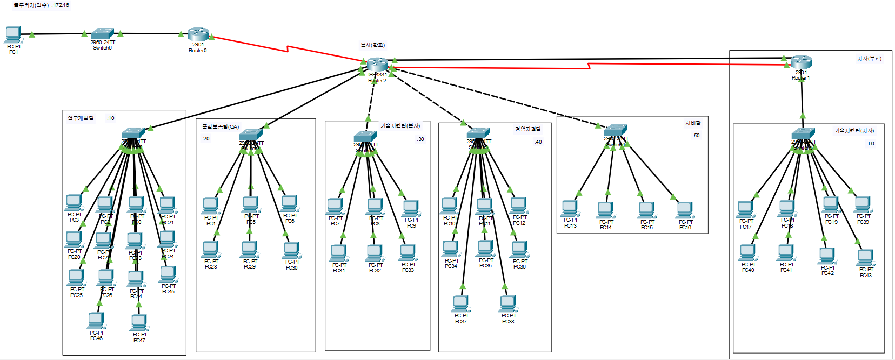

# SafeCore-NetSec 네트워크 설계서

- 최종 작성일: 2026-11-28 (7일차 블루워치 연결 기준)

## 1. 회사 개요

- 회사: 세이프코어(SafeCore), 보안 솔루션(방화벽, 백신, EDR) 개발 및 판매
- 본사: 판교, 34명 / 지사: 부산(고객지원센터), 8명

## 2. 전체 토폴로지

- 본사(판교): 라우터 1대(SC-HQ-R1, ISR4331) + 스위치 6대 중 5대(연구개발/QA/기술지원본사/경영지원/서버팜)
- 지사(부산): 라우터 1대(SC-BR-R1, 2901) + 스위치 1대(기술지원지사)
- 본사-지사 연결: 메인 회선(이더넷, VLAN 70) + 백업 회선(시리얼, 4일차 신규 추가)
- 블루워치(인수한 보안관제 기업): 라우터 BW-R1(2901) + 스위치 BW-SW1 + PC, 본사와 시리얼로 연결(7일차)
- 본사 라우터는 부서마다 전용 물리 포트로 연결되는 구조다.

## 3. 부서/구간별 VLAN·IP 설계

| 구간 | VLAN | 대역 | 게이트웨이 | 비고 |
|------|------|------|-----------|------|
| 연구개발팀 | 10 | 192.168.10.0/24 | 192.168.10.1 | 본사 라우터 온보드 포트 직결 |
| 품질보증팀(QA) | 20 | 192.168.20.0/24 | 192.168.20.1 | 본사 라우터 온보드 포트 직결 |
| 기술지원팀(본사) | 30 | 192.168.30.0/24 | 192.168.30.1 | VLAN+SVI |
| 경영지원팀 | 40 | 192.168.40.0/24 | 192.168.40.1 | VLAN+SVI |
| 서버팜 | 50 | 192.168.50.0/24 | 192.168.50.1 | VLAN+SVI |
| 기술지원팀(지사) | 60 | 192.168.60.0/24 | 192.168.60.1 | 지사 라우터 직결 |
| WAN(본사-지사, 메인 회선) | 70 | 192.168.70.0/24 | 본사 192.168.70.1 / 지사 192.168.70.2 | 이더넷, VLAN+SVI |
| WAN(본사-지사, 백업 회선) | - | 192.168.80.0/30 | 본사 192.168.80.1 / 지사 192.168.80.2 | 시리얼(point-to-point), 4일차 신규 |
| 창고(지사 실습 네트워크) | - | 192.168.90.32/27 | - | 지사 Loopback1, `192.168.90.33/27` |
| 블루워치 LAN | - | 172.16.10.0/24 | 172.16.10.1 | BW-R1 Gi0/0 |
| 본사-블루워치 | - | 172.16.20.0/30 | 본사 172.16.20.1 / BW-R1 172.16.20.2 | 시리얼, 7일차 |

/24로 설계한 이유: 부서마다 PC를 최대 254대까지 수용할 수 있도록 확장성을 고려.

## 4. 본사 라우터(SC-HQ-R1) 인터페이스 구성

| 구간 | 인터페이스 | 방식 |
|------|-----------|------|
| 연구개발팀 | GigabitEthernet0/0/0 | 포트에 직접 ip address |
| 품질보증팀 | GigabitEthernet0/0/1 | 포트에 직접 ip address |
| 기술지원팀(본사) | GigabitEthernet0/1/0 (NIM 1 슬롯) | VLAN30+SVI |
| 경영지원팀 | GigabitEthernet0/1/1 (NIM 1 슬롯) | VLAN40+SVI |
| 서버팜 | GigabitEthernet0/1/2 (NIM 1 슬롯) | VLAN50+SVI |
| WAN(지사, 메인) | GigabitEthernet0/1/3 (NIM 1 슬롯) | VLAN70+SVI |
| WAN(지사, 백업) | Serial0/2/0 (NIM 2 슬롯, NIM-2T) | ip address 직접 |
| 블루워치 | Serial0/2/1 (NIM-2T, DCE) | ip address 직접, ACL 110 out |
| OSPF 라우터 ID | Loopback0 | `192.168.255.1/32` |

모듈 구성: NIM 1 슬롯 = NIM-ES2-4(사용 중, 건드리지 않음) / NIM 2 슬롯 = 원래 미사용 NIM-ES2-4 → 4일차에 NIM-2T로 교체.

## 5. 지사 라우터(SC-BR-R1) 인터페이스 구성

| 구간 | 인터페이스 | 방식 |
|------|-----------|------|
| 기술지원팀(지사) | GigabitEthernet0/0 | ip address 직접 |
| WAN(본사, 메인) | GigabitEthernet0/1 | ip address 직접 |
| WAN(본사, 백업) | Serial0/3/0 (기존 WIC 슬롯, HWIC-2T) | ip address 직접 |
| OSPF 라우터 ID | Loopback0 | `192.168.255.2/32` |
| 창고(루프백) | Loopback1 | `192.168.90.33/27`, `ip ospf network point-to-point`로 `/27` 광고 |

## 6. 라우팅 설계

### OSPF 프로세스 1, area 0

- RIPv2와 예비 정적 경로를 제거했다. 주 회선과 시리얼에서 각각 OSPF 이웃을 유지한다.

| 회선 | 본사 | 지사 | 인터페이스 비용 | 실습에서 확인한 경로 비용 |
|------|------|------|-----------------|---------------------------|
| 주 회선 | Vlan70 | GigabitEthernet0/1 | 1 | 2 |
| 예비 회선 | Serial0/2/0 | Serial0/3/0 | 64 | 65 |

- 양쪽 라우터는 정상 상태에서 비용 2인 주 회선을 사용한다. 장애 시 비용 65인 시리얼로 전환하고, 주 회선 복구 후 다시 비용 2인 경로를 사용한다.
- 양쪽에 `passive-interface default`를 지정하고, 표의 두 회선만 `no passive-interface`로 열었다. `network`로 선언된 LAN과 루프백은 경로로 광고된다.
- 표의 네 인터페이스에 MD5 인증을 직접 적용했다. 영역 공통 인증은 해제했다.
- 이전 방식과의 차이는 [라우팅 비교](라우팅_비교.md), 설정과 출력은 [6일차 학습문서](../04_학습문서/6일차_학습문서.md)에 기록했다.
- 양쪽 라우터의 OSPF 상태와 회선별 MD5는 [최종 검증 캡처](../04_학습문서/6일차_학습문서.md#최종-검증-캡처)에서 확인할 수 있다.

### EIGRP 20 (블루워치)과 재분배

| 항목 | 설정 |
|------|------|
| EIGRP 20 | 본사 Serial0/2/1과 BW-R1 Serial0/3/0, `no auto-summary` |
| EIGRP를 OSPF로 | 본사 `redistribute eigrp 20 subnets`, 지사는 `O E2 172.16.10.0/24`로 학습 |
| 세이프코어를 블루워치로 | 재분배하지 않고 본사 EIGRP에 서버팜 192.168.50.0/24만 선언(Vlan50 passive) |
| 인증 | 연결 구간 EIGRP MD5(key chain) |

- OSPF를 EIGRP로 재분배하면 연구개발 대역과 내부 회선 대역까지 블루워치에 넘어가서 선언 방식으로 바꿨다. 이 Packet Tracer는 경로 필터(`distribute-list`, `route-map`, `prefix-list`)를 지원하지 않는다.
- 설정과 출력은 [7일차 학습문서](../04_학습문서/7일차_학습문서.md)에 기록했다.

## 7. 스위치 구성 (본사 5대 + 지사 1대)

| 스위치 | connected 포트 | VLAN | VLAN 이름 | 라우터 업링크 포트 |
|---|---|---|---|---|
| SC-SW-RND | Fa0/1-15 | 10 | RnD | Fa0/1 → SC-HQ-R1 Gi0/0/0 |
| SC-SW-QA | Fa0/1-7 | 20 | QA | Fa0/1 → SC-HQ-R1 Gi0/0/1 |
| SC-SW-TS | Fa0/1-7 | 30 | TechSupport_HQ | Fa0/4 → SC-HQ-R1 Gi0/1/0 |
| SC-SW-ADM | Fa0/1-9 | 40 | Admin | Fa0/4 → SC-HQ-R1 Gi0/1/1 |
| SC-SW-SRV | Fa0/1-5 | 50 | ServerFarm | Fa0/5 → SC-HQ-R1 Gi0/1/2 |
| SC-SW-TSBR | Fa0/1-9 | 60 | TechSupport_Branch | Fa0/1 → SC-BR-R1 Gi0/0 |

스위치 관리용 IP(텔넷 접속용): 각 부서 대역의 `.254` 주소 사용(예: SC-SW-RND = 192.168.10.254).

## 8. 보안 설정

- VLAN으로 부서별 네트워크 분리(연구개발팀은 요구사항상 다른 부서와 통신 금지 — 현재는 라우팅만 열어둔 상태이고, ACL로 실제 차단하는 작업은 이후 보안 작업 단계에서 별도 진행 예정).
- 스위치 6대의 미사용 포트는 shutdown 처리했다. 라우터는 미적용이며 케이블이 없는 포트가 down 상태로 남아 있다.
- 스위치 6대와 본사 라우터(SC-HQ-R1)에 enable secret, console, vty 비밀번호를 적용했다(실습용). 지사 라우터(SC-BR-R1)는 비밀번호가 없는 상태이며 장비 보안 단계에서 적용할 예정이다.
- 본사 라우터의 console, vty 비밀번호는 설정 파일에 평문으로 저장되어 있다(`service password-encryption` 미적용).
- OSPF는 LAN을 passive로 두어 해당 인터페이스에서 OSPF 이웃을 맺지 않는다. 주·예비 회선의 OSPF 패킷은 인터페이스별 MD5로 인증한다.
- 스위치 관리 접속은 텔넷으로 구성, 관리 IP 별도 할당.
- 블루워치 연결: 연구개발 대역은 블루워치에 광고하지 않는다. 본사 Serial0/2/1에 ACL 110(out)을 걸어 블루워치 LAN이 목적지인 트래픽만 내보내, 블루워치가 좁은 경로를 광고해 트래픽을 빼 가도 유출되지 않게 했다. EIGRP는 MD5로 인증한다.
- 블루워치 장비(BW-R1, BW-SW1)는 비밀번호와 미사용 포트 차단이 없는 인수 직후 상태다.

## 9. 수업 과제로 별도 적용 후 되돌린 것

- 3일차 수업 과제: 본사 스위치 5대를 체인 구조(RND-QA-TS-ADM-SRV)로 물리 재배선 + 본사 라우터 서브인터페이스(Router-on-a-Stick) + VTP(서버: SC-SW-RND, 클라이언트: 나머지 4대) 구성. 적용·검증(캡처 8종) 후, 메인 설계(부서별 전용 포트+VLAN+SVI)로 전부 되돌리고 ping 4/4로 재검증 완료. 메인 포트폴리오 구조에는 포함되지 않음, 수업 과제 이력으로만 기록.

## 10. 앞으로 확장 예정

- ACL로 연구개발팀 등 부서 간 통신 제한 적용(보안 작업 단계). 블루워치는 서버팜 중 파일 서버(192.168.50.11)만 허용하도록 좁힌다.
- 블루워치 장비 보안(비밀번호, 미사용 포트 차단).
- 고객지원 포털 외부 노출 및 나머지 서버 외부 비노출 설정.
- 재택 근무용 VPN 구성(연구개발팀 일부).
