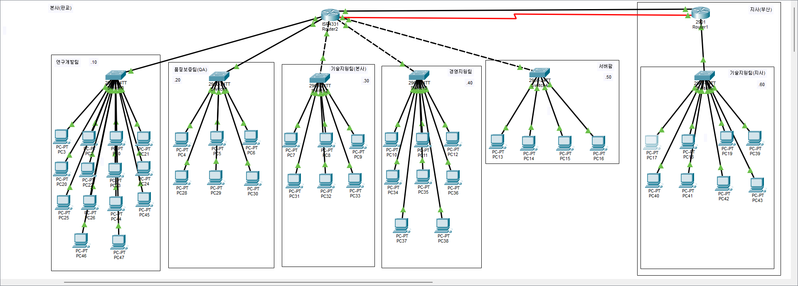

# SafeCore-NetSec 네트워크 설계서

- 최종 작성일: 2026-11-08 (4일차 작업 기준)
- 이 문서는 지금까지(1~4일차) 구축한 네트워크 전체 구조를 한 번에 정리한 문서다. 일자별 세부 작업 과정은 `02_작업 계획` 폴더의 일자별 작업계획서·명령어 로그를 참고.

## 1. 회사 개요

- 회사: 세이프코어(SafeCore), 보안 솔루션(방화벽, 백신, EDR) 개발 및 판매
- 본사: 판교, 34명 / 지사: 부산(고객지원센터), 8명
- 요구사항 원문: `01_요구사항/프로젝트_계획서.md`

## 2. 전체 토폴로지

- 본사(판교): 라우터 1대(SC-HQ-R1, ISR4331) + 스위치 6대 중 5대(연구개발/QA/기술지원본사/경영지원/서버팜)
- 지사(부산): 라우터 1대(SC-BR-R1, 2901) + 스위치 1대(기술지원지사)
- 본사-지사 연결: 메인 회선(이더넷, VLAN 70) + 백업 회선(시리얼, 4일차 신규 추가)
- 본사 라우터는 부서마다 전용 물리 포트로 연결되는 구조(Router-on-a-Stick/서브인터페이스 방식이 아님). 서브인터페이스+트렁크 방식은 3일차에 별도 수업 과제로만 적용 후 원래 설계로 되돌림.

## 3. 부서/구간별 VLAN·IP 설계

| 구간 | VLAN | 대역 | 게이트웨이 | 비고 |
|------|------|------|-----------|------|
| 연구개발팀 | 10 | 192.168.10.0/24 | 192.168.10.1 | 본사 라우터 온보드 포트 직결 |
| 품질보증팀(QA) | 20 | 192.168.20.0/24 | 192.168.20.1 | 본사 라우터 온보드 포트 직결 |
| 기술지원팀(본사) | 30 | 192.168.30.0/24 | 192.168.30.1 | VLAN+SVI |
| 경영지원팀 | 40 | 192.168.40.0/24 | 192.168.40.1 | VLAN+SVI |
| 서버팜 | 50 | 192.168.50.0/24 | 192.168.50.1 | VLAN+SVI |
| 기술지원팀(지사) | 60 | 192.168.60.0/24 | 192.168.60.1 | 지사 라우터 직결 |
| WAN(본사-지사, 메인 회선) | 70 | 192.168.70.0/24 | 본사 192.168.70.1 / 지사 192.168.70.2 | 이더넷, VLAN+SVI |
| WAN(본사-지사, 백업 회선) | - | 192.168.80.0/30 | 본사 192.168.80.1 / 지사 192.168.80.2 | 시리얼(point-to-point), 4일차 신규 |

/24로 설계한 이유: 부서마다 PC를 최대 254대까지 수용할 수 있도록 확장성을 고려.

## 4. 본사 라우터(SC-HQ-R1) 인터페이스 구성

| 구간 | 인터페이스 | 방식 |
|------|-----------|------|
| 연구개발팀 | GigabitEthernet0/0/0 | 포트에 직접 ip address |
| 품질보증팀 | GigabitEthernet0/0/1 | 포트에 직접 ip address |
| 기술지원팀(본사) | GigabitEthernet0/1/0 (NIM 1 슬롯) | VLAN30+SVI |
| 경영지원팀 | GigabitEthernet0/1/1 (NIM 1 슬롯) | VLAN40+SVI |
| 서버팜 | GigabitEthernet0/1/2 (NIM 1 슬롯) | VLAN50+SVI |
| WAN(지사, 메인) | GigabitEthernet0/1/3 (NIM 1 슬롯) | VLAN70+SVI |
| WAN(지사, 백업) | Serial0/2/0 (NIM 2 슬롯, NIM-2T) | ip address 직접 |

모듈 구성: NIM 1 슬롯 = NIM-ES2-4(사용 중, 건드리지 않음) / NIM 2 슬롯 = 원래 미사용 NIM-ES2-4 → 4일차에 NIM-2T로 교체.

## 5. 지사 라우터(SC-BR-R1) 인터페이스 구성

| 구간 | 인터페이스 | 방식 |
|------|-----------|------|
| 기술지원팀(지사) | GigabitEthernet0/0 | ip address 직접 |
| WAN(본사, 메인) | GigabitEthernet0/1 | ip address 직접 |
| WAN(본사, 백업) | Serial0/3/0 (기존 WIC 슬롯, HWIC-2T) | ip address 직접 |

## 6. 라우팅 설계

### 메인 정적 라우팅 (3일차, 계속 유지)

- SC-HQ-R1: `ip route 192.168.60.0 255.255.255.0 192.168.70.2`
- SC-BR-R1: 본사 5개 부서 대역(10/20/30/40/50)으로 가는 경로를 각각 `192.168.70.1`로 지정(5줄)

### 백업 정적 라우팅 (floating static route, 4일차 신규)

- administrative distance(AD) 값: 250 — 메인 경로(AD 1)보다 훨씬 후순위로 밀어두되, 메인 경로가 끊겼을 때만 자동으로 쓰이게 하는 값. 255(사용 안 함 예약값) 바로 아래라서 "최후의 수단"이라는 의도가 명확함.
- SC-HQ-R1: `ip route 192.168.60.0 255.255.255.0 192.168.80.2 250`
- SC-BR-R1: 본사 5개 부서 대역으로 가는 백업 경로를 각각 `192.168.80.1 250`으로 지정(5줄)
- 동작 방식: 평소에는 AD가 더 낮은 메인 경로만 라우팅 테이블에 올라오고 백업 경로는 대기. 메인 회선(WAN Gi 포트)이 끊기면 자동으로 백업 경로(시리얼)로 전환되고, 메인 회선이 복구되면 다시 메인 경로로 돌아옴. 장애 테스트로 전체 전환·복구 사이클 확인 완료(`4일차_명령어_로그.md` 4번 섹션).

## 7. 스위치 구성 (본사 5대 + 지사 1대)

| 스위치 | connected 포트 | VLAN | VLAN 이름 | 라우터 업링크 포트 |
|---|---|---|---|---|
| SC-SW-RND | Fa0/1-15 | 10 | RnD | Fa0/1 → SC-HQ-R1 Gi0/0/0 |
| SC-SW-QA | Fa0/1-7 | 20 | QA | Fa0/1 → SC-HQ-R1 Gi0/0/1 |
| SC-SW-TS | Fa0/1-7 | 30 | TechSupport_HQ | Fa0/4 → SC-HQ-R1 Gi0/1/0 |
| SC-SW-ADM | Fa0/1-9 | 40 | Admin | Fa0/4 → SC-HQ-R1 Gi0/1/1 |
| SC-SW-SRV | Fa0/1-5 | 50 | ServerFarm | Fa0/5 → SC-HQ-R1 Gi0/1/2 |
| SC-SW-TSBR | Fa0/1-9 | 60 | TechSupport_Branch | Fa0/1 → SC-BR-R1 Gi0/0 |

스위치 관리용 IP(텔넷 접속용): 각 부서 대역의 `.254` 주소 사용(예: SC-SW-RND = 192.168.10.254).

## 8. 보안 설정

- VLAN으로 부서별 네트워크 분리(연구개발팀은 요구사항상 다른 부서와 통신 금지 — 현재는 라우팅만 열어둔 상태이고, ACL로 실제 차단하는 작업은 이후 보안 작업 단계에서 별도 진행 예정).
- 전 장비 미사용 포트는 전부 shutdown 처리.
- 전 장비 enable secret / console / vty 비밀번호 통일 적용(실습용).
- 스위치 관리 접속은 텔레넷으로 구성, 관리 IP 별도 할당.

## 9. 수업 과제로 별도 적용 후 되돌린 것

- 3일차 수업 과제: 본사 스위치 5대를 체인 구조(RND-QA-TS-ADM-SRV)로 물리 재배선 + 본사 라우터 서브인터페이스(Router-on-a-Stick) + VTP(서버: SC-SW-RND, 클라이언트: 나머지 4대) 구성. 적용·검증(캡처 8종) 후, 메인 설계(부서별 전용 포트+VLAN+SVI)로 전부 되돌리고 ping 4/4로 재검증 완료. 메인 포트폴리오 구조에는 포함되지 않음, 수업 과제 이력으로만 기록.

## 10. 앞으로 확장 예정

- ACL로 연구개발팀 등 부서 간 통신 제한 적용(보안 작업 단계).
- 고객지원 포털 외부 노출 및 나머지 서버 외부 비노출 설정.
- 재택 근무용 VPN 구성(연구개발팀 일부).
- 수업에서 동적 라우팅을 배우면, 지금의 정적 라우팅 기반 회선 이중화를 동적 라우팅 기반으로 확장하는 것도 검토.
