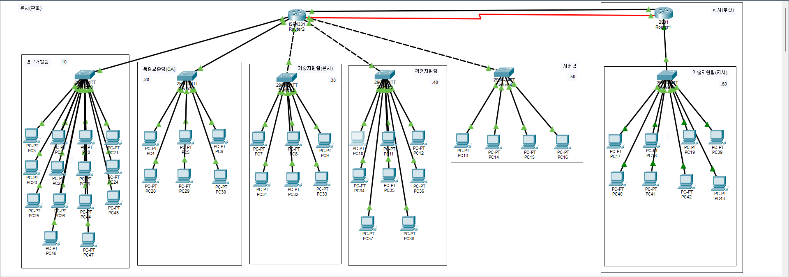
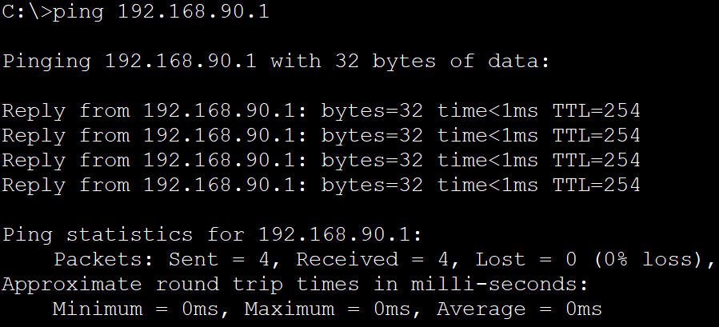
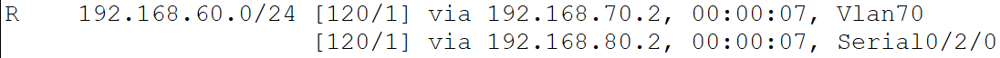
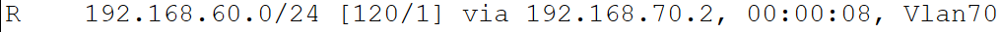

# 정적 라우팅, RIPv2, OSPF 비교

본사(판교)와 지사(부산)를 잇는 주 회선과 예비 회선에서 4일차 정적 라우팅과 5일차 RIPv2를 비교했다. 6일차에는 같은 회선에서 OSPF를 시험했다. 결과는 Cisco Packet Tracer 실습에 기반한다.

- 작성일: 2026-11-21
- 캡처: `99_첨부파일/5일차_1` - `5일차_13`

## 1. 결론

1. **네트워크가 늘어나는 구간은 RIPv2가 유리하다.** 지사에 새 네트워크를 만들고 지사 라우터에 `network` 한 줄만 넣었더니 본사가 자동으로 학습했다. 본사에는 아무것도 입력하지 않았다.
2. **동적 라우팅이 모든 것을 자동으로 해 주지는 않는다.** 예비 회선은 정적 경로라서 새 네트워크마다 본사에 예비 경로를 따로 추가해야 한다. 놓치면 평소에는 정상이다가 주 회선 장애 때만 그 네트워크가 끊긴다. 시험에서 재현했다.
3. **복구는 RIPv2가 더 깔끔했다.** 정적 방식은 지사에서 수동 조작(ARP 재학습용 ping)이 필요했고, RIPv2는 양쪽이 자동으로 돌아왔다.

| 비교 항목 | 정적(4일차) | RIPv2(5일차) | 우세 |
|-----------|-------------|--------------|------|
| 설정 길이 | 주 회선 경로 6줄 | 두 라우터 합쳐 17줄 | 현재 규모에서는 정적 |
| 새 네트워크 추가 | 본사에 경로 직접 추가 | 지사에 `network` 한 줄 | RIPv2 |
| 장애 대응(포트 shutdown) | 패킷 1개 유실 | 140개 중 유실 0 | 비슷함 |
| 복구 | 지사 수동 조작 필요 | 양쪽 자동 복귀 | RIPv2 |
| 예비 회선 | 직접 관리 | 직접 관리, 새 네트워크를 덮지 못함 | 같음 |
| 부하와 타이머 | 없음 | 30초 광고, 수렴 180초대 | 정적 |
| 보안 | 광고가 없어 공격면이 없음 | 광고 수신, 이 환경에서는 passive만 검증 | 정적 |

## 2. 비교 환경



| 구분 | 값 |
|------|-----|
| 본사 / 지사 라우터 | SC-HQ-R1(ISR4331) / SC-BR-R1(2901) |
| 주 회선 | 이더넷 VLAN 70, 192.168.70.0/24 (본사 .1, 지사 .2) |
| 예비 회선 | 시리얼 192.168.80.0/30 (본사 Serial0/2/0, 지사 Serial0/3/0) |
| 본사 / 지사 대역 | 192.168.10, 20, 30, 40, 50.0/24 / 192.168.60.0/24, 창고(루프백) 192.168.90.0/24 |

경로 우선순위(AD, 작을수록 우선): 직접 연결 0, 정적 주 회선 1(4일차에만 사용), RIP 120, 정적 예비(floating) 250.

## 3. 항목별 비교

### 3-1. 설정 방식

- 정적: 본사 1줄, 지사 5줄. 대역이 늘면 상대 라우터에 줄이 늘고, 빠뜨리면 그 대역만 조용히 끊긴다.
- RIPv2: `router rip`, `version 2`, `no auto-summary`와 대역별 `network` 선언. 합쳐서 17줄로 현재 규모에서는 정적보다 길다. 이득은 변경할 때 나온다(3-2).
- 함정: `network 192.168.0.0` 한 줄로는 RIP이 켜지지 않았다. `network`가 클래스 기준이라 대역마다 선언해야 한다. 이때도 ping은 예비 정적 경로 덕분에 성공했으므로, `show ip protocols`의 인터페이스 목록과 경로표의 `R` 경로로 판단해야 한다.

### 3-2. 확장성: 지사에 새 네트워크 추가

지사 라우터에 루프백으로 창고 네트워크(192.168.90.0/24)를 만들고 `network 192.168.90.0` 한 줄만 추가했다.

| 확인 | 결과 |
|------|-----------|
| 본사 `show ip route 192.168.90.0` | `Known via "rip", distance 120, metric 1`, via 192.168.70.2 |
| 본사 설정의 정적 경로 | `192.168.60.0` 예비 한 줄뿐. 90 대역 정적 경로 없음 |
| 본사 PC(192.168.40.11)에서 `ping 192.168.90.1` | 4/4 성공, TTL=254 |



정적이었다면 본사에 `ip route 192.168.90.0 ...`을 직접 넣어야 한다. 지사가 여러 곳이 되면 이 작업이 그만큼 곱해진다.

### 3-3. 장애 대응

두 방식 모두 지사 PC에서 `ping 192.168.50.1 -t`를 걸어 두고 본사 주 회선 포트(Gi0/1/3)를 shutdown 했다.

| | 정적 | RIPv2 |
|---|---|---|
| 유실 | 패킷 1개 | 140개 중 0개 |
| 장애 중 경로 | 양쪽 `S [250/0]` | 양쪽 R 경로가 사라지고 `S [250/0]` |

- 포트를 내리면 라우터가 회선 단절을 즉시 알기 때문에 두 방식의 결과가 비슷하다. 1개와 0개의 차이는 전환 시점과 ping 간격(1초)의 차이이며 방식의 우열이 아니다.
- 시험하지 못한 것: 회선은 살아 있는데 통신이 끊기는 장애. 정적 경로는 연결된 인터페이스가 up이면 다음 홉에 닿지 못해도 경로표에 남고, 보완하려면 IP SLA와 track이 필요하다 [5][6]. RIP은 갱신이 180초 오지 않으면 경로를 무효 처리하므로 느리지만 스스로 감지한다 [1].

### 3-4. 복구

| | 정적 | RIPv2 |
|---|---|---|
| 본사 | 즉시 `[1/0]` 복귀 | R 경로 자동 복귀 |
| 지사 | `[250/0]`이 남았다가 `ping 192.168.70.1`로 ARP를 다시 학습시킨 뒤 복귀 | R 경로 자동 복귀, 수동 조작 없음 |

복구 후 예비 경로는 설정에 남고 경로표에서만 물러났다. 복구 시간과 복구 중 유실 수는 측정하지 못했다.

### 3-5. 예비 회선과의 상호작용

주 회선은 RIP, 예비 회선은 floating static인 혼합 구조에서 확인한 세 가지.

| 항목 | 내용 |
|------|------|
| 기존 정적 경로 삭제 | 주 회선 정적 경로(AD 1)가 남으면 RIP(AD 120)보다 우선해서 RIP 경로가 올라오지 못한다. RIP을 켜기 전에 6줄을 삭제했다 |
| 시리얼 passive | RIP을 켜면 시리얼로도 광고가 오가 같은 경로가 두 줄(같은 metric)로 올라왔다. 시리얼을 `passive-interface`로 막자 주 회선 한 줄만 남았다 |
| **예비 경로가 새 네트워크를 덮지 못함** | 장애 중 본사 경로표에 창고가 없었다. 예비 정적 경로가 60 대역 한 줄뿐이고 창고는 RIP으로만 학습했기 때문이다 |

| 장애 중 시험(본사 PC) | 결과 |
|---|---|
| `ping 192.168.60.1`(예비 경로 있음) | 4/4 성공 |
| `ping 192.168.90.1`(예비 경로 없음) | 4/4 실패, `Destination host unreachable` |
| 창고용 예비 경로 추가 후 `ping 192.168.90.1` | 4/4 성공 |





RIP의 자동 학습은 RIP이 살아 있는 주 회선에서만 성립한다. 예비 회선은 새 네트워크마다 사람이 경로를 추가해야 한다.

### 3-6. 타이머

`show ip protocols` 기준: 광고 30초, invalid 180초, holddown 180초, flush 240초, 최대 동시 경로 4개, 송수신 버전 2. 정적에는 광고와 타이머가 없다. 이 시험은 포트를 직접 내려서 타이머를 거치지 않았다.

### 3-7. 보안

이 프로젝트의 보안 요구 중 "장비 설정 무결성"과 관련된 항목이다.

| | 정적 | RIPv2 |
|---|---|---|
| 광고 수신 | 없음 | 있음(UDP 520, 멀티캐스트 224.0.0.9) [3][4] |
| 외부 경로 주입 | 불가능(입력한 것만 존재) | 가능성 있음(가짜 라우터나 PC가 RIP 패킷을 보내면) |
| 약점 | 입력 실수, 변경 누락 | 가짜 광고, 정보 노출 |

| 통제 | 결과 | 상태 |
|------|------|------|
| LAN 쪽 `passive-interface` | 본사 5개, 지사 2개 포트와 시리얼 양쪽에 적용, `show ip protocols`로 확인 | 검증함 |
| RIP 인증 | key chain은 생성되나 `ip rip authentication`이 `Invalid input`, `ip rip ?`가 `Unrecognized command`(양쪽 동일) | Packet Tracer 미지원 |
| 경로 필터 `distribute-list`, 유니캐스트 `neighbor` | `Unrecognized command` | 미지원 |
| LAN 쪽 ACL(UDP 520 차단) | 시험하지 않음 | ACL 단계 예정 |

passive는 광고를 내보내는 방향만 막는다 [7]. LAN으로 내부 대역 정보가 새는 것은 줄이지만, PC가 보낸 가짜 RIP 패킷을 거부하지는 못한다.

실제 장비용 RIP 인증 설정(이 환경에서 검증하지 못함). 평문은 키가 패킷에 그대로 실리고 MD5는 해시만 실려서, 보안이 중요하면 MD5를 권한다 [2].

```
key chain RIPKEY
 key 1
  key-string <키>
interface <RIP이 켜진 포트>
 ip rip authentication mode md5
 ip rip authentication key-chain RIPKEY
```

## 4. 한계

- 포트를 직접 내리는 방식이라 RIP 타이머와 회선은 살아 있는 장애에서의 차이는 시험하지 못했다.
- 복구 시간과 복구 중 유실 수는 측정하지 못했다.
- 정적의 새 네트워크 추가 비용은 직접 시험하지 않았다.
- 4일차 유실 수는 기록이 일관되지 않아 "1개"로만 표기했다.
- RIP 자체의 한계: metric이 홉 수이고 16은 도달 불가라 최대 15홉이며 [3], 타이머 때문에 수렴이 느리다 [1].

## 5. 언제 무엇을 쓰나

| 상황 | 권장 | 이유 |
|------|------|------|
| 경로가 적고 거의 바뀌지 않는 구간 | 정적 | 광고가 없어 공격면이 없고 관리가 직관적이다 |
| 예비 회선, 최후 수단 | 정적(floating, AD 250) | 동적 경로가 사라질 때만 올라오게 하는 가장 단순한 방법이다 |
| 소규모에서 네트워크가 늘어나는 구간 | RIPv2 | 새 네트워크를 한 줄 선언으로 자동 전파한다 |
| 회선 비용에 따라 경로를 선택하고 인증이 필요한 구간 | OSPF | 비용으로 경로를 선택하고, 인터페이스 또는 영역에 인증을 지정할 수 있다 [8] |

**5일차 구성:** 주 회선은 RIPv2, 예비 회선은 floating static. 지사에 네트워크를 추가할 때 지사의 RIP 선언과 본사의 예비 정적 경로가 필요했다.

## 6. 6일차 RIPv2 기준선과 OSPF 비교

본사 Vlan70을 내려 지사에서 `192.168.50.0/24` 경로가 시리얼로 바뀌는 시점을 비교했다.

| 항목 | RIPv2와 예비 정적 경로 | OSPF |
|------|------------------------|------|
| 정상 시 | 주 회선 `R [120/1]` | 주 회선 `O [110/2]` |
| 장애 시 | 시리얼 `S [250/0]` | 시리얼 `O [110/65]` |
| 예비 경로 전환 | 마지막 RIP 갱신 후 402초에서 475초 사이 | 마지막 Hello 후 약 9초에서 14초 |
| 회선별 인증 | 5일차 시뮬레이터에서 RIP 인증 적용을 완료하지 못함 | 주·예비 회선 각 인터페이스에서 MD5 동작 확인 |

- OSPF의 주 회선 이웃이 `DOWN`으로 바뀐 시점은 마지막 Hello 후 40초였다. 시리얼을 통한 LSA 전달로 경로가 먼저 전환됐다는 해석은 추정이다.
- 표의 시간은 경로표 전환을 추정한 범위다. 실제 패킷 단절 시간과 물리 단절부터 전환까지 걸린 정확한 시간은 미측정이다.
- 6일차 구성은 두 회선의 OSPF와 인터페이스 MD5다. 회선별 전환과 복구 명령, 출력은 [6일차 학습문서](../04_학습문서/6일차_학습문서.md)에 기록했다.

## 7. 7일차 EIGRP 연결과 재분배

블루워치(EIGRP 20)를 본사에서 OSPF와 연결하며 확인한 것이다.

| 경로 | 표시 | AD | 확인한 곳 |
|------|------|----|-----------|
| EIGRP 내부 | `D` | 90 | 본사의 블루워치 LAN, 블루워치의 서버팜 |
| EIGRP 외부(재분배) | `D EX` | 170 | 재분배 때 블루워치가 받은 세이프코어 대역 |
| OSPF 외부 E2 | `O E2` | 110 | 지사의 블루워치 대역, 주 회선 장애 때도 metric 20 유지 |

- OSPF를 EIGRP로 재분배하면 OSPF `network`에 포함된 본사 직접 연결 대역까지 넘어가 연구개발 대역이 노출됐다. 경로 필터가 지원되지 않아 필요한 대역만 EIGRP에 선언했다.
- 블루워치가 서버팜보다 좁은 /25를 광고하자 본사가 최장 일치로 그 경로를 택해 서버팜 트래픽이 블루워치로 갔다. 나가는 ACL로 유출은 막았지만 통신 끊김은 막지 못했다.
- 이 Packet Tracer는 EIGRP를 OSPF로 넘기는 재분배를 파일을 열 때만 계산해, 이후 EIGRP 경로의 추가나 소멸이 지사에 반영되지 않았다.

## 참고 자료

번호가 없는 내용은 이번 실습에서 직접 확인한 결과다.

1. Cisco, [Cisco IOS IP Routing: RIP Command Reference](https://www.cisco.com/c/en/us/td/docs/ios-xml/ios/iproute_rip/command/irr-cr-book/irr-cr-rip.html) - 타이머 기본값(update 30, invalid 180, holddown 180, flush 240초)
2. Cisco, [Sample Configuration for Authentication in RIPv2](https://www.cisco.com/c/en/us/support/docs/ip/routing-information-protocol-rip/13719-50.html) - RIP 인증, 평문과 MD5
3. IETF, [RFC 2453: RIP Version 2](https://datatracker.ietf.org/doc/html/rfc2453) - metric 16은 도달 불가
4. Cisco, [Understanding RIP (IOS XR)](https://www.cisco.com/c/en/us/td/docs/iosxr/cisco8000/routing/configuration-guide/routing-config-cisco8000/implementing-rip/understanding-rip.html) - RIPv2 멀티캐스트 224.0.0.9
5. Cisco, [Static and Default Routes (ASA 9.12)](https://www.cisco.com/c/en/us/td/docs/security/asa/asa912/configuration/general/asa-912-general-config/route-static.html) - 정적 경로는 다음 홉 도달 여부를 감지하지 못함, 추적으로 보완
6. Cisco, [Configuring Static Routing (Nexus 7000)](https://www.cisco.com/c/en/us/td/docs/switches/datacenter/nexus7000/sw/unicast/config/cisco_nexus7000_unicast_routing_config_guide_8x/configuring_static_routing.html) - 추적 대상이 down이면 floating static이 올라옴
7. O'Reilly, [Cisco IOS in a Nutshell: Passive Interfaces](https://www.oreilly.com/library/view/cisco-ios-in/156592942X/ch08s04.html) - RIP의 passive는 광고를 보내지 않고 갱신은 계속 받음
8. Cisco, [Configure Authentication in Open Shortest Path First](https://www.cisco.com/c/en/us/support/docs/ip/open-shortest-path-first-ospf/13697-25.html) - OSPF 인터페이스 및 영역 인증

5와 6은 IOS 라우터가 아닌 같은 Cisco의 다른 플랫폼 문서이며, 정적 경로와 floating static의 일반 원리를 확인하는 용도로 썼다.
