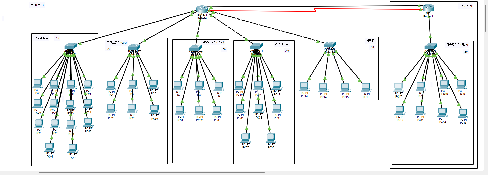

# 4일차 학습 문서: 회선 이중화와 floating static route (시리얼 백업 회선, AD 250)

- 날짜: 2026-11-08 (4일차 작업일, 명령어 로그 기준)
- 범위: 명령어 로그 1번(시리얼 케이블 연결과 IP 설정), 2번(DCE와 clock rate 확인), 3번(AD 250 예비 경로), 4번(장애 전환과 복구 시험)
- 근거 자료: 이관 전 명령어 로그와 개념정리(폴더는 삭제했고 커밋 4da9d5e에서 복원할 수 있다), `02_작업 계획/4일차_작업계획서.md`, `03_설계도/네트워크_설계서.md`, `01_요구사항/프로젝트_계획서.md`
- 이 문서에 적은 명령어는 명령어 로그에 기록된 것이다. 3일차에 입력한 메인 경로 한 줄만 설계서 6번의 표기를 따랐다. 출력은 로그에 기록된 것만 인용하고, 출력 원문이 로그에 없는 명령은 읽는 법만 설명한다.
- 표기: "(확인 필요)"는 위 자료만으로 확정할 수 없는 항목이다. 면접에서 단정해서 말하기 전에 직접 확인한다. "추론"은 자료에 적힌 사실이 아니라 설명을 위해 덧붙인 해석이라는 뜻이다.

## 1. 왜 하는가

- 프로젝트 계획서 3번 연결 요구사항에 "지사 기술지원팀은 본사의 티켓 시스템과 파일 서버를 쓴다"가 있다. 부산 지사(8명)가 일을 하려면 본사까지 가는 WAN 회선이 살아 있어야 한다.
- 3일차까지 본사와 지사 사이 회선은 이더넷 하나(메인 회선, VLAN 70)뿐이었다. 이 선이 끊기면 지사는 본사의 서비스에 닿지 못해 업무가 멈춘다. 이렇게 하나가 고장 나면 전체가 멈추는 지점을 단일 장애점(SPOF)이라고 한다.
- 그래서 두 번째 길(시리얼 백업 회선)을 만들고, 메인 회선이 죽었을 때만 그 길로 돌아가는 예비 경로(floating static route)를 추가했다.
- 3일차에 만든 메인 설계(VLAN과 SVI, 정적 라우팅)는 바꾸지 않고 그 위에 백업만 얹었다. 동적 라우팅은 아직 수업 진도가 아니어서 정적 라우팅 범위 안에서만 이중화했다.
- 이중화는 설정했다고 끝나지 않는다. 메인 회선을 실제로 끊어서 전환되는지, 복구하면 돌아오는지까지 확인해야 믿을 수 있다. 그래서 마지막 단계가 장애 시험이다.

### 4단계의 순서와 이유

| 단계 | 하는 일 | 이 순서인 이유 |
|------|---------|----------------|
| 1 | 시리얼 케이블 연결, 양쪽 IP 설정, no shutdown | 백업 경로가 지나갈 길과 양끝 주소가 먼저 있어야 한다 |
| 2 | DCE와 clock rate 확인, up/up 확인 | 시리얼은 박자를 주는 쪽이 없으면 길이 열리지 않는다. 길이 열린 것을 확인한 뒤에 경로를 올린다 |
| 3 | AD 250 예비 경로 입력 | 길이 살아 있어야 다음 홉(상대 시리얼 주소)에 닿는 경로가 의미가 있다 |
| 4 | 메인 회선 차단, 전환 확인, 복구, 복귀 확인 | 끊어 보지 않은 이중화는 동작한다고 말할 수 없다 |

## 2. 핵심 개념

### 2.1 단일 장애점과 회선 이중화
- 이중화(redundancy)는 같은 일을 할 수 있는 길이나 장비를 하나 더 두어 단일 장애점을 없애는 것이다. 보안 3요소 중 가용성을 지키는 수단이다.
- 이번 작업의 단일 장애점은 본사와 지사를 잇는 메인 이더넷 회선이었다. 두 번째 회선으로 시리얼 회선을 추가했다.
- 이더넷과 시리얼처럼 다른 매체를 쓰면 같은 원인으로 두 회선이 함께 끊길 가능성이 줄어든다(개념정리).

### 2.2 시리얼 링크: DCE, DTE, clock rate
- 시리얼 WAN 구간에서는 한쪽 끝(DCE)이 데이터의 박자(clock)를 만들어 주고, 반대쪽 끝(DTE)이 그 박자에 맞춘다. 박자를 주는 쪽이 없으면 링크가 올라오지 않는다.
- 박자는 DCE 쪽 인터페이스의 `clock rate`로 정한다. 어느 쪽이 DCE인지는 케이블을 어떻게 연결했느냐로 정해지므로, 연결한 뒤 `show controllers serial`로 확인한다.
- 이번 실습에서는 `show controllers serial0/2/0`으로 본사(SC-HQ-R1)가 DCE임을 확인했다. DCE가 본사이므로 지사는 반대쪽인 DTE다.
- NIM-2T 모듈을 추가하면 `clock rate 2000000`이 기본값으로 이미 들어 있어서 따로 입력하지 않았다. 이 값은 초당 2,000,000비트(2Mbps)다.
- 메인 회선은 GigabitEthernet 포트로 연결되어 있으므로 백업 회선은 그보다 훨씬 느리다. 장애 중에는 업무는 이어지지만 속도는 떨어진다. 시뮬레이터에서 속도를 측정한 기록은 없다.
- Cisco 시리얼의 기본 캡슐화는 HDLC다(개념정리). 양쪽이 모두 Cisco 라우터라서 기본값이 같고, 이번 로그에는 캡슐화를 따로 확인하거나 바꾼 기록이 없다.

### 2.3 /30 점대점 주소
- 두 장비만 잇는 구간에는 주소가 2개만 있으면 된다. /30(255.255.255.252)은 주소가 4개이고 그중 호스트용이 2개다.
- 192.168.80.0/30에서 네트워크 주소는 .0, 호스트는 .1(본사)과 .2(지사), 브로드캐스트는 .3이다.
- 주소를 낭비하지 않고, 부서 대역(192.168.10, 20, 30, 40, 50, 60)과 메인 WAN 대역(192.168.70)과 겹치지 않는 별도 대역이라는 점도 장점이다.

### 2.4 Administrative Distance(AD)
- 서로 다른 출처(직접 연결, 정적, EIGRP, OSPF, RIP 등)가 같은 목적지를 알려 줄 때 어느 쪽을 믿을지 정하는 신뢰도 값이다. 작을수록 더 신뢰한다.

| 출처 | 기본 AD |
|------|---------|
| 직접 연결 | 0 |
| 정적 경로 | 1 |
| EIGRP | 90 |
| OSPF | 110 |
| RIP | 120 |
| 외부 EIGRP | 170 |
| 신뢰 안 함(사용 안 함) | 255 |

- 255는 "절대 쓰지 않음"으로 예약된 값이다. 이 값을 주면 경로가 라우팅 테이블에 아예 올라오지 않는다(로그 3번).
- 범위 표기: 로그는 AD 범위를 1부터 255로, 개념정리는 0부터 255로 적었다. 직접 연결이 0이므로 전체 척도는 0부터 255이고, 로그의 1부터 255는 정적 경로에 줄 수 있는 값을 가리킨 것으로 보면 두 기록이 모두 맞는다.
- AD와 metric은 다르다. AD는 출처끼리 비교하는 값이고, metric은 같은 출처 안에서 경로끼리 비교하는 값이다. `show ip route`의 `[250/0]`에서 앞이 AD, 뒤가 metric이다.

### 2.5 라우팅 테이블이 경로를 고르는 순서
1. 목적지와 가장 길게 일치하는 경로(더 구체적인 경로)가 먼저다.
2. 길이가 같으면 AD가 낮은 출처가 이긴다.
3. 같은 출처 안에서는 metric이 낮은 경로가 이긴다.

- 그래서 예비 경로는 메인 경로와 같은 목적지, 같은 마스크로 적어야 한다. 마스크가 더 길면 AD와 상관없이 그 경로가 먼저 이겨서 평소에도 예비 경로로 나간다. 같게 맞추면 AD 한 값으로 우열이 정해져서 동작을 예측할 수 있다.

### 2.6 floating static route
- 평소에는 라우팅 테이블에 올라오지 않고 설정에만 들어 있다가, 더 신뢰도 높은 경로(AD가 낮은 경로)가 테이블에서 사라지면 그때 올라오는 정적 경로다. AD를 기본값 1보다 높게 줘서 만든다.
- 다음 홉(next hop)은 패킷을 목적지 쪽으로 넘겨줄 바로 옆 라우터의 주소다. 이 문서의 정적 경로는 모두 다음 홉 주소로 적는다.
- 평소 `show ip route static`에 보이지 않는 것이 정상이다. 설정에 있는지는 `show running-config | include ip route`로 확인한다.
- AD를 주지 않으면 기본값 1이 되어 메인 경로와 우선순위가 같아진다. 같은 목적지에 같은 AD의 경로가 둘이면 둘 다 테이블에 올라가 트래픽이 두 회선으로 나뉠 수 있다. 그러면 예비가 아니라 분산이 된다. 이번 실습에서 AD를 생략하고 시험해 본 기록은 없다.

### 2.7 AD 250을 쓴 이유 (강사님 설명이 아니라 본인 분석)

> 주의: 강사님이 배부한 4일차 자료에는 예비 경로의 AD가 250으로 지정되어 있었고, 이유는 따로 적혀 있지 않았다. 아래 근거는 명령어 로그 3번에 정리한 본인의 기술적 분석(추론)이다. 강사님이 밝힌 이유가 아니므로 면접에서 "강사님이 이렇게 설명하셨다"고 말하지 않는다.

- AD는 작을수록 신뢰하는 값이고 범위는 1부터 255다.
- 255는 "사용 안 함"으로 예약된 특수값이라서 주면 경로가 테이블에 아예 올라오지 않는다. 백업으로 쓸 수 없다.
- 주요 방식의 기본 AD는 직접 연결 0, 정적 1, EIGRP 90, OSPF 110, RIP 120, 외부 EIGRP 170이다.
- 250은 255 바로 아래 숫자다. 어떤 라우팅 방식보다도 확실히 뒤로 미루면서, 완전 비활성(255)은 아니어서 "최후의 수단"으로는 쓸 수 있게 살려 둔 값으로 해석했다.

**더 정확히 답하기 위한 설명** (로그에 없는 설명용 추론):
- 지금 구성에는 직접 연결과 정적 경로만 있다. 이 상태에서는 예비 경로의 AD가 1보다 크기만 하면 동작은 같다. 250이어야만 동작하는 것은 아니다.
- 250처럼 큰 값을 쓰면 나중에 동적 라우팅(EIGRP, OSPF, RIP)을 도입해도 예비 정적 경로가 항상 맨 뒤에 남는다. 큰 값을 고른 쪽의 장점은 이것이다.

### 2.8 장애 전환이 일어나는 원리
- 다음 홉 주소로 나가는 정적 경로는 그 다음 홉에 닿는 길이 이미 테이블에 있을 때만 올라온다. 보통 그 길은 인터페이스가 up/up일 때 생기는 직접 연결 경로다.
- 본사: 메인 WAN 포트 Gi0/1/3은 VLAN 70의 SVI(192.168.70.1)에 속한다. SVI는 VLAN에 IP 주소를 붙이는 가상 인터페이스이고, 이 포트를 shutdown하면 SVI가 내려가고 192.168.70.0/24 직접 연결 경로가 사라지는 것으로 추론한다. 그러면 다음 홉 192.168.70.2를 쓰는 AD 1 경로가 테이블에서 빠지고 AD 250 경로(다음 홉 192.168.80.2)가 올라온다.
- 지사: 본사 쪽 포트가 내려가면 지사 Gi0/1의 링크도 끊기는 것으로 추론한다. 같은 원리로 다음 홉 192.168.70.1을 쓰는 AD 1 경로 5줄이 빠지고 AD 250 경로 5줄(다음 홉 192.168.80.1)이 올라온다.
- 로그에는 SVI나 인터페이스 상태 출력이 없고 경로가 바뀐 결과만 있다. 위 설명은 설계서의 구성에서 유추한 것이다(확인 필요).
- 복구하면 반대로 AD 1 경로가 다시 올라오고 AD 250 경로는 대기로 돌아간다.
- 시험에서 ping 손실이 1개에 그친 것은 인터페이스 상태가 바뀌자 경로가 바로 바뀌었다는 뜻이다. 동적 라우팅은 이웃의 장애를 타이머로 감지하므로 전환이 더 느릴 수 있다. 이번에 시험하지 않았다.

### 2.9 복구 후 지사에서 관찰한 현상
- 본사 Gi0/1/3을 no shutdown한 직후 본사는 곧바로 `[1/0] via 192.168.70.2`로 돌아왔다. 지사는 처음에 `[250/0]`이 그대로 남아 있었고, 지사에서 `ping 192.168.70.1`을 보내 ARP를 다시 학습시키자(첫 패킷만 실패, 이후 성공) `[1/0] via 192.168.70.1`로 5줄 전부 돌아왔다.
- ARP는 IP 주소에 해당하는 MAC 주소를 알아내는 절차다. 라우터는 다음 홉으로 프레임을 보내려면 그 MAC 주소가 필요하다. 로그는 원인을 ARP 미갱신으로 판단했다.
- 지사의 ARP 테이블을 직접 확인한 출력은 로그에 없다. 일반적으로 정적 경로가 테이블에 올라오는 조건은 다음 홉으로 가는 직접 연결 경로(인터페이스 상태)이고 ARP 캐시가 아니다. 그래서 이 현상이 ARP 때문인지, 인터페이스가 다시 올라오는 데 시간이 걸린 것인지, 시뮬레이터의 특성인지는 로그만으로 구분할 수 없다(확인 필요). 면접에서는 관찰한 사실(ping 뒤에 복귀했다)과 내가 세운 설명(ARP 미갱신)을 나누어 말한다.

## 3. 단계별 실습



그림에서 본사 라우터(ISR4331)와 지사 라우터(2901) 사이에 선이 두 줄 있다. 검은 선이 메인 이더넷 회선, 붉은 선이 시리얼 백업 회선이다.

### 이번 작업의 구성 값

| 구간 | SC-HQ-R1 (본사) | SC-BR-R1 (지사) | 대역 |
|------|-----------------|-----------------|------|
| 메인 회선(이더넷, VLAN 70) | Gi0/1/3, VLAN 70 SVI 192.168.70.1 | Gi0/1, 192.168.70.2 | 192.168.70.0/24 |
| 백업 회선(시리얼) | Serial0/2/0, 192.168.80.1 (NIM 2 슬롯의 NIM-2T, DCE) | Serial0/3/0, 192.168.80.2 (기존 WIC 슬롯, DTE) | 192.168.80.0/30 |
| 메인 경로(3일차, AD 1) | 192.168.60.0/24 via 192.168.70.2 | 192.168.10.0/24, 192.168.20.0/24, 192.168.30.0/24, 192.168.40.0/24, 192.168.50.0/24 각각 via 192.168.70.1 | |
| 예비 경로(4일차, AD 250) | 192.168.60.0/24 via 192.168.80.2 | 192.168.10.0/24, 192.168.20.0/24, 192.168.30.0/24, 192.168.40.0/24, 192.168.50.0/24 각각 via 192.168.80.1 | |

### 단계 1. 시리얼 케이블 연결과 백업 회선 IP 설정 (로그 1번)

**(a) 목적**

본사와 지사 사이에 두 번째 길(시리얼 링크)을 만들고 양끝에 192.168.80.0/30 대역의 주소를 준다. 이 길과 주소가 있어야 단계 3의 예비 경로가 다음 홉(상대 라우터의 시리얼 주소)에 닿을 수 있다. 길이 없는 채로 예비 경로부터 넣으면 다음 홉으로 가는 길이 없어서 경로가 의미가 없다.

먼저 한 GUI 작업(명령어 없음)은 다음과 같다.

| 작업 | 왜 하는가 |
|------|-----------|
| 본사 라우터 NIM 2 슬롯에 NIM-2T 모듈로 교체하고 Serial0/2/0, Serial0/2/1 생성 확인 | 본사에 시리얼 포트를 만들려면 시리얼 모듈이 필요하다. NIM 1 슬롯에는 기술지원팀(본사), 경영지원팀, 서버팜 포트와 메인 WAN 포트(Gi0/1/0부터 Gi0/1/3까지)가 있어서 건드리면 3일차 구성이 깨지므로, 쓰지 않던 NIM 2 슬롯만 교체했다 |
| 지사는 기존 WIC 슬롯의 Serial0/3/0 사용(로그는 HWIC-2T로 추정한다고 적었고 작업계획서와 설계서는 HWIC-2T로 적었다) | 지사 라우터에는 시리얼 모듈 자리가 이미 있어 추가 작업이 없었다(확인 필요) |
| SC-HQ-R1의 Serial0/2/0과 SC-BR-R1의 Serial0/3/0을 시리얼 케이블로 연결 | 두 시리얼 포트를 물리적으로 이어야 링크가 생긴다. 어느 쪽이 DCE가 되는지는 케이블 연결로 정해지므로 단계 2에서 확인한다 |

**(b) 명령어**

**SC-HQ-R1 (본사 라우터)**
```
configure terminal
interface Serial0/2/0
ip address 192.168.80.1 255.255.255.252
no shutdown
exit
```

**SC-BR-R1 (지사 라우터)**
```
configure terminal
interface Serial0/3/0
ip address 192.168.80.2 255.255.255.252
no shutdown
exit
```

**(c) 명령어별 이유**

| 명령어 | 뜻 | 왜 넣는가 (빠지면 잃는 것) |
|--------|-----|----------------------------|
| `configure terminal` (본사, 지사 공통) | 특권 모드에서 전역 설정 모드로 들어간다 | 설정 명령은 이 모드에서만 받아들여진다. 빠지면 `interface` 같은 명령이 거부되어 아무것도 설정되지 않는다 |
| `interface Serial0/2/0` (본사) | 본사 NIM 2 슬롯 NIM-2T의 첫 번째 포트를 골라 인터페이스 설정 모드로 들어간다 | `ip address`와 `no shutdown`은 인터페이스 단위 설정이다. 빠지면 전역 모드에서 거부된다. 포트 이름을 틀리면 다른 포트에 설정되거나 오류가 난다 |
| `interface Serial0/3/0` (지사) | 지사 라우터 기존 모듈 슬롯의 시리얼 포트를 골라 인터페이스 설정 모드로 들어간다 | 본사(Serial0/2/0)와 이름이 다른 것은 모듈이 꽂힌 슬롯 위치가 달라서다. 케이블이 꽂힌 포트와 다른 이름을 쓰면 연결되지 않은 포트에 설정하게 된다 |
| `ip address 192.168.80.1 255.255.255.252` (본사) | 이 인터페이스에 주소 192.168.80.1과 /30 마스크를 준다. 본사가 .1이다 | 주소가 없으면 이 링크 위에서 라우팅할 수 없고, 지사 예비 경로가 가리킬 다음 홉(192.168.80.1)이 존재하지 않는다. 마스크를 빼면 명령이 불완전해서 거부된다. /30은 장비 둘뿐인 구간에 주소 2개만 쓰고 부서 대역과 구분하려고 고른 크기다 |
| `ip address 192.168.80.2 255.255.255.252` (지사) | 지사 쪽 주소를 .2로 준다 | 두 주소가 같은 192.168.80.0/30 안에 있어야 서로를 직접 연결된 이웃으로 본다. 다른 대역을 주면 본사 예비 경로의 다음 홉(192.168.80.2)으로 보낸 패킷을 받아 줄 장비가 없어진다 |
| `no shutdown` (본사, 지사 공통) | 관리자가 꺼 둔 상태를 풀어 인터페이스를 켠다 | 라우터 인터페이스는 기본이 shutdown 상태다. 빠지면 케이블과 주소가 맞아도 링크가 올라오지 않아(administratively down) 예비 경로를 쓸 수 없다. 양쪽 모두 켜야 한다 |
| `exit` (본사, 지사 공통) | 인터페이스 설정 모드에서 한 단계 나와 전역 설정 모드로 돌아간다 | 설정 값에는 영향이 없다. 다음 명령이 어느 모드에서 입력되는지 분명히 하려는 정리 용도이고, 빠져도 이미 입력한 설정은 그대로다 |

**(d) 확인과 읽는 법**

**SC-HQ-R1 (본사 라우터)**
```
show ip interface brief
```

**SC-BR-R1 (지사 라우터)**
```
show ip interface brief
```

- 본사는 Serial0/2/0 행에서 IP-Address가 192.168.80.1인지, 지사는 Serial0/3/0 행에서 192.168.80.2인지 본다. `unassigned`로 나오면 `ip address` 입력이 빠진 것이다.
- Status는 물리 연결, Protocol은 링크 계층 상태다. 둘 다 up이어야 정상(up/up)이다.
- 로그 1번은 "up/up 또는 DCE 쪽 clock rate 입력 전까지는 down 가능"이라고 확인 기준을 적었고, 실제 up/up 확인 결과는 단계 2에 기록되어 있다.

| Status / Protocol | 의미 | 점검할 것 (일반적인 해석이며 로그에 기록된 결과는 up/up뿐이다) |
|-------------------|------|-----------------------------------------------------------|
| up / up | 물리 연결과 링크 계층이 모두 정상이다 | 없음 |
| administratively down | 명령으로 꺼져 있다 | `no shutdown`을 입력했는지 |
| down / down | 물리 신호가 없다 | 케이블이 두 포트에 꽂혔는지, 상대 장비 상태 |
| up / down | 물리 신호는 있으나 링크 계층이 올라오지 않았다 | DCE 쪽 clock rate, 상대 쪽 설정 |

핵심 한 줄: 길(링크)과 양끝 주소를 먼저 만든다. 주소가 맞지 않으면 뒤의 예비 경로가 다음 홉에 닿지 못한다.

### 단계 2. DCE와 clock rate 확인 (로그 2번)

**(a) 목적**

시리얼 링크에서 박자(clock)를 주는 쪽(DCE)이 어디인지 확인하고, 그쪽에 clock rate가 있는지 본다. DCE에 clock rate가 없으면 링크가 올라오지 않기 때문이다. 확인 뒤에 양쪽 `show ip interface brief`로 up/up을 확인한다.

**(b) 명령어**

**SC-HQ-R1 (본사 라우터)**
```
show controllers serial0/2/0
show running-config
```

로그의 이 코드 블록에는 실행한 장비가 적혀 있지 않다. `Serial0/2/0`은 본사에만 있는 포트 이름이므로 첫 명령은 본사에서 실행한 것이다. `show running-config`도 DCE인 본사의 clock rate를 확인하려는 것으로 판단했다(확인 필요).

**(c) 명령어별 이유**

| 명령어 | 뜻 | 왜 넣는가 (빠지면 잃는 것) |
|--------|-----|----------------------------|
| `show controllers serial0/2/0` | 시리얼 포트의 하드웨어 정보를 보여 준다. 여기서 이 포트가 DCE인지 DTE인지 읽는다 | clock을 주는 DCE가 어느 장비인지 알아야 clock rate를 어디에 넣을지 안다. 확인을 건너뛰면 링크가 안 올라올 때 원인이 DCE 쪽 clock rate 누락인지 좁히지 못한다 |
| `show running-config` | 현재 실행 중인 전체 설정을 보여 준다 | `clock rate 2000000` 줄이 이미 있는지 본다. 이미 있으면 따로 넣을 필요가 없다. 확인 없이 값을 덧입력하면 이미 있는 설정과 달라질 수 있다 |
| `clock rate 2000000` (이번에는 입력하지 않았다. 설정에 이미 들어 있던 줄) | DCE 쪽이 링크에 내보내는 박자를 초당 2,000,000비트로 정한다 | NIM-2T 모듈을 추가할 때 기본값으로 들어 있었다. 이 줄이 DCE 쪽에 없으면 박자가 없어 시리얼 링크가 올라오지 않는다. 실제 장비에서 없다면 DCE 쪽 인터페이스에 직접 입력해야 한다 |

**(d) 확인과 읽는 법**

**SC-HQ-R1 (본사 라우터)**
```
show ip interface brief
```

**SC-BR-R1 (지사 라우터)**
```
show ip interface brief
```

- `show controllers serial0/2/0` 출력에서는 이 포트가 DCE로 표시되는지 DTE로 표시되는지를 읽는다. 로그에는 본사가 DCE라는 결론만 있고 출력 원문은 없다. 지사 쪽을 따로 확인한 기록도 없다.
- `show running-config`에서는 `clock rate 2000000` 줄이 있는지 본다. clock rate는 인터페이스 설정이라 DCE인 본사 시리얼 인터페이스 아래에 있을 것으로 본다(확인 필요).
- 로그에 기록된 결과: 본사 Serial0/2/0(192.168.80.1)과 지사 Serial0/3/0(192.168.80.2)이 양쪽 `show ip interface brief`에서 전부 up/up이었다.
- 읽는 법은 단계 1의 표와 같다. up/up이면 박자와 주소가 모두 맞다는 뜻이다.

핵심 한 줄: 시리얼은 박자를 주는 쪽이 있어야 열린다. DCE를 확인해 보니 본사였고 clock rate는 이미 있어서 추가 입력 없이 up/up이 되었다.

### 단계 3. AD 250 floating static route 입력 (로그 3번)

**(a) 목적**

메인 회선이 죽었을 때만 시리얼 회선으로 돌아가는 대기 경로를 양쪽 라우터에 넣는다. 메인 경로(3일차, AD 1)는 그대로 두고, 같은 목적지와 같은 마스크로 다음 홉만 시리얼 상대 주소로 바꾸고 AD를 250으로 올린다. AD가 높아서 평소에는 테이블에 올라오지 않다가 메인 경로가 사라지면 올라온다. AD 값을 정한 근거는 2.7에 있다. 근거는 강사님 설명이 아니라 본인 분석이다.

참고로 3일차에 입력해 둔 메인 경로는 본사가 `ip route 192.168.60.0 255.255.255.0 192.168.70.2`(설계서 6번)이고, 지사는 본사 5개 부서 대역으로 가는 경로 5줄이 각각 다음 홉 192.168.70.1이다. 둘 다 AD를 따로 적지 않아 기본값 1이다.

**(b) 명령어**

**SC-HQ-R1 (본사 라우터)**
```
configure terminal
ip route 192.168.60.0 255.255.255.0 192.168.80.2 250
exit
```

**SC-BR-R1 (지사 라우터)**
```
configure terminal
ip route 192.168.10.0 255.255.255.0 192.168.80.1 250
ip route 192.168.20.0 255.255.255.0 192.168.80.1 250
ip route 192.168.30.0 255.255.255.0 192.168.80.1 250
ip route 192.168.40.0 255.255.255.0 192.168.80.1 250
ip route 192.168.50.0 255.255.255.0 192.168.80.1 250
exit
```

**(c) 명령어별 이유**

| 명령어 | 뜻 | 왜 넣는가 (빠지면 잃는 것) |
|--------|-----|----------------------------|
| `configure terminal` (본사, 지사 공통) | 전역 설정 모드로 들어간다 | `ip route`는 전역 설정 명령이다. 빠지면 명령이 거부되어 경로가 하나도 들어가지 않는다 |
| `ip route 192.168.60.0 255.255.255.0 192.168.80.2 250` (본사) | 지사 기술지원팀 대역(192.168.60.0/24)으로 가려면 다음 홉 192.168.80.2(지사 시리얼 주소)로 보낸다. 신뢰도(AD)는 250이다 | 메인 회선이 죽으면 본사는 지사 LAN으로 가는 길을 잃는다. 이 줄이 없으면 장애 중에 지사 PC의 요청이 본사에 도착해도 응답이 돌아갈 길이 없어 ping이 실패한다. 끝의 250을 빼면 AD가 1이 되어 메인 경로와 같아진다 |
| `ip route 192.168.10.0 255.255.255.0 192.168.80.1 250` (지사) | 연구개발팀 대역(192.168.10.0/24, VLAN 10)으로 가는 예비 경로다. 다음 홉은 본사 시리얼 주소 192.168.80.1이다 | 장애 중 지사가 이 대역으로 갈 길이다. 이 줄이 빠지면 그 대역만 장애 중에 닿지 못한다 |
| `ip route 192.168.20.0 255.255.255.0 192.168.80.1 250` (지사) | 품질보증팀(QA) 대역(192.168.20.0/24, VLAN 20)으로 가는 예비 경로다. 다음 홉은 192.168.80.1이다 | 이 줄이 빠지면 장애 중에 지사가 QA 대역에 닿지 못한다 |
| `ip route 192.168.30.0 255.255.255.0 192.168.80.1 250` (지사) | 기술지원팀(본사) 대역(192.168.30.0/24, VLAN 30)으로 가는 예비 경로다. 다음 홉은 192.168.80.1이다 | 이 줄이 빠지면 장애 중에 지사가 본사 기술지원팀 대역에 닿지 못한다 |
| `ip route 192.168.40.0 255.255.255.0 192.168.80.1 250` (지사) | 경영지원팀 대역(192.168.40.0/24, VLAN 40)으로 가는 예비 경로다. 다음 홉은 192.168.80.1이다 | 이 줄이 빠지면 장애 중에 지사가 경영지원팀 대역에 닿지 못한다 |
| `ip route 192.168.50.0 255.255.255.0 192.168.80.1 250` (지사) | 서버팜 대역(192.168.50.0/24, VLAN 50)으로 가는 예비 경로다. 다음 홉은 192.168.80.1이다 | 서버실 서버가 있는 대역이고 시험 ping의 목적지(192.168.50.1)도 여기에 있다. 이 줄이 빠지면 단계 4의 시험에서 ping이 실패한다 |
| `exit` (본사, 지사 공통) | 전역 설정 모드에서 나가 특권 모드로 돌아간다 | 설정이 끝났음을 표시하고 바로 `show` 명령으로 확인할 수 있게 한다. 빠져도 입력한 경로는 유지된다 |

`ip route` 한 줄의 구성은 다음과 같다.

| 구성 요소 | 본사 예시 값 | 이유 |
|-----------|--------------|------|
| `ip route` | 정적 경로를 직접 적는 명령 | 동적 라우팅은 아직 진도가 아니라서 정적으로 적는다 |
| 목적지와 마스크 | `192.168.60.0 255.255.255.0` | 메인 경로와 같은 목적지, 같은 마스크여야 AD로 우열이 가려진다(2.5) |
| 다음 홉 | `192.168.80.2` | 메인(192.168.70.2)과 다른 길인 시리얼 상대 주소여야 한다. 지사 시리얼 주소와 정확히 같아야 한다 |
| AD | `250` | 메인(1)보다 뒤로 밀어 평소에는 대기시키고 메인 경로가 사라질 때만 쓴다 |

- 왜 양쪽에 모두 넣는가: ping은 요청과 응답이 모두 지나가야 성공한다. 지사 PC가 보낸 요청은 지사 라우터의 예비 경로로 나가고, 본사가 돌려보내는 응답은 본사 라우터의 예비 경로로 돌아온다. 한쪽에만 있으면 한 방향만 시리얼로 가고 반대 방향은 갈 길이 없다.
- 왜 본사 1줄, 지사 5줄인가: 예비 경로는 상대편 LAN마다 한 줄이 필요하다. 본사가 가야 할 지사 LAN은 192.168.60.0/24 하나이고, 지사가 가야 할 본사 LAN은 5개(10, 20, 30, 40, 50)다. 직접 연결된 대역(본사의 부서 LAN과 70, 80 대역, 지사의 60, 70, 80 대역)은 경로를 적을 필요가 없다.
- 지사 5줄의 다음 홉이 모두 192.168.80.1인 이유: 본사 5개 부서 대역이 전부 같은 본사 라우터 뒤에 있어서 시리얼 쪽 이웃이 하나뿐이기 때문이다.

**(d) 확인과 읽는 법**

**SC-HQ-R1 (본사 라우터)**
```
show running-config | include ip route
show ip route static
```

**SC-BR-R1 (지사 라우터)**
```
show running-config | include ip route
show ip route static
```

| 확인 명령 | 보는 것 | 정상일 때 |
|-----------|---------|-----------|
| `show running-config \| include ip route` | 설정 파일에서 `ip route`가 들어간 줄만 걸러서 보여 준다. 끝에 숫자가 없는 줄은 기본 AD 1인 메인 경로이고 끝에 250이 붙은 줄이 예비 경로다 | 로그 기록: 양쪽 다 메인 경로(AD 1)와 예비 경로(AD 250)가 함께 들어 있다. 입력한 명령 수로 계산한 기대 줄 수는 본사 2줄, 지사 10줄이다(로그에 줄 수 기록은 없다) |
| `show ip route static` | 라우팅 테이블에 실제로 올라온 정적 경로만 보여 준다. `S`는 정적, `[AD/metric]`, `via`는 다음 홉이다 | 로그 기록: AD가 더 낮은 기존 경로만 표시되는 것이 정상이다. 예비 경로는 메인 회선이 살아 있는 동안 대기 상태라서 여기에 안 보인다 |

- 예비 경로가 `show ip route static`에 안 보인다고 설정이 틀린 것이 아니다. 두 번째 명령(설정에는 있고 테이블에는 없음)으로 구분한다.

핵심 한 줄: 같은 목적지에 AD만 올린 경로를 양쪽에 넣는다. 평소엔 설정에만 있고 테이블에는 없는 것이 정상이다.

### 단계 4. 장애 전환 시험 (로그 4번)

시험 전체의 목적은 설정이 실제로 동작함을 증명하는 것이다. 메인 회선을 일부러 끊어 예비 경로로 자동 전환되는지, 복구하면 원래 경로로 돌아오는지 본다. 세 개의 하위 단계로 나눈다.

#### 단계 4-1. 지사 PC에서 연속 ping 시작

**(a) 목적**

전환 순간에 패킷이 몇 개 사라지는지 보려고 끊김 없이 계속 ping을 보낸다. 목적지는 본사 서버팜 게이트웨이(192.168.50.1)라서 WAN을 건너야만 닿는다. 그래서 회선 전환의 영향을 그대로 받는다.

**(b) 명령어**

**지사 PC (기술지원팀 지사 소속, 명령 프롬프트. PC 이름은 로그에 없다)**
```
ping 192.168.50.1 -t
```

**(c) 명령어별 이유**

| 명령어 | 뜻 | 왜 넣는가 (빠지면 잃는 것) |
|--------|-----|----------------------------|
| `ping 192.168.50.1 -t` | 192.168.50.1로 멈출 때까지 계속 ICMP echo를 보낸다. 192.168.50.1은 본사 서버팜 VLAN 50의 게이트웨이(본사 라우터 인터페이스)다 | 전환 순간의 끊김을 눈으로 보려면 연속 ping이 필요하다. 기본 ping은 4번만 보내고 끝나서 전환 순간을 놓칠 수 있다. 요청은 지사 라우터의 경로, 응답은 본사 라우터의 경로를 타므로 양쪽이 모두 전환되어야 Reply가 이어진다 |

**(d) 확인과 읽는 법**

- `Reply` 줄은 왕복이 성공했다는 뜻이고 `Request timed out.`은 그 패킷이 사라졌다는 뜻이다. 이 창은 4-2의 shutdown을 입력하는 동안 켜 둔다.
- 로그 기록: 패킷 1개만 유실(Request timed out)되고 바로 Reply가 재개되었다. 전체 12개 중 11개가 성공했고 9% loss로 기록되어 있다. 12개 중 1개 손실은 약 8.3%이고 11개 중 1개 손실은 약 9.1%라서 로그의 숫자끼리 맞지 않는다. 표시 방식의 차이인지 기록 오류인지는 로그만으로 알 수 없다(확인 필요). 면접에서는 "패킷 1개 유실"로 말하는 것이 안전하다.

#### 단계 4-2. 주 회선 차단과 전환 확인

**(a) 목적**

본사의 메인 WAN 포트를 내려 메인 회선 장애를 재현하고, 양쪽 라우터의 경로가 AD 250 예비 경로로 바뀌는지 확인한다.

**(b) 명령어**

**SC-HQ-R1 (본사 라우터)** 기존 회선 차단
```
configure terminal
interface GigabitEthernet0/1/3
shutdown
exit
```

**(c) 명령어별 이유**

| 명령어 | 뜻 | 왜 넣는가 (빠지면 잃는 것) |
|--------|-----|----------------------------|
| `configure terminal` | 전역 설정 모드로 들어간다 | 포트를 내리는 `shutdown`은 인터페이스 설정이라 설정 모드가 필요하다 |
| `interface GigabitEthernet0/1/3` | 본사의 메인 WAN 포트(VLAN 70)를 고른다 | 끊을 대상을 정확히 골라야 한다. 시리얼(백업)을 끊으면 시험의 의미가 없다. 설계서 기준으로 Gi0/1/2는 서버팜 포트라서 숫자를 하나만 틀려도 서버팜이 끊긴다 |
| `shutdown` | 포트를 관리자가 내린다 | 케이블을 뽑지 않고도 메인 회선이 죽은 상황을 재현하고, 시험 뒤에 바로 되돌릴 수 있다. 이 방법은 인터페이스가 down이 되는 유형의 장애만 재현한다(6장) |
| `exit` | 인터페이스 설정 모드에서 한 단계 나온다 | 설정 값에는 영향이 없는 정리 용도다 |

**(d) 확인과 읽는 법**

**SC-HQ-R1 (본사 라우터)**
```
show ip route static
```

**SC-BR-R1 (지사 라우터)**
```
show ip route static
```

- 로그 기록(차단 중): 본사는 `S    192.168.60.0/24 [250/0] via 192.168.80.2`가 올라왔다. 지사는 192.168.10.0, 192.168.20.0, 192.168.30.0, 192.168.40.0, 192.168.50.0 대역 5줄이 전부 `[250/0] via 192.168.80.1`이었다(로그는 5줄을 한 줄로 줄여 적었다).
- 읽는 법: 평소에 보이던 `[1/0]`(AD 1) 줄이 사라지고 `[250/0]` 줄이 나타났다면 전환된 것이다. `via` 뒤 주소가 192.168.80.x(시리얼)이면 트래픽이 백업 회선으로 간다.
- ping 창에서는 `Request timed out.`이 1번 나온 뒤 곧바로 `Reply`가 이어진다(4-1의 결과).

#### 단계 4-3. 주 회선 복구와 복귀 확인

**(a) 목적**

포트를 다시 켜서 메인 경로가 되돌아오는지 확인한다. 전환만 확인하고 복구를 확인하지 않으면 시험 뒤 구성이 원래대로 돌아왔는지 알 수 없다. 이 단계에서 지사 경로가 바로 돌아오지 않는 현상이 나왔다(4.3).

**(b) 명령어**

**SC-HQ-R1 (본사 라우터)** 기존 회선 복구
```
configure terminal
interface GigabitEthernet0/1/3
no shutdown
exit
```

복구 뒤 확인 명령은 다음과 같다.

**SC-HQ-R1 (본사 라우터)**
```
show ip route static
```

**SC-BR-R1 (지사 라우터)**
```
show ip route static
```

지사가 바로 돌아오지 않아 ARP를 다시 학습시킨 명령은 다음과 같다. 로그에는 실행 장비가 적혀 있지 않다. 192.168.70.1은 본사 SVI 주소이고 지사 라우터의 메인 경로 다음 홉이므로 지사 라우터에서 실행한 것으로 판단했다(확인 필요).

**SC-BR-R1 (지사 라우터)**
```
ping 192.168.70.1
show ip route static
```

**(c) 명령어별 이유**

| 명령어 | 뜻 | 왜 넣는가 (빠지면 잃는 것) |
|--------|-----|----------------------------|
| `configure terminal` | 전역 설정 모드로 들어간다 | 포트를 다시 켜는 `no shutdown`도 설정 모드에서 입력한다 |
| `interface GigabitEthernet0/1/3` | 4-2에서 내린 같은 포트를 고른다 | 다른 포트를 켜면 내려 둔 메인 포트가 그대로여서 복구되지 않는다 |
| `no shutdown` | 포트를 다시 켠다 | 메인 회선 복구를 재현한다. 시험 뒤에 반드시 되돌려야 이후 작업이 메인 회선 위에서 이어진다 |
| `exit` | 인터페이스 설정 모드에서 한 단계 나온다 | 설정 값에는 영향이 없는 정리 용도다 |
| `show ip route static` (본사) | 복구 후 본사의 정적 경로를 본다 | 메인 경로(AD 1)가 돌아왔는지 확인한다. 보지 않으면 복귀 여부를 모른다 |
| `show ip route static` (지사) | 복구 후 지사의 정적 경로를 본다 | 지사 5줄이 돌아왔는지 확인한다. 처음에는 `[250/0]`이 그대로 남아 있었다 |
| `ping 192.168.70.1` (지사 라우터) | 본사의 메인 WAN 주소로 echo를 보낸다 | 로그 기준으로 ARP를 다시 학습시키려는 목적이다. 첫 패킷은 실패했고 이후는 성공했다. 이 ping 뒤에 지사 경로가 돌아왔다. 원인이 ARP인지는 단정할 수 없다(2.9) |

**(d) 확인과 읽는 법**

- 본사: `show ip route static`에서 즉시 `[1/0] via 192.168.70.2`로 돌아왔다(로그 기록).
- 지사: 처음에는 `[250/0]`이 그대로 남아 있었다. `ping 192.168.70.1`로 ARP를 다시 학습시키니(첫 패킷만 실패, 이후 성공) 다시 본 `show ip route static`에서 5줄 전부 `[1/0] via 192.168.70.1`로 돌아왔다(로그 기록).
- 읽는 법: `[1/0]`이 돌아오고 `[250/0]` 줄이 사라졌으면 복귀한 것이다. `via` 뒤 주소가 192.168.70.x(메인)이면 트래픽이 다시 메인 회선으로 간다.
- 로그의 결론: 메인 회선 장애 시 예비 경로(시리얼, AD 250)로 자동 전환되고, 복구 시 다시 메인 경로로 돌아오는 전체 사이클을 확인했다. 단, 지사는 복귀에 ping 한 번의 개입이 있었다.

핵심 한 줄: 일부러 끊고(전환 확인) 다시 살려서(복귀 확인) 끝까지 봐야 이중화가 검증된 것이다.

## 4. 실제 결과와 실수

### 4.1 단계별로 로그에 기록된 결과

| 단계 | 확인한 것 | 로그에 기록된 결과 |
|------|-----------|--------------------|
| 1, 2 | 양쪽 `show ip interface brief` | 본사 Serial0/2/0(192.168.80.1)과 지사 Serial0/3/0(192.168.80.2) 모두 up/up |
| 2 | `show controllers serial0/2/0`, `show running-config` | 본사가 DCE이고 `clock rate 2000000`이 이미 설정되어 있어 별도 입력이 필요 없었다 |
| 3 | `show running-config \| include ip route` | 양쪽 모두 기존 경로(AD 1)와 예비 경로(AD 250)가 함께 설정되어 있다 |
| 3 | `show ip route static` (평상시) | AD가 더 낮은 기존 경로만 표시된다(정상) |
| 4-1 | 지사 PC `ping 192.168.50.1 -t` | 패킷 1개만 유실(Request timed out) 후 Reply 재개. 12개 중 11개 성공, 9% loss로 기록(확인 필요). 4.2 참고 |
| 4-2 | 차단 중 양쪽 `show ip route static` | 본사 `S    192.168.60.0/24 [250/0] via 192.168.80.2`. 지사 5개 대역 모두 `[250/0] via 192.168.80.1` |
| 4-3 | 복구 후 양쪽 `show ip route static` | 본사는 즉시 `[1/0] via 192.168.70.2`. 지사는 처음 `[250/0]`이 남았다가 `ping 192.168.70.1` 뒤 `[1/0] via 192.168.70.1` 5줄 |

### 4.2 장애 전환 시험의 결과
- 지속 ping 중 메인 회선을 내렸을 때 사라진 패킷은 1개였다. 전환 순간에 한 번만 끊기고 바로 복구되었다.
- 이 숫자는 정적 라우팅의 전환이 인터페이스 상태 변화에 바로 따른다는 것을 보여 준다. 다만 로그에 기록된 시험은 1번뿐이므로 "항상 1개"라고 일반화하지 않는다.
- 통계의 숫자는 12개 전송, 11개 수신, 9% loss로 적혀 있다. 12개 중 1개 손실은 약 8.3%라서 맞지 않는다. 전송 수나 손실률 중 하나가 달리 기록되었을 가능성이 있다(확인 필요).

### 4.3 막힌 곳: 복구 후 지사 라우터가 `[250/0]`을 유지했다

| 시점 | 한 일 | 본사 `show ip route static` | 지사 `show ip route static` |
|------|-------|----------------------------|----------------------------|
| 평상시 | 메인 회선으로 통신 | AD 1 경로만 표시 | AD 1 경로만 표시 |
| 차단 중 | 본사 Gi0/1/3 shutdown | `[250/0] via 192.168.80.2` | 5줄 모두 `[250/0] via 192.168.80.1` |
| 복구 직후 | 본사 Gi0/1/3 no shutdown | 즉시 `[1/0] via 192.168.70.2` | 처음에는 `[250/0]`이 그대로 남아 있었다 |
| 지사 ping 뒤 | 지사에서 `ping 192.168.70.1` (첫 패킷 실패, 이후 성공) | 재확인 기록 없음 | 5줄 모두 `[1/0] via 192.168.70.1` |

- 로그의 판단: 원인은 ARP 미갱신이다. ping으로 ARP를 다시 학습시키자 복귀했다.
- 작업계획서는 `show ip interface brief`와 ping으로 물리 상태와 도달성이 정상임을 먼저 확인한 뒤 ARP 캐시 미갱신이 원인임을 파악했다고 적었다. 명령어 로그 4번에는 `ping 192.168.70.1`만 기록되어 있다.
- 지사의 ARP 테이블을 확인한 출력이 없으므로 ARP가 원인이라는 것은 가설이다(확인 필요). 2.9에서도 같은 내용을 다뤘다.
- 배운 점:
  - 전환(fail-over)만이 아니라 복귀(fail-back)도 따로 확인해야 한다. 전환만 보았다면 이 현상을 놓쳤다.
  - 관찰한 사실(ping 뒤에 복귀했다)과 그 설명(ARP 미갱신)을 구분해서 기록하고 말한다.
  - 시험이 끝났다고 끝이 아니다. 본사 Gi0/1/3이 up이고 양쪽 경로가 AD 1로 돌아왔는지까지 확인해야 이후 작업이 메인 회선 위에서 이어진다.

### 4.4 자료에 기록이 없어 단정할 수 없는 것
- 단계 1과 2의 `show ip interface brief` 전체 출력: 로그에는 up/up이라는 결론만 있다.
- `show controllers serial0/2/0` 출력 원문: 본사가 DCE라는 결론만 있다. 지사 쪽 확인은 기록이 없다.
- 설정 저장: 4일차 로그에 저장 명령을 입력한 기록이 없다. 작업계획서 5번은 모듈 구성이 바뀌면 인터페이스 설정이 날아갈 수 있으니 되돌리기 전에 설정을 저장하라고 적었다(확인 필요).
- 티켓 시스템의 위치: 요구사항에는 본사의 티켓 시스템이라고만 있고 어느 대역에 있는지 적혀 있지 않다(확인 필요). 시험 ping의 목적지 192.168.50.1은 서버팜 게이트웨이, 즉 라우터 인터페이스다. 따라서 시험이 증명한 것은 지사와 본사 라우터 사이 경로가 양방향으로 전환된다는 것이고, 서버 서비스가 동작한다는 것까지는 아니다.
- 지사 ping 뒤 본사 경로 재확인: 기록이 없다.

## 5. 면접 질문과 답변 요지

**Q1. 왜 본사와 지사 사이 회선을 이중화했는가?**
- 지사 기술지원팀이 본사의 티켓 시스템과 파일 서버를 쓰기 때문에 회선이 하나면 그 선이 단일 장애점이 된다. 두 번째 회선을 두어 한쪽이 끊겨도 업무가 이어지게 했다. 보안 3요소 중 가용성에 해당한다.

**Q2. 백업 회선을 왜 시리얼로 했는가?**
- 메인이 이더넷이라서 다른 매체를 쓰면 같은 원인으로 둘 다 끊길 가능성이 줄어든다. 본사 라우터의 쓰지 않던 NIM 2 슬롯에 NIM-2T를 넣어 시리얼 포트를 만들었고, 사용 중인 NIM 1은 건드리지 않았다.

**Q3. floating static route란 무엇인가?**
- AD를 기본값 1보다 높게 준 정적 경로다. 평소에는 설정에만 있고 라우팅 테이블에는 올라오지 않다가, AD가 낮은 메인 경로가 사라지면 올라와서 백업 역할을 한다.

**Q4. 평소에 `show ip route static`에 예비 경로가 안 보이는데 설정이 잘못된 것 아닌가?**
- 아니다. 같은 목적지에 AD 1 경로와 AD 250 경로가 있으면 테이블에는 AD가 낮은 쪽만 올라온다. 안 보이는 것이 정상이다. 설정에 있는지는 `show running-config | include ip route`로 확인했다.

**Q5. AD와 metric은 어떻게 다른가?**
- AD는 출처(정적, OSPF, RIP 등)끼리 누구를 믿을지 정하는 값이고, metric은 같은 출처 안에서 경로를 비교하는 값이다. 경로 선택 순서는 가장 긴 프리픽스, 그다음 AD, 그다음 metric이다. `[250/0]`에서 앞이 AD, 뒤가 metric이다.

**Q6. 왜 AD를 250으로 했는가?**
- 강사님 자료에 250으로 지정되어 있었고 이유는 적혀 있지 않았다. 이 부분을 먼저 밝힌다. 아래는 내가 분석한 이유라고 구분해서 말한다.
- AD 255는 사용 안 함이라 경로가 테이블에 올라오지 않으므로 쓸 수 없다. 250은 255 바로 아래라서 어떤 라우팅 방식보다 후순위이면서도 최후의 수단으로는 살아 있다.
- 덧붙이면 지금은 정적 경로뿐이라 1보다 크면 동작이 같다. 큰 값을 쓰면 나중에 동적 라우팅을 도입해도 예비 경로가 맨 뒤에 남는다.

**Q7. 예비 경로에 AD를 주지 않으면 어떻게 되는가?**
- 기본값 1이 되어 메인 경로와 우선순위가 같아진다. 두 경로가 모두 테이블에 올라가 트래픽이 두 회선으로 나뉠 수 있어서 예비가 아니라 분산이 된다. 이번에 직접 시험하지는 않았다.

**Q8. 예비 경로를 왜 메인과 같은 목적지, 같은 마스크로 적었는가?**
- 라우터는 먼저 가장 길게 일치하는 경로를 고르고, 길이가 같을 때만 AD를 비교한다. 마스크가 다르면 AD와 무관하게 더 구체적인 경로가 이긴다. 같게 맞춰야 AD 한 값으로 우열이 정해진다.

**Q9. 왜 양쪽 라우터에 모두 넣었고, 왜 본사는 1줄이고 지사는 5줄인가?**
- 통신은 요청과 응답이 모두 시리얼을 지나야 성립한다. 한쪽에만 있으면 반대 방향이 막힌다. 줄 수는 상대편 LAN 개수다. 본사가 갈 지사 LAN은 192.168.60.0/24 하나, 지사가 갈 본사 LAN은 5개다.

**Q10. DCE와 clock rate는 무엇이고 왜 확인했는가?**
- 시리얼 링크는 한쪽(DCE)이 박자를 만들어 줘야 올라온다. 어느 쪽이 DCE인지는 케이블로 정해지므로 `show controllers`로 확인했고 본사가 DCE였다. NIM-2T를 넣으면 clock rate 2000000이 기본으로 들어 있어서 따로 입력하지 않았다. DCE 쪽에 clock rate가 없으면 링크가 올라오지 않을 수 있다.

**Q11. 인터페이스를 설정했는데 올라오지 않으면 무엇부터 보는가?**
- `show ip interface brief`의 Status와 Protocol을 본다. administratively down이면 `no shutdown`을 빠뜨린 것이다. 물리 신호가 없으면 케이블과 상대 장비를 본다. 시리얼에서 up/down이면 DCE 쪽 clock rate와 상대 쪽 설정을 본다. 이 순서는 일반적인 점검 순서이며 이번 실습에서 모든 경우를 재현하지는 않았다.

**Q12. 장애 시험은 어떻게 했고 결과는 어땠는가?**
- 지사 PC에서 192.168.50.1로 `ping -t`를 계속 보낸 상태에서 본사 Gi0/1/3을 shutdown했다. 패킷 1개만 Request timed out이 나고 곧바로 Reply가 재개되었다. 양쪽 `show ip route static`에서 AD 1 경로가 사라지고 `[250/0]` 경로가 올라왔다. `no shutdown`으로 복구하니 본사는 즉시 `[1/0]`으로 돌아왔고 지사는 `ping 192.168.70.1` 뒤에 돌아왔다.

**Q13. 복구 후 지사가 바로 원래 경로로 돌아오지 않은 이유는?**
- 관찰한 사실은 지사 라우터에 `[250/0]`이 남아 있다가 `ping 192.168.70.1`을 보낸 뒤(첫 패킷 실패, 이후 성공) `[1/0]`으로 돌아왔다는 것이다. 내가 세운 설명은 ARP가 갱신되지 않았다는 것이다. ARP 테이블을 직접 확인하지는 않아서 원인은 가설이다(확인 필요). 이런 복귀 확인을 따로 해야 한다는 점을 배웠다.

**Q14. 이 방식의 한계는 무엇인가?**
- 정적 경로는 인터페이스가 down일 때만 사라진다. 중간에 스위치나 사업자 구간이 있어 내 인터페이스는 up인데 상대까지 닿지 않는 장애는 감지하지 못한다. IP SLA와 track으로 도달성을 검사하거나 동적 라우팅이 필요하다. 그 밖에 백업 회선 속도가 낮고 라우터 자체 고장은 막지 못한다.

**Q15. 이 작업은 보안 3요소 중 무엇과 관련되는가?**
- 가용성이다. 기밀성과 무결성은 이번 작업이 높이지 않았다. 경로가 하나 늘었으므로 이후 ACL 같은 통제를 도입할 때 두 회선에 똑같이 적용해야 한다.

## 6. 한계와 더 깊게 갈 방향

- 인터페이스 상태만 본다: 정적 경로는 다음 홉으로 가는 길이 테이블에서 사라질 때(인터페이스 down)만 제거된다. 이번 실습은 두 장비가 직접 연결되어 있어서 상대가 끊기면 내 인터페이스도 내려갔고, 포트를 shutdown하는 가장 쉬운 유형의 장애만 재현했다. 중간에 스위치나 사업자(ISP) 구간이 있어 내 인터페이스는 up인데 상대까지 닿지 않는 경우에는 AD 1 경로가 계속 남고 패킷은 사라진다. 이때 AD가 높은 예비 경로는 올라오지 않는다.
- IP SLA와 track: IP SLA는 라우터가 상대 주소로 주기적으로 탐지 패킷을 보내 도달성을 재는 기능이고, track은 그 결과를 정적 경로에 연결해 도달에 실패하면 그 경로를 제거하게 하는 기능이다. 인터페이스가 up이어도 도달 불가를 감지해 예비 경로로 넘어갈 수 있다. 아직 적용하지 않았다(개념정리).
- 동적 라우팅: 라우터끼리 정보를 주고받으며 이웃의 장애를 감지한다. 도입하면 floating static route(AD 250)는 동적 프로토콜의 AD(EIGRP 90, OSPF 110, RIP 120)보다 뒤에 남아 최후의 수단으로 쓰인다. 정적 라우팅 기반 이중화를 동적 라우팅 기반으로 확장하는 것은 설계서 10번의 검토 항목이다.
- 복귀 지연의 정밀 분석: 지사의 `[250/0]`이 한동안 남은 원인을 가설(ARP)에서 확인된 사실로 바꾸려면 복구 직후 지사의 인터페이스 상태와 ARP 테이블을 함께 확인해야 한다(2.9).
- 백업 회선 용량: clock rate 2000000(2Mbps)은 메인 회선보다 훨씬 낮다. 장애 중에는 업무가 이어져도 속도가 떨어지며, 중요한 트래픽을 우선하는 설정은 아직 없다.
- 라우터 자체 장애: 본사와 지사에 라우터가 각각 1대이고 두 회선이 모두 그 라우터에 연결되어 있다(설계서 2번). 회선은 이중화했지만 라우터가 고장 나면 두 회선 모두 소용없다.
- 전환을 알리는 장치 없음: 메인 회선이 끊겨도 백업으로 조용히 넘어가므로, 관리자가 장애를 알 수 있는 로그나 알림이 없으면 메인 회선이 오래 끊긴 채로 있을 수 있다.
- 경로의 독립성: 이더넷과 시리얼은 매체가 다르지만, 실제 환경에서는 사업자와 물리 경로까지 달라야 같은 원인으로 함께 끊기는 일이 줄어든다.
- 설정 저장: 4일차 로그에는 설정 저장 기록이 없다(확인 필요). 저장하지 않은 설정은 재부팅이나 모듈 교체 때 사라질 수 있다. 4.4에서도 같은 내용을 다뤘다.

## 7. 보안 3요소와의 연결

| 요소 | 이번 작업과의 관계 | 아직 남은 것 |
|------|--------------------|--------------|
| 가용성 | 직접 관련된다. 메인 회선이 끊겨도 시리얼 회선과 AD 250 예비 경로로 본사와 지사의 통신이 이어진다 | 인터페이스가 up인 채로 도달만 안 되는 장애(6장), 라우터 자체 장애, 백업 회선의 낮은 속도 |
| 무결성 | 간접 관련된다. 정적 경로와 AD 값은 장비 설정이다. 누가 AD를 1로 바꾸거나 다음 홉을 바꾸면 트래픽이 의도하지 않은 회선으로 흐르거나 예비 경로가 평소에도 쓰일 수 있다. 계획서 4번 표의 "장비 설정 무결성(아무나 라우터에 접속해 설정을 바꾼다)"과 이어진다 | 라우터 접속 통제는 지금은 설계서 8번에 적힌 enable secret, console, vty 비밀번호 설정으로 하고 있다. 이번 작업의 범위 밖이다 |
| 기밀성 | 직접 높이지 않았다. 경로가 하나 늘었을 뿐 암호화나 인증은 추가되지 않았다. 계획서 4번 표에는 본사와 지사 사이에서 티켓 내용이 엿보이거나 바뀐다는 걱정이 있고, 이 걱정은 두 회선 모두에 그대로 남아 있다 | 설계서 10번의 확장 예정 목록에는 사이트 간 암호화 항목이 없다. 후속 보안 작업에서 다룰 후보로 적어 둔다 |

- 가용성의 대상 차이: 계획서 4번 표에서 가용성 항목은 고객지원 포털(외부에 공개하는 서비스)이다. 이번 작업이 지키는 것은 본사와 지사를 잇는 내부 회선이라서 대상은 다르지만 같은 가용성 원칙이다.
- ACL과 이중화: 지사에는 연구개발팀 대역(192.168.10.0/24)으로 가는 경로도 메인과 예비 모두 들어 있다. 설계서는 연구개발팀의 통신 차단을 이후 ACL 단계로 미뤄 두었다. ACL을 WAN 인터페이스에 걸기로 한다면 메인 회선(Gi 포트)뿐 아니라 시리얼 인터페이스에도 같은 규칙을 걸어야 장애 전환 중에 차단이 풀리지 않는다. 지금 구성에는 ACL이 없으므로 이것은 이후 작업에서 지킬 점이다.
- 면접에서 한 문장으로: 이번 작업은 가용성을 높였고, 기밀성과 무결성은 이번 작업의 범위가 아니며 설계서의 확장 예정 항목(ACL 등)에서 다룬다.
