# 7일차: 블루워치 EIGRP 망 연결, 재분배, 경로 훼손 대응, 인증

포트폴리오 본문은 [7일차 작업계획서](../02_작업%20계획/7일차_작업계획서.md)다.

- 날짜: 2026-11-28
- 브랜치: `eigrp`

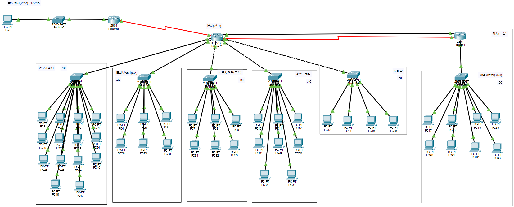

## 1. 단계별 실습

| 단계 | 내용 |
|------|------|
| 0 | 6일차 최종 상태 확인 |
| 1 | 명령 지원 여부 확인 |
| 2 | 블루워치 장비 추가와 연결 |
| 3 | EIGRP 20 |
| 4 | 양방향 재분배 |
| 5 | 서버팜 경로만 넘기기 |
| 6 | 경로 훼손 재현과 ACL |
| 7 | EIGRP MD5 인증 |
| 8 | 장애 시험 |

### 단계 0. 6일차 최종 상태 확인

**목적**: 커밋되지 않은 `.pkt`가 6일차 최종 상태인지 확인한다.

**SC-HQ-R1**, **SC-BR-R1**
```
show ip interface brief
show ip ospf neighbor
show ip route ospf
show running-config | include authentication
```

**결과**
- 이웃 두 줄 FULL, `O` 경로(본사 3개, 지사 6개, 비용 2), 인터페이스 MD5 2줄이 6일차와 같다. `.pkt`를 main에 커밋하고 `eigrp` 브랜치를 만들었다.
- 서버팜 PC는 192.168.50.11 - 14, 파일 서버는 192.168.50.11로 정했다.

### 단계 1. 명령 지원 여부 확인

**목적**: 경로 필터와 인증 명령이 되는지 장비를 늘리기 전에 확인한다. `?`는 설정을 바꾸지 않는다.

**SC-HQ-R1**
```
configure terminal
ip prefix-list ?
route-map ?
access-list ?
router eigrp 20
?
distribute-list ?
distance 255 172.16.20.2 0.0.0.0 ?
redistribute ospf 1 ?
exit
router ospf 1
distribute-list ?
redistribute eigrp 20 ?
exit
interface gigabitEthernet 0/0/2
ip authentication ?
end
```

**결과**

| 기능 | 결과 |
|------|------|
| `ip prefix-list`, `route-map`, `distribute-list`(EIGRP, OSPF) | 미지원 |
| `distance 255 <출발지> <와일드카드>` | ACL을 붙일 수 없어 경로를 골라 막지 못한다 |
| `redistribute ospf 1` / `redistribute eigrp 20` | `match`, `metric` / `metric`, `metric-type`, `subnets`, `tag` |
| `access-list`, `ip access-group` | 지원 |
| `key chain`, `ip authentication` | 지원(지사 2901에서도 확인) |

- 경로를 골라 거르는 도구가 없다. 단계 5는 재분배 대신 서버팜 대역만 선언하고, 단계 6은 인터페이스 ACL로 피해를 막는다.
- 처음 블록은 거부된 `route-map` 모드에 들어갔다고 가정한 줄이 이어져 판정이 꼬였다. 모드가 바뀌는 줄마다 프롬프트를 확인하며 다시 했다.

### 단계 2. 블루워치 장비 추가와 연결

**목적**: 블루워치 망을 만들고 본사와 시리얼로 연결한다.

| 연결 | 케이블 |
|------|--------|
| SC-HQ-R1 Serial0/2/1(DCE) - BW-R1 Serial0/3/0 | Serial DCE, 본사에서 시작 |
| BW-R1 Gi0/0 - BW-SW1 Fa0/1 | Copper Straight-Through |
| BW-SW1 Fa0/2 - BW-PC1 | Copper Straight-Through |

BW-R1(2901)에는 HWIC-2T를 꽂았다(전원을 끄고 꽂으면 `Serial0/3/0`, `0/3/1` 생성).

**SC-HQ-R1**
```
configure terminal
interface serial 0/2/1
description To_BW-R1_BlueWatch
ip address 172.16.20.1 255.255.255.252
no shutdown
end
```

**BW-R1**
```
configure terminal
hostname BW-R1
no ip domain-lookup
interface serial 0/3/0
description To_SC-HQ-R1
ip address 172.16.20.2 255.255.255.252
no shutdown
exit
interface gigabitEthernet 0/0
description BlueWatch_LAN
ip address 172.16.10.1 255.255.255.0
no shutdown
end
```

**BW-SW1**
```
configure terminal
hostname BW-SW1
no ip domain-lookup
end
```

BW-PC1: 172.16.10.11/24, 게이트웨이 172.16.10.1. 블루워치 장비는 인수 직후 상태로 두려고 비밀번호와 미사용 포트 차단을 넣지 않았다.

**결과**
- 본사 Serial0/2/1 up/up, CDP에 `BW-R1 Ser 0/2/1 - Ser 0/3/0`, `ping 172.16.20.2` 5/5, BW-PC1에서 게이트웨이 ping 4/4.
- 본사가 DCE이고 clock이 이미 있다(`show controllers serial 0/2/1`: `DCE V.35, clock rate 2000000`).

**막힌 곳**: 본사 Gi0/0/2는 구리 케이블 연결 목록에 나오지 않았고 CLI로는 원인을 확정하지 못했다. 본사 NIM 슬롯이 모두 차 있어 남은 Serial0/2/1을 쓰고, Gi0/0/2에 넣었던 주소는 지웠다.

### 단계 3. EIGRP 20

**목적**: 본사와 BW-R1이 이웃을 맺고 본사가 블루워치 LAN을 배우게 한다.

**SC-HQ-R1**
```
configure terminal
router eigrp 20
no auto-summary
network 172.16.20.0 0.0.0.3
end
```

**BW-R1**
```
configure terminal
router eigrp 20
no auto-summary
network 172.16.20.0 0.0.0.3
network 172.16.10.0 0.0.0.255
passive-interface gigabitEthernet 0/0
end
```

| 명령어 | 왜 넣는가 |
|--------|-----------|
| `router eigrp 20` | AS 번호는 OSPF 프로세스 번호와 달리 이웃끼리 같아야 한다 |
| `no auto-summary` | 172.16은 B 클래스라 켜져 있으면 /24가 172.16.0.0/16으로 묶일 수 있다 |
| 본사 `network 172.16.20.0 0.0.0.3` | 연결 구간만 선언해 세이프코어 대역은 아직 넘기지 않는다 |

**결과**
- 양쪽 이웃 성립. 본사 `D 172.16.10.0/24 [90/2172416] via 172.16.20.2`(AD 90은 EIGRP 내부 경로, metric이 큰 것은 시리얼 1544Kbps 때문).
- BW-R1 경로표는 비어 있고 지사에는 172.16 경로가 없다(재분배 전 기준선).

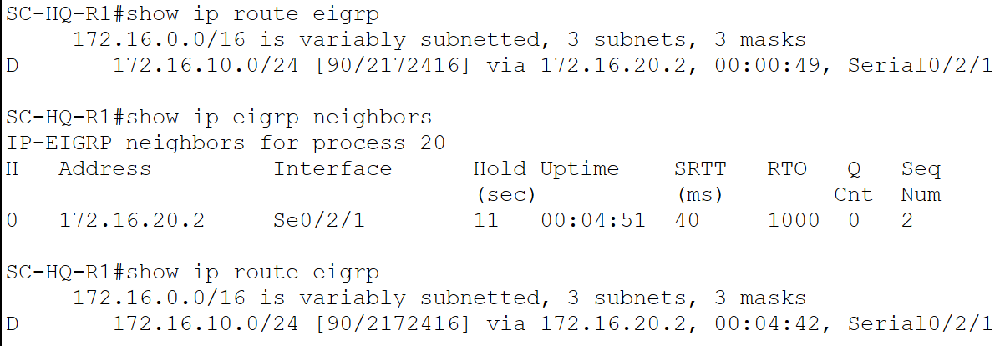

### 단계 4. 양방향 재분배

**목적**: EIGRP와 OSPF 경로를 서로 넘기고 블루워치에 무엇이 넘어가는지 본다.

**SC-HQ-R1**
```
configure terminal
router ospf 1
redistribute eigrp 20 subnets
exit
router eigrp 20
redistribute ospf 1 metric 1544 2000 255 1 1500
end
```

| 명령어 | 왜 넣는가 |
|--------|-----------|
| `redistribute eigrp 20 subnets` | `subnets`가 없으면 서브넷 경로가 빠질 수 있다 |
| `redistribute ospf 1 metric 1544 2000 255 1 1500` | OSPF cost는 EIGRP가 쓰지 못해 시작 metric을 직접 준다(대역폭 Kbps, 지연 10마이크로초 단위, 신뢰도, 부하, MTU) |

**결과**
- 지사: `O E2 172.16.10.0`, `O E2 172.16.20.0` `[110/20]`(E2는 외부 경로, 20은 재분배 기본 metric).
- BW-R1: 세이프코어 경로 11개가 `D EX [170/...]`로 들어왔다. 본사 부서 10 - 50, 지사 60, 회선 70과 80, 창고 90.32, 라우터 ID까지다. 본사 직접 연결 대역도 OSPF `network`에 포함돼 함께 넘어갔다.
- BW-PC1에서 파일 서버와 연구개발 PC(192.168.10.11) 모두 ping 3/4.
- **과다 노출**: 블루워치에서 연구개발팀까지 닿고, 내부 회선 대역과 라우터 ID로 망 구조가 드러난다.


### 단계 5. 서버팜 경로만 넘기기

**목적**: OSPF 재분배를 지우고 서버팜 대역만 EIGRP에 선언한다.

**SC-HQ-R1**
```
configure terminal
router eigrp 20
passive-interface vlan 50
network 192.168.50.0 0.0.0.255
no redistribute ospf 1
end
```

passive와 `network`를 먼저 넣어 서버팜 경로가 끊기는 순간이 없게 했다.

**결과**
- BW-R1: `D 192.168.50.0/24` 한 줄, `show ip route 192.168.10.0`은 `% Network not in table`.
- BW-PC1: 파일 서버 3/4, 연구개발 PC는 `Reply from 172.16.10.1: Destination host unreachable`, 서버팜 다른 서버(50.12) 3/4. 본사에서 연구개발 PC ping은 4/5라 PC 자체는 정상이다.
- 남는 한계: 서버팜은 /24 단위로 넘어가 소스코드 서버에도 닿는다. 서버 단위 차단은 ACL 단계에서 한다.

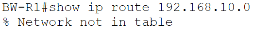

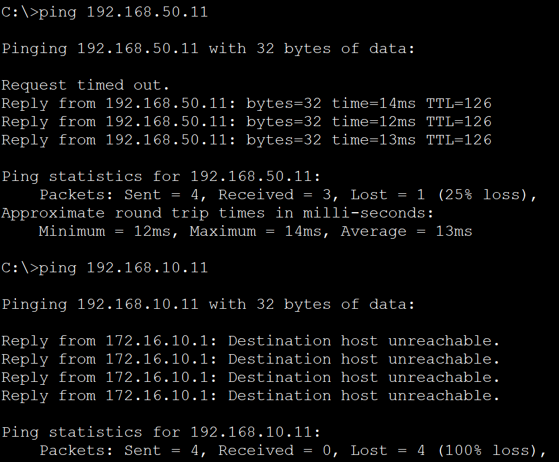

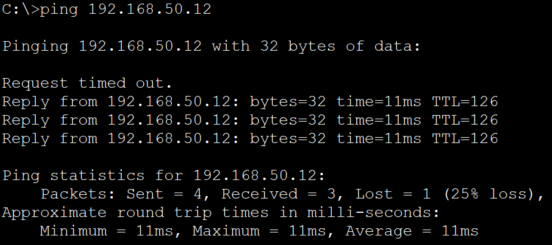

**막힌 곳: 재분배를 지워도 경로가 남았다**

| 순서 | 관찰 | 판단 |
|------|------|------|
| 1 | 적용 직후 BW-R1에 `D EX` 8줄(본사 직접 연결 대역)이 남음. 지사에서 배운 60, 90.32, 255.2만 사라짐 | BW-R1에 남은 오래된 경로로 추정 |
| 2 | BW-R1 Serial0/3/0을 내렸다 올려 이웃을 다시 맺어도 같은 8줄을 새로 받음 | 추정이 틀렸다. 본사가 계속 광고한다 |
| 3 | 본사 `show ip eigrp topology`에 8개가 `via Redistributed`로 남음. 설정에는 재분배가 없음 | Packet Tracer가 지운 재분배를 내부 목록에서 정리하지 못했다 |
| 4 | `no router eigrp 20` 입력 중 Packet Tracer가 종료됨 | 프로세스 삭제는 쓰지 않는다 |
| 5 | 저장 파일을 다시 열자 `via Redistributed`가 사라지고 BW-R1에 `D 192.168.50.0/24`만 남음 | 저장 후 다시 열기가 해결책이다 |

- 2901에서는 `clear ip eigrp neighbors`가 미지원이다(`clear ip ?`: bgp, dhcp, nat, ospf, route).
- 1번 상태의 연구개발 PC ping은 `Request timed out`이었고, 다시 연 뒤 재현되지 않아 원인은 확인하지 못했다.

### 단계 6. 경로 훼손 재현과 ACL

#### 6-1. 경로 훼손 재현

**목적**: 블루워치가 서버팜보다 좁은 192.168.50.0/25를 광고하면 최장 일치에 따라 세이프코어 트래픽이 블루워치로 가는지 본다.

**BW-R1**
```
configure terminal
interface loopback 50
description Hijack_Test_ServerFarm
ip address 192.168.50.126 255.255.255.128
exit
router eigrp 20
network 192.168.50.0 0.0.0.127
end
```

**결과**
- 본사 `show ip route 192.168.50.11`: `Routing entry for 192.168.50.0/25`, `Known via "eigrp 20", distance 90`, via 172.16.20.2. 본사가 자기 서버팜(직접 연결 /24)보다 블루워치의 /25를 택했다.
- 경영지원 PC(192.168.40.11)에서 파일 서버 ping 0/4. 본사 사용자도 파일 서버를 못 쓴다.
- 지사 PC `tracert 192.168.50.11`: 192.168.60.1, 192.168.70.1(본사) 뒤로 응답 없음. 본사를 지나 블루워치로 넘어간 패킷에 BW-R1이 응답하지 못한 것으로 본다(BW-R1은 지사 대역 경로가 없다, 추정).
- 본사 `traceroute 192.168.50.11`의 첫 홉이 172.16.20.2(BW-R1)다. 본사가 서버팜 트래픽을 블루워치로 보낸다는 직접 증거다.
- 지사 경로표에는 `O E2 192.168.50.0/25`가 생기지 않았다(7-3에서 재분배 미갱신으로 확인). 지사 트래픽도 본사에 도착한 뒤 /25를 따라가므로 영향은 같다.

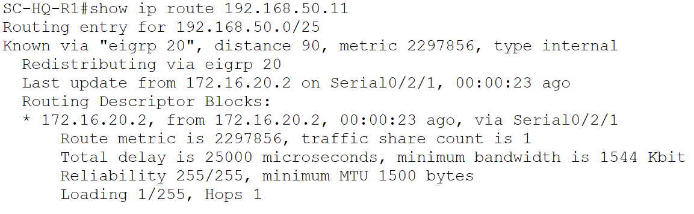

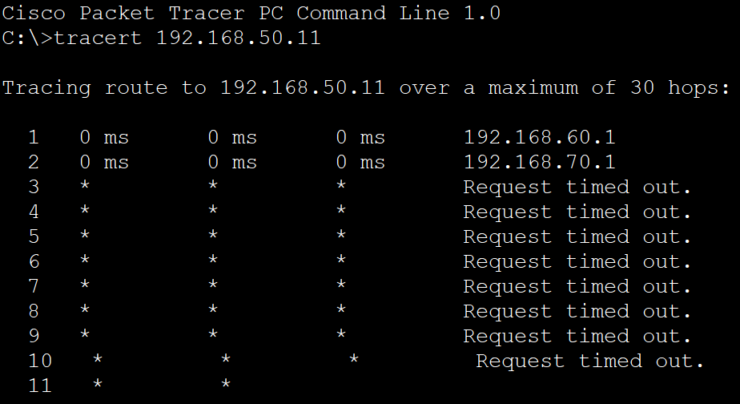

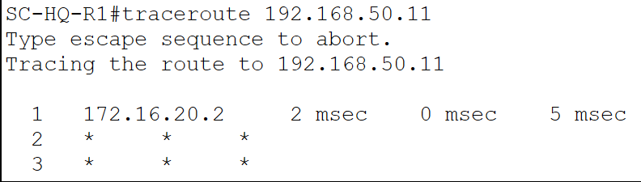

#### 6-2. ACL로 피해 막기

**목적**: 경로표 훼손은 막을 수 없으므로, 본사에서 블루워치로 나가는 트래픽을 블루워치 LAN 목적지만 허용해 유출을 막는다.

**SC-HQ-R1**
```
configure terminal
access-list 110 permit eigrp any any
access-list 110 permit ip any 172.16.10.0 0.0.0.255
access-list 110 deny ip any any
interface serial 0/2/1
ip access-group 110 out
end
```

| 줄 | 왜 넣는가 |
|----|-----------|
| `permit eigrp any any` | EIGRP 이웃 패킷이 막히지 않게 명시한다 |
| `permit ip any 172.16.10.0 0.0.0.255` | 블루워치 LAN으로 가는 정상 트래픽만 허용한다 |
| `deny ip any any` | 암묵적 차단과 같지만 직접 적어야 차단 횟수가 보인다 |

**결과**
- 경영지원 PC에서 파일 서버 ping: `Reply from 192.168.40.1: Destination host unreachable` 4번. ACL 전에는 시간 초과(패킷이 블루워치로 넘어감)였고, 이제 본사가 버리고 응답한다.
- `show access-lists`: `30 deny ip any any (4 match(es))`. 경영지원 PC가 보낸 4개가 블루워치로 나가지 않고 본사에서 차단됐다.
- EIGRP 이웃은 유지된다(Uptime 18분).
- 한계: 유출(기밀성)은 막았지만 파일 서버 접속 끊김(가용성)은 그대로다. 가용성까지 지키려면 들어오는 경로 필터가 필요하고, 이 Packet Tracer에서는 지원되지 않는다.

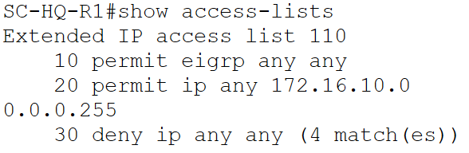

#### 6-3. 훼손 광고 제거

**BW-R1**
```
configure terminal
router eigrp 20
no network 192.168.50.0 0.0.0.127
exit
interface loopback 50
shutdown
end
```

**결과**
- 본사 `show ip route 192.168.50.11`: `192.168.50.0/24`, `Known via "connected"`, via Vlan50. 토폴로지에 /25가 남지 않았다.
- 경영지원 PC에서 파일 서버 ping 4/4, BW-PC1에서 파일 서버 ping 4/4. ACL을 둔 채로도 블루워치의 정상 접속은 된다.
- ACL 110은 보호 장치로 유지한다.

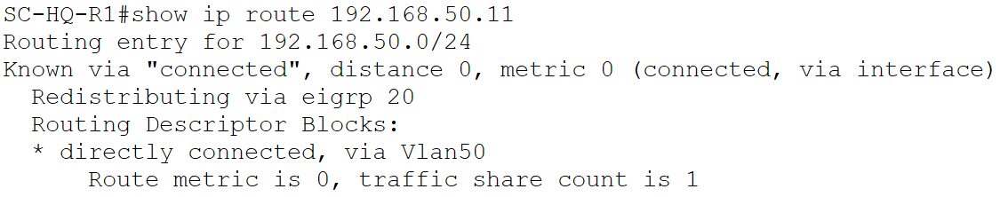

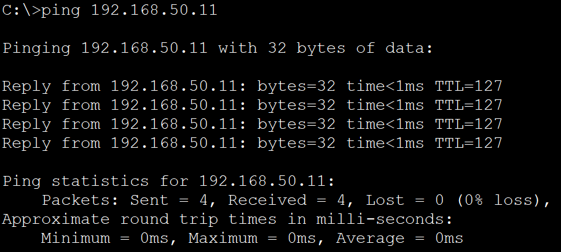

### 단계 7. EIGRP MD5 인증

**목적**: 연결 구간에 인증을 걸어 키를 모르는 라우터는 이웃이 되지 못하게 한다. 키 값은 문서에 적지 않는다.

**SC-HQ-R1** (먼저), **BW-R1** (나중, 인터페이스만 Serial0/3/0)
```
configure terminal
key chain BW-KEY
key 1
key-string <키>
exit
exit
interface serial 0/2/1
ip authentication mode eigrp 20 md5
ip authentication key-chain eigrp 20 BW-KEY
end
```

| 명령어 | 왜 넣는가 |
|--------|-----------|
| `key chain`, `key 1`, `key-string` | EIGRP는 OSPF(6일차)와 달리 키를 key chain으로 따로 만들어 연결한다. 키 번호와 값은 양쪽이 같아야 하고, key chain 이름은 장비 안에서만 쓰인다 |
| `ip authentication mode eigrp 20 md5` | AS 20에서 MD5 인증을 쓴다 |
| `ip authentication key-chain eigrp 20 BW-KEY` | 그 인증에 쓸 key chain을 연결한다 |

**결과**
- 본사만 설정: 본사 `show ip eigrp neighbors`가 비었다.
- 양쪽 설정: 이웃 172.16.20.2 복구(Uptime 21초), BW-PC1에서 파일 서버 ping 4/4.
- 지사 `O E2 172.16.10.0`, `172.16.20.0`의 나이가 29분으로 이웃이 끊긴 동안에도 초기화되지 않았다. 본사만 설정했을 때 지사 경로는 확인하지 못했다(BW-R1에서 입력). 7-3에서 다시 본다.

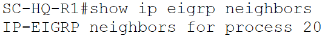

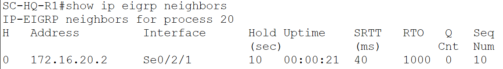

#### 7-3. 틀린 키

**BW-R1** (`key-string`만 다른 값으로 바꾼 뒤 원래 값으로 복구)
```
configure terminal
key chain BW-KEY
key 1
key-string <틀린 값>
end
```

**결과**
- 틀린 키: 본사 `show ip eigrp neighbors`가 비고, `show ip route eigrp`도 비었다(`D 172.16.10.0` 사라짐).
- 같은 시점 지사 `O E2 172.16.10.0`, `172.16.20.0`은 그대로였고 나이가 33분으로 계속 늘었다. 본사가 원본 경로를 잃었는데도 외부 경로를 거두지 않았다.
- 원래 키로 복구하자 이웃이 다시 맺어졌다(Uptime 14초).
- 단계 6의 /25가 지사에 오지 않은 것, 7-1의 나이가 초기화되지 않은 것과 합치면, 이 Packet Tracer는 EIGRP에서 OSPF로의 재분배를 파일을 열 때만 계산하고 이후 EIGRP 변화를 반영하지 않는 것으로 본다(실제 장비에서는 원본 경로가 사라지면 외부 경로도 거둔다).

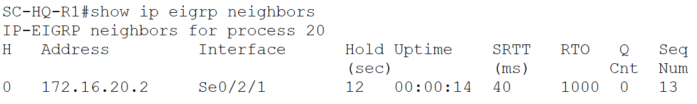

### 단계 8. 장애 시험

**목적**: 장애가 나도 피해가 그 구간에서 그치는지 본다. 7-3의 한계 때문에 지사 `O E2`의 소멸은 기준으로 쓰지 않는다.

**SC-HQ-R1** (8-1은 `interface serial 0/2/1`, 8-2는 `interface vlan 70`)
```
configure terminal
interface serial 0/2/1
shutdown
end
```
확인 후 같은 인터페이스에서 `no shutdown`으로 복구했다.

**결과**
- 8-1 블루워치 회선 장애: 지사 PC에서 파일 서버 ping 4/4. 블루워치가 끊겨도 세이프코어 내부는 영향이 없다.
- 8-2 주 회선 장애: 지사 `O E2 172.16.10.0`, `172.16.20.0`이 `via 192.168.80.1, Serial0/3/0`으로 바뀌었다. 내부 경로는 `[110/65]`로 비용이 늘었지만 E2는 `[110/20]` 그대로다. E2는 OSPF 내부 비용을 더하지 않고 재분배할 때의 metric만 쓴다.

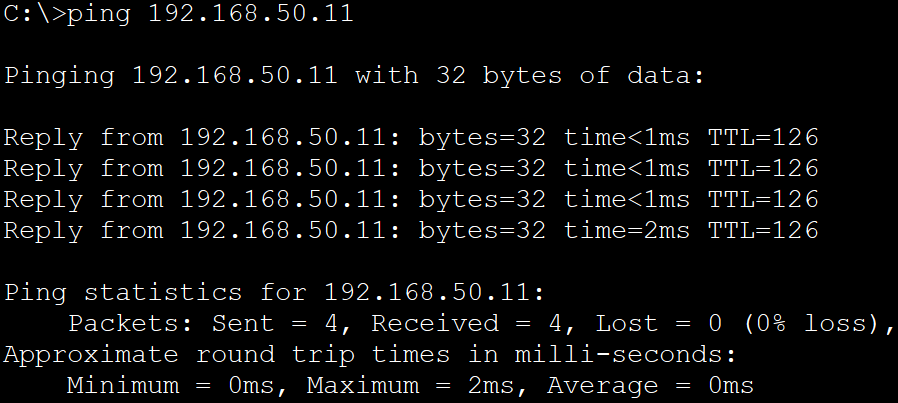

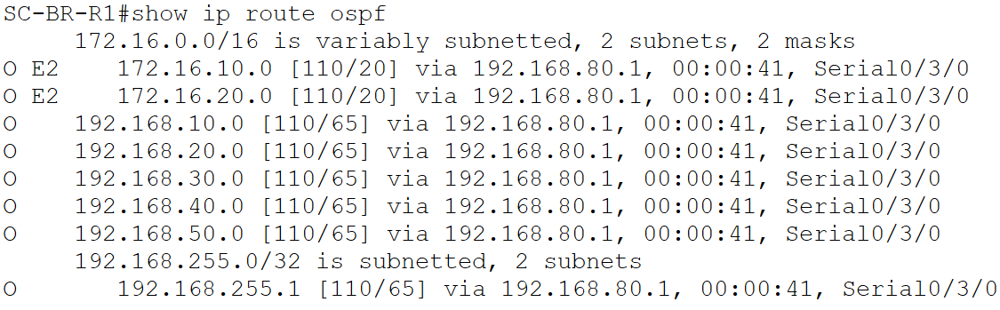

## 2. 면접 대비

- **재분배에서 무엇을 조심했나?** OSPF를 EIGRP로 통째로 넘기자 연구개발 대역과 내부 회선, 라우터 ID까지 인수 회사에 넘어갔다. 필터가 없는 환경이라 필요한 서버팜만 EIGRP에 선언해 최소한만 노출했다.
- **경로 훼손을 어떻게 재현하고 막았나?** 인수 회사 라우터가 192.168.50.0/25를 광고하자 최장 일치로 본사가 서버팜 트래픽을 그쪽으로 보냈다(traceroute 첫 홉으로 확인). 경로 필터 대신 나가는 ACL로 유출을 막았고 ACL 차단 수 4로 확인했다. 가용성은 지키지 못해 실제 장비에서는 들어오는 경로 필터(prefix-list와 distribute-list)가 필요하다.
- **MD5 인증은 무엇을 막고 무엇을 못 막나?** 키를 모르는 라우터가 이웃이 되는 것은 막는다(틀린 키 시험으로 확인). 키를 가진 인수 회사 라우터가 잘못된 경로를 광고하는 것은 막지 못해 경로 필터나 ACL이 따로 필요하다.
- **E2 경로의 metric은 왜 장애 중에도 20인가?** E2는 OSPF 내부 비용을 더하지 않고 재분배할 때의 metric만 쓴다. 주 회선 장애 때 내부 경로는 65로 늘었지만 E2는 20 그대로였다.
