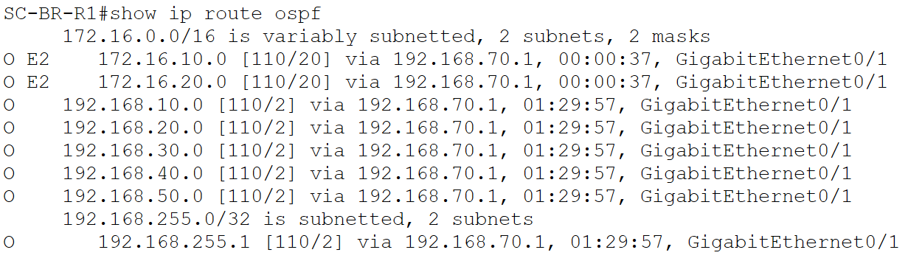
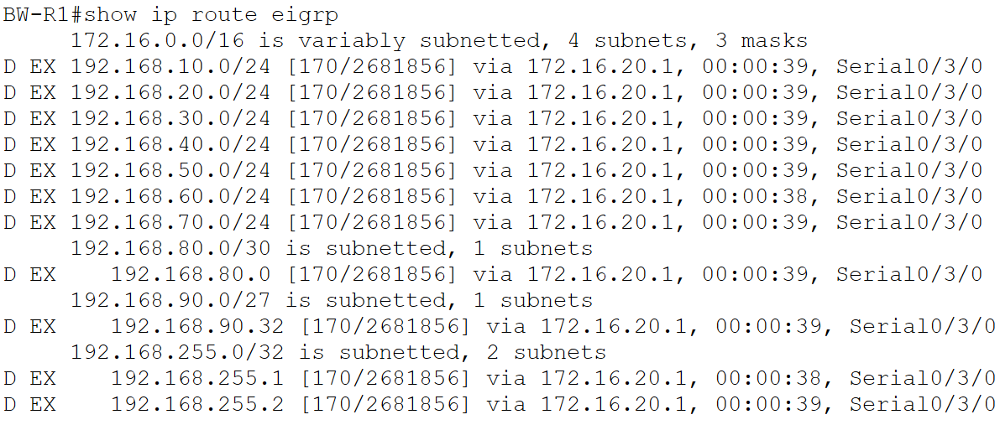
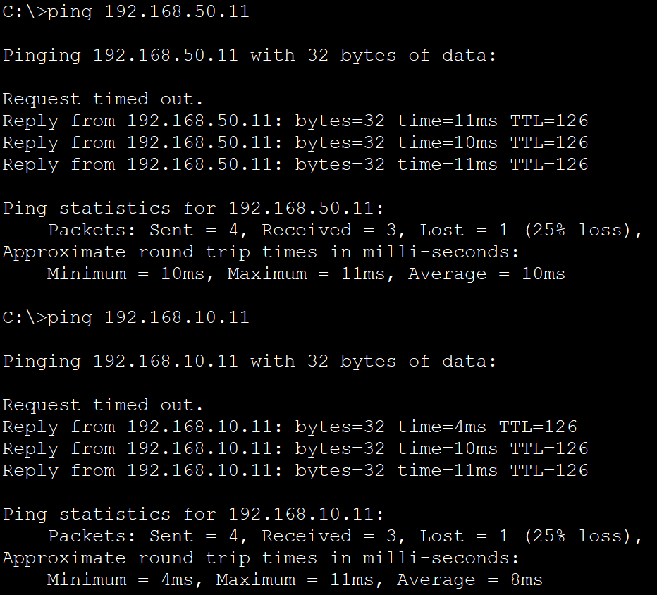

# 7일차: 블루워치 EIGRP 망 연결, 재분배, 경로 훼손 대응, 인증

포트폴리오 본문은 [7일차 작업계획서](../02_작업%20계획/7일차_작업계획서.md)다.

- 날짜: 2026-11-28
- 브랜치: `eigrp`

## 1. 단계별 실습

| 단계 | 내용 |
|------|------|
| 0 | 6일차 최종 상태 확인 |
| 1 | 명령 지원 여부 확인 |
| 2 | 블루워치 장비 추가와 연결 |
| 3 | EIGRP 20 |
| 4 | 양방향 재분배 |
| 5 | 서버팜 경로만 넘기기 |
| 6 | 경로 훼손 재현과 ACL |
| 7 | EIGRP MD5 인증 |
| 8 | 장애 시험 |

### 단계 0. 6일차 최종 상태 확인

**목적**: 커밋되지 않은 `.pkt`가 6일차 최종 상태인지 확인한다.

**SC-HQ-R1**, **SC-BR-R1**
```
show ip interface brief
show ip ospf neighbor
show ip route ospf
show running-config | include authentication
```

**결과**
- 이웃 두 줄 FULL, `O` 경로(본사 3개, 지사 6개, 비용 2), 인터페이스 MD5 2줄이 6일차와 같다. `.pkt`를 main에 커밋하고 `eigrp` 브랜치를 만들었다.
- 서버팜 PC는 192.168.50.11 - 14이고 파일 서버는 192.168.50.11로 정했다.

### 단계 1. 명령 지원 여부 확인

**목적**: 경로 필터와 인증 명령이 되는지 장비를 늘리기 전에 확인한다. `?`는 설정을 바꾸지 않는다.

**SC-HQ-R1**
```
configure terminal
ip prefix-list ?
route-map ?
access-list ?
router eigrp 20
?
distribute-list ?
distance 255 172.16.20.2 0.0.0.0 ?
redistribute ospf 1 ?
exit
router ospf 1
distribute-list ?
redistribute eigrp 20 ?
exit
interface gigabitEthernet 0/0/2
ip authentication ?
end
```

**결과**

| 기능 | 결과 |
|------|------|
| `ip prefix-list`, `route-map`, `distribute-list`(EIGRP, OSPF) | 미지원 |
| `distance 255 <출발지> <와일드카드>` | 뒤에 ACL을 붙일 수 없어 경로를 골라 막는 데 못 쓴다 |
| `redistribute ospf 1` | `match`, `metric` |
| `redistribute eigrp 20` | `metric`, `metric-type`, `subnets`, `tag` |
| `access-list`, `ip access-group` | 지원 |
| `key chain`, `ip authentication` | 지원(지사 2901에서도 확인) |

- 경로를 골라 거르는 도구가 없다. 그래서 단계 5는 재분배 대신 서버팜 대역만 EIGRP에 선언하고, 단계 6은 경로 훼손을 막는 대신 인터페이스 ACL로 피해를 막는다.
- 처음 블록은 `route-map PROBE permit 10`이 거부된 뒤에도 그 모드에 들어갔다고 가정한 줄이 이어져 판정이 꼬였다. 모드가 바뀌는 줄마다 프롬프트를 확인하도록 나눠서 다시 했다.

### 단계 2. 블루워치 장비 추가와 연결

**목적**: 블루워치 망(라우터, 스위치, PC)을 만들고 본사와 시리얼로 연결한다.


| 연결 | 케이블 |
|------|--------|
| SC-HQ-R1 Serial0/2/1(DCE) - BW-R1 Serial0/3/0 | Serial DCE, 본사에서 시작 |
| BW-R1 Gi0/0 - BW-SW1 Fa0/1 | Copper Straight-Through |
| BW-SW1 Fa0/2 - BW-PC1 | Copper Straight-Through |

BW-R1(2901)에는 시리얼 포트가 없어 HWIC-2T를 꽂았다(전원을 끄고 꽂으면 `Serial0/3/0`, `0/3/1` 생성).

**SC-HQ-R1**
```
configure terminal
interface serial 0/2/1
description To_BW-R1_BlueWatch
ip address 172.16.20.1 255.255.255.252
no shutdown
end
```

**BW-R1**
```
configure terminal
hostname BW-R1
no ip domain-lookup
interface serial 0/3/0
description To_SC-HQ-R1
ip address 172.16.20.2 255.255.255.252
no shutdown
exit
interface gigabitEthernet 0/0
description BlueWatch_LAN
ip address 172.16.10.1 255.255.255.0
no shutdown
end
```

**BW-SW1**
```
configure terminal
hostname BW-SW1
no ip domain-lookup
end
```

BW-PC1: 172.16.10.11/24, 게이트웨이 172.16.10.1. 블루워치 장비는 인수 직후 상태로 두려고 비밀번호와 미사용 포트 차단을 넣지 않았다.

**결과**
- 본사 Serial0/2/1 up/up, `show cdp neighbors`에 `BW-R1 Ser 0/2/1 - Ser 0/3/0`, `ping 172.16.20.2` 5/5. BW-PC1에서 게이트웨이 ping 4/4.
- 본사가 DCE이고 clock이 이미 있다(`show controllers serial 0/2/1`: `DCE V.35, clock rate 2000000`).

**막힌 곳**: 처음에는 본사 Gi0/0/2를 쓰려 했지만 구리 케이블 연결 목록에 Gi0/0/2가 나오지 않았다. CLI(`show interfaces`)로는 원인을 확정하지 못했다. 본사의 NIM 슬롯이 모두 차 있어 남은 Serial0/2/1을 쓰고, Gi0/0/2에 넣었던 주소는 지웠다.

### 단계 3. EIGRP 20

**목적**: 본사와 BW-R1이 EIGRP 이웃을 맺고 본사가 블루워치 LAN을 배우게 한다. 재분배는 하지 않는다.

**SC-HQ-R1**
```
configure terminal
router eigrp 20
no auto-summary
network 172.16.20.0 0.0.0.3
end
```

**BW-R1**
```
configure terminal
router eigrp 20
no auto-summary
network 172.16.20.0 0.0.0.3
network 172.16.10.0 0.0.0.255
passive-interface gigabitEthernet 0/0
end
```

| 명령어 | 뜻 | 왜 넣는가 |
|--------|-----|-----------|
| `router eigrp 20` | EIGRP AS 20 | OSPF 프로세스 번호와 달리 AS 번호는 이웃끼리 같아야 한다 |
| `no auto-summary` | 클래스 경계 자동 요약 끄기 | 172.16은 B 클래스라 켜져 있으면 /24가 172.16.0.0/16으로 묶일 수 있다 |
| `network 172.16.20.0 0.0.0.3` | 연결 구간에서 EIGRP 활성화 | 본사는 이 한 줄만 넣어 세이프코어 대역을 아직 넘기지 않는다 |

**결과**
- 본사 이웃 `172.16.20.2`(Se0/2/1), BW-R1 이웃 `172.16.20.1`(Se0/3/0).
- 본사 `D 172.16.10.0/24 [90/2172416] via 172.16.20.2`. AD 90은 EIGRP 내부 경로이고, metric이 큰 것은 시리얼 대역폭(1544Kbps)이 계산에 들어가서다.
- BW-R1 `show ip route eigrp`는 비어 있다. 본사가 세이프코어 대역을 아직 넘기지 않았다.
- 지사 `show ip route ospf`는 6일차와 같고 172.16 경로가 없다(재분배 전 기준선).


### 단계 4. 양방향 재분배

**목적**: 본사에서 EIGRP와 OSPF 경로를 서로 넘기고, 블루워치에 무엇이 넘어가는지 확인한다.

**SC-HQ-R1**
```
configure terminal
router ospf 1
redistribute eigrp 20 subnets
exit
router eigrp 20
redistribute ospf 1 metric 1544 2000 255 1 1500
end
```

| 명령어 | 뜻 | 왜 넣는가 |
|--------|-----|-----------|
| `redistribute eigrp 20 subnets` | EIGRP 경로를 OSPF로 | `subnets`가 없으면 서브넷 경로가 빠질 수 있다 |
| `redistribute ospf 1 metric 1544 2000 255 1 1500` | OSPF 경로를 EIGRP로, 시작 metric 지정 | OSPF cost는 EIGRP가 쓰지 못해 직접 준다. 대역폭 1544Kbps, 지연 2000(10마이크로초 단위), 신뢰도 255, 부하 1, MTU 1500 |

**결과**
- 지사: `O E2 172.16.10.0 [110/20]`, `O E2 172.16.20.0 [110/20]` via 192.168.70.1. E2는 OSPF 밖에서 들어온 경로이고 20은 재분배 기본 metric이다.
- BW-R1: 세이프코어 경로 11개가 `D EX [170/2681856]`으로 들어왔다. 본사 부서 대역 10 - 50, 지사 60, 주 회선 70, 시리얼 80.0/30, 창고 90.32/27, 라우터 ID 255.1과 255.2다. 본사에 직접 연결된 대역도 OSPF `network`에 포함되어 있어 함께 넘어갔다. AD 170은 EIGRP 외부 경로다.
- BW-PC1에서 파일 서버(192.168.50.11)와 연구개발 PC(192.168.10.11) ping 모두 3/4(첫 패킷은 ARP).
- **과다 노출**: 블루워치에서 연구개발팀까지 길이 열렸고, 내부 회선 대역과 라우터 ID까지 넘어가 세이프코어 망 구조가 드러난다.






