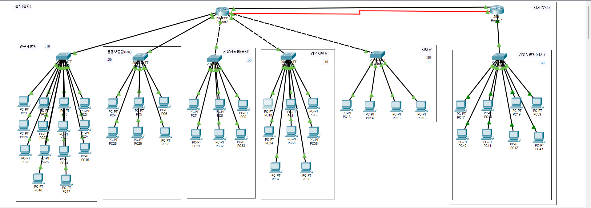
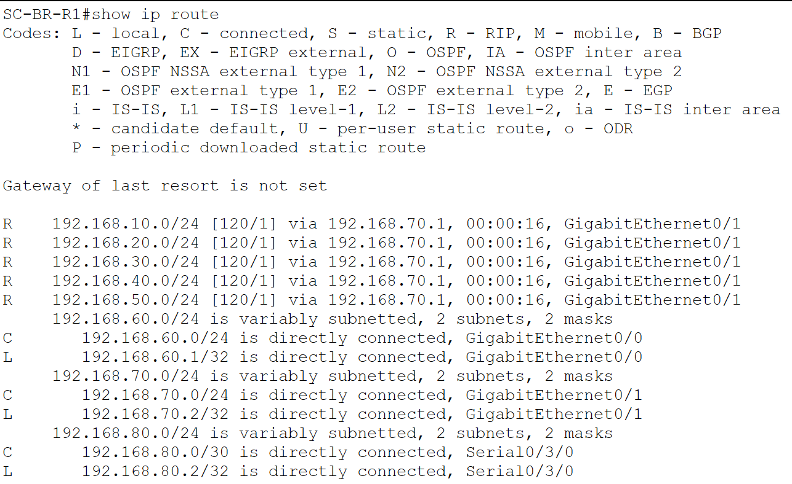
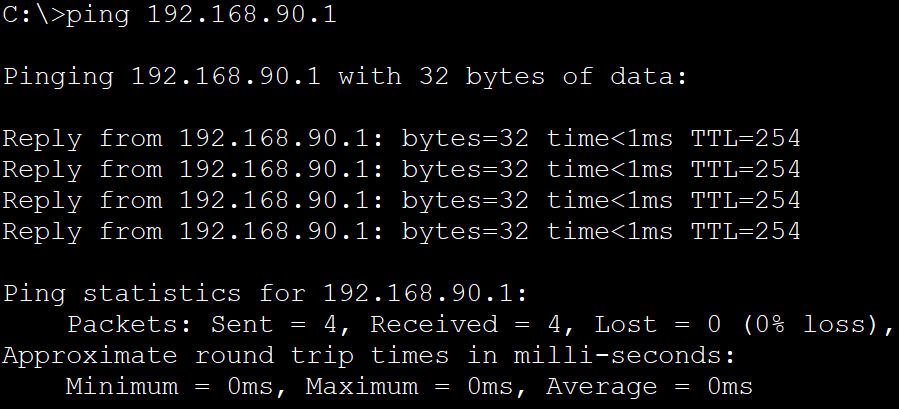
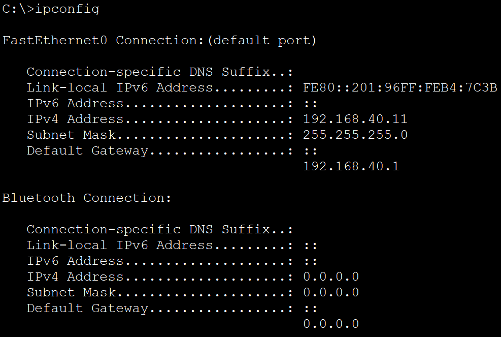
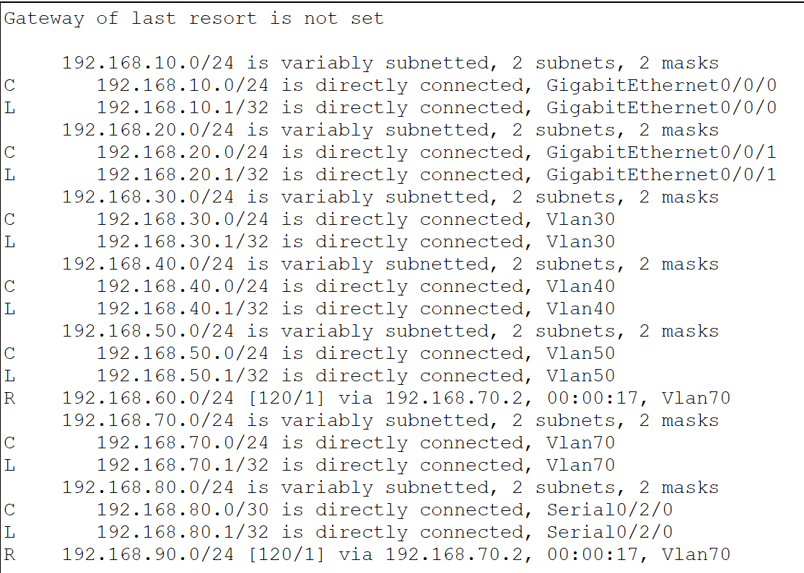
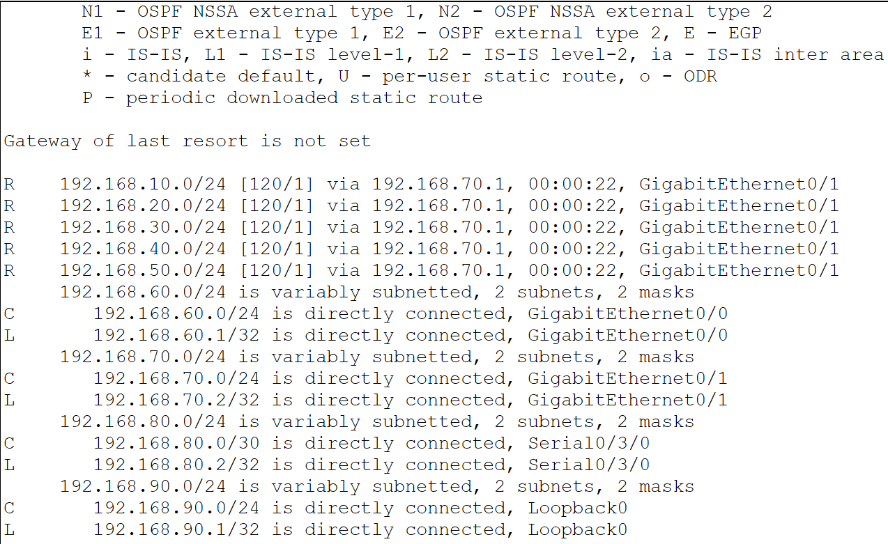
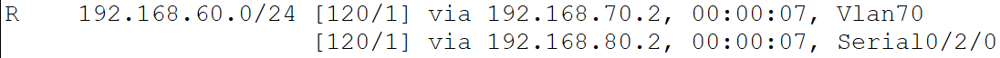
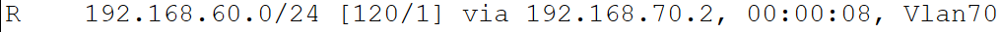

# 정적 라우팅 vs RIPv2 비교

> SafeCore 본사(판교)와 지사(부산)를 잇는 두 회선(주 회선, 예비 회선)에서 정적 라우팅과 RIPv2를 같은 조건으로 구성하고 비교한 기록이다. 모든 결과는 Cisco Packet Tracer에서 직접 시험한 것이고, 시험하지 못했거나 추정인 것은 그렇게 표시했다.

- 작성일: 2026-11-21
- 근거 문서: [4일차 학습문서](4일차_학습문서.md), [5일차 학습문서](5일차_학습문서.md)
- 근거 캡처: `99_첨부파일/5일차_1` 부터 `5일차_13`

---

## 1. 한눈에 보기

### 결론 세 줄

1. **네트워크가 늘어나는 구간은 RIPv2가 유리하다.** 지사에 새 네트워크를 만들었을 때 지사 라우터에 `network` 한 줄만 넣었는데 본사가 자동으로 학습했다(본사에 경로를 입력하지 않았다).
2. **그래도 동적 라우팅이 모든 것을 자동으로 해 주지는 않는다.** 예비 회선은 정적 경로라서, 새 네트워크는 예비 경로를 사람이 따로 추가해야 한다. 놓치면 평소에는 문제가 없다가 주 회선 장애 때만 그 네트워크가 끊긴다. 시험에서 실제로 재현했다.
3. **복구는 RIPv2가 더 깔끔했다.** 정적 방식에서는 지사가 수동 조작(ARP 재학습용 ping)이 필요했지만, RIPv2에서는 양쪽 모두 자동으로 돌아왔다.

### 요약 비교표

| 비교 항목 | 정적 라우팅(4일차) | RIPv2(5일차) | 우세 |
|-----------|--------------------|--------------|------|
| 설정 방식과 관리 비용 | 기본 구성은 짧다(주 회선 경로 6줄). 대역이 늘면 줄이 는다 | 기본 구성은 길다(두 라우터 합쳐 17줄). 대역이 늘어도 선언 한 줄 | 규모에 따라 다름 |
| 확장성(새 네트워크 추가) | 본사에 경로를 직접 추가해야 한다(추론) | 지사에 `network` 한 줄, 본사는 손대지 않음(실측) | RIPv2 |
| 장애 대응 | 패킷 1개 유실 | 140개 중 유실 0 | 비슷함(RIPv2가 약간 나음) |
| 복구 동작 | 지사가 수동 조작 필요 | 양쪽 자동 복귀 | RIPv2 |
| 예비 회선과의 상호작용 | 예비 경로를 직접 관리 | 예비 경로는 여전히 직접 관리해야 하고, 새 네트워크를 덮지 못하는 함정이 있음 | 같음 |
| 부하와 타이머 | 없음 | 30초마다 광고, 수렴 타이머 180초대 | 정적 |
| 보안 | 광고가 없어서 공격면이 없다 | 광고를 받아서 공격면이 생김, 이 환경에서는 passive만 검증 | 정적 |

---

## 2. 비교 환경

두 방식 모두 같은 장비, 같은 주소, 같은 두 회선에서 시험했다. 바뀐 것은 라우팅 방식뿐이다.



> 토폴로지 캡처는 5일차 마무리 때 추가한다(아직 저장하지 않았다).

| 구분 | 값 |
|------|-----|
| 본사 라우터 | SC-HQ-R1 (ISR4331) |
| 지사 라우터 | SC-BR-R1 (2901) |
| 주 회선 | 이더넷, VLAN 70, 192.168.70.0/24 (본사 .1, 지사 .2) |
| 예비 회선 | 시리얼, 192.168.80.0/30 (본사 .1 Serial0/2/0, 지사 .2 Serial0/3/0) |
| 본사 대역 | 192.168.10, 20, 30, 40, 50.0/24 |
| 지사 대역 | 192.168.60.0/24, 창고(루프백) 192.168.90.0/24 |

### 라우팅 우선순위(AD)

라우터는 같은 목적지로 가는 경로가 여럿이면 AD(신뢰도, 숫자가 작을수록 우선)가 낮은 것을 쓴다. 이 값들 때문에 두 방식을 한 장비에서 함께 둘 수 있다.

| 경로 종류 | AD | 이번 구성에서의 역할 |
|-----------|----|-----------------------|
| 직접 연결 | 0 | 각 라우터의 LAN, WAN |
| 정적(주 회선) | 1 | 4일차에만 사용. 5일차에서 삭제 |
| RIP | 120 | 5일차의 주 회선 경로 |
| 정적(예비, floating) | 250 | 두 방식 모두에서 주 회선 장애 때만 올라오는 최후 수단 |

---

## 3. 항목별 상세 비교

### 3-1. 설정 방식과 관리 비용

**왜 보는가**: 같은 결과를 내는 데 라우터에 몇 줄을 넣어야 하고, 실수했을 때 어떻게 되는지 본다.

**정적(4일차)**
- 주 회선 경로: 본사 1줄(`ip route 192.168.60.0 255.255.255.0 192.168.70.2`), 지사 5줄(10, 20, 30, 40, 50 대역을 192.168.70.1로).
- 대역이 하나 늘면 상대 라우터에 줄이 하나 늘어난다.
- 줄을 빠뜨리거나 틀리면 그 대역만 조용히 통신이 안 된다.

**RIPv2(5일차)**
- 본사: `router rip`, `version 2`, `no auto-summary`와 `network` 7줄(10, 20, 30, 40, 50, 70, 80 대역). 지사: 같은 세 줄과 `network` 4줄(60, 70, 80, 90 대역). 합쳐서 17줄이다.
- 지금 규모에서는 정적(6줄)보다 **오히려 길다.** 이 비교가 단순히 "동적이 무조건 짧다"가 아니라는 점을 보여 준다.
- 이득은 변경할 때 나온다. 대역이 늘어도 지사에 선언 한 줄이면 된다(3-2).

**시험 중 발견한 함정**: `network 192.168.0.0` 한 줄이면 우리 대역이 모두 켜질 줄 알았지만 켜지지 않았다. `network` 명령은 클래스 기준으로 해석되어서, C 클래스인 192.168.x.0 대역은 대역마다 선언해야 한다. `show ip protocols`에서 `Interface Send Recv` 목록과 `Routing Information Sources`가 비어 있는 것을 보고 찾았다.

**해석**: 정적은 작고 고정된 구성에서 간단하고, RIPv2는 처음 설정이 길어도 변화가 잦을수록 이득이다.

### 3-2. 확장성: 지사에 새 네트워크 추가

**왜 보는가**: 이번 실습의 목표다. 지사에 네트워크가 늘어났을 때 본사와 연결하는 데 사람이 할 일이 얼마나 되는가.

**방법**: 지사 라우터에 루프백을 만들어 창고 네트워크(192.168.90.0/24)를 흉내 냈다. 수업에서 루프백으로 배웠고, 본사 PC에서 ping으로 통신 증거를 남길 수 있어서 루프백을 택했다.

```
(SC-BR-R1)
interface loopback 0
ip address 192.168.90.1 255.255.255.0
router rip
network 192.168.90.0
```

**결과 (실측)**
- 지사에 넣은 것은 `network 192.168.90.0` 한 줄이다. 본사에는 아무것도 입력하지 않았다.
- 본사 `show ip route 192.168.90.0`: `Known via "rip", distance 120, metric 1`, `Last update from 192.168.70.2 on Vlan70, 00:00:24 ago`.
- 본사 `show running-config | include ip route`에는 `ip route 192.168.60.0 ... 250` 한 줄뿐이다. 90 대역 정적 경로가 없다는 증거다.
- 본사 PC(경영지원, 192.168.40.11)에서 `ping 192.168.90.1`: 4/4 성공, TTL=254.







**정적이었다면(추론, 직접 시험하지 않음)**: 본사에 `ip route 192.168.90.0 255.255.255.0 192.168.70.2`를 직접 추가해야 한다. 지사는 창고가 직접 연결된 네트워크라서 추가할 것이 없다. 지사가 늘어 네트워크가 여러 개, 지사 라우터가 여러 대가 되면 이 작업이 그만큼 곱해진다.

**해석**: RIPv2는 "지사 쪽에서 한 줄 선언하면 본사가 알아서 안다"는 점에서 확장 작업이 한 곳에서 끝난다.

### 3-3. 장애 대응

**왜 보는가**: 주 회선이 끊겼을 때 통신이 얼마나 끊기는지, 어떻게 예비로 넘어가는지 본다.

**방법 (두 방식 동일)**: 지사 PC에서 본사 서버팜 게이트웨이로 `ping 192.168.50.1 -t`를 걸어 두고, 본사의 주 회선 포트(`GigabitEthernet0/1/3`)를 `shutdown`했다.

| | 정적(4일차) | RIPv2(5일차) |
|---|---|---|
| 유실 | 패킷 1개 | 140개 중 0개 |
| 전환된 경로 | 양쪽 `S [250/0]` | 양쪽 `S [250/0]` (R 경로 삭제 후) |





**장애 중 확인(실측, 5일차)**
- 본사 `show ip interface brief`: Gi0/1/3 `administratively down`, Vlan70 `up down`.
- 본사: R 경로와 192.168.70.0/24가 사라지고 `S 192.168.60.0/24 [250/0] via 192.168.80.2`가 올라왔다.
- 지사: R 경로 5줄이 사라지고 `S [250/0] via 192.168.80.1` 5줄이 올라왔다.

**해석과 주의**
- 두 방식 모두 **회선 단절을 라우터가 즉시 아는 방식의 장애**라서 결과가 비슷하다. 포트가 내려가면 그 인터페이스로 학습한 경로(정적의 다음 홉, RIP 경로)가 바로 지워지고, 그 자리에 예비(AD 250)가 올라오기 때문이다.
- 4일차(1개 유실)와 5일차(0개 유실)의 차이는 전환 시점과 ping 간격(1초)이 맞물린 정도의 차이로 추정하며, 이유는 확인하지 못했다. 이 차이를 방식의 우열로 읽으면 안 된다.
- **이 시험이 드러내지 못하는 것(이번에 시험하지 않음)**: 회선은 살아 있는데 통신이 끊기는 장애(중간 장비 고장)에서는 두 방식이 달라진다. 정적 경로는 연결된 인터페이스가 up이면 다음 홉에 도달할 수 없어도 경로표에 남는다. 이를 보완하려면 IP SLA와 track 같은 추적 기능이 필요하다 [5][6]. RIP은 갱신이 180초 동안 오지 않으면 경로를 무효 처리하므로 느리지만 스스로 감지한다 [1].

### 3-4. 복구 동작

**왜 보는가**: 장애가 해소됐을 때 사람이 손대지 않고 원래 경로로 돌아오는지 본다.

| | 정적(4일차) | RIPv2(5일차) |
|---|---|---|
| 본사 | 즉시 `[1/0]` 복귀 | R 경로 자동 복귀(`00:00:20`) |
| 지사 | 처음에 `[250/0]`이 남아 있다가 `ping 192.168.70.1`로 ARP를 다시 학습시키자 복귀 | R 경로 자동 복귀(`00:00:16`), 수동 조작 없음 |

- 복구 후 양쪽 모두 S 250 경로는 설정에는 남아 있고 경로표에서만 물러났다(`show running-config | include ip route`로 확인, 본사 2줄, 지사 5줄).
- 복구에 걸린 정확한 시간과 복구 중 ping 유실 수는 측정하지 못했다(복구 중 `ping -t`를 걸지 않았다).

**해석**: 정적 방식은 지사의 ARP 상태에 따라 복구가 지연됐는데, RIP은 광고를 새로 주고받아 경로를 다시 만들기 때문에 같은 문제가 생기지 않았다.

### 3-5. 예비 회선과의 상호작용

**왜 보는가**: 이번 구성은 주 회선은 라우팅 방식을 바꾸고 예비 회선은 정적으로 남겨 둔 혼합 구조다. 둘이 어떻게 맞물리는지 본다.

**(a) 기존 정적 경로를 지워야 RIP이 보인다**
주 회선 정적 경로(AD 1)가 남아 있으면 RIP(AD 120)보다 우선해서 RIP 경로가 경로표에 올라오지 못한다. 그래서 RIP을 켜기 전에 주 회선 정적 경로 6줄을 지웠다. 예비 경로는 AD 250이라 RIP 뒤의 최후 수단으로 둔다.

**(b) 시리얼에도 RIP을 켜면 경로가 둘로 갈라진다**
RIP을 켠 직후에는 시리얼에서도 광고가 오가서, 지사 경로표에 같은 대역이 주 회선 경로와 시리얼 경로 두 줄(같은 metric)로 올라왔다. 예비로만 쓰려는 설계에 어긋나서 시리얼을 `passive-interface`로 막았고, 그러자 시리얼 경유 RIP 경로가 사라지고 주 회선 한 줄만 남았다.





**(c) 예비 경로는 새 네트워크를 자동으로 덮지 못한다(핵심 발견)**
장애 상태에서 본사 경로표에 창고(192.168.90.0)가 없었다. 본사의 예비 정적 경로가 192.168.60.0/24 한 줄뿐이었기 때문이다. 창고는 RIP으로만 학습했고, 주 회선이 끊기면 그 RIP 경로가 사라진다.

| 장애 중 시험(본사 PC 192.168.40.11) | 결과 |
|---|---|
| `ping 192.168.60.1`(예비 경로 있음) | 4/4 성공, TTL=254 |
| `ping 192.168.90.1`(예비 경로 없음) | 4/4 실패, `Destination host unreachable`(본사 라우터가 응답) |
| 본사에 `ip route 192.168.90.0 255.255.255.0 192.168.80.2 250` 추가 후 `ping 192.168.90.1` | 4/4 성공, TTL=254 |

**해석**: RIP의 장점(자동 학습)은 RIP이 살아 있는 주 회선에서만 성립한다. 예비 회선에는 새 네트워크마다 정적 경로를 사람이 추가해야 하고, 이 부분의 "자동" 속성은 정적 방식과 다르지 않다.

### 3-6. 부하와 타이머

| 항목 | 값 | 출처 |
|------|-----|------|
| 광고 주기 | 30초마다 | `show ip protocols` (`Sending updates every 30 seconds`) |
| invalid | 180초 | 같은 출력 |
| hold down | 180초 | 같은 출력 |
| flushed | 240초 | 같은 출력 |
| 최대 동시 경로 | 4개 | 같은 출력 (`Maximum path: 4`) |
| 버전 | 송수신 모두 2 | 같은 출력 (`send version 2, receive 2`) |

- 정적 방식은 광고 자체가 없어서 부하와 타이머가 없다.
- RIPv2는 30초마다 전체 경로를 광고하지만, 이 규모(경로 몇 개)에서는 부하가 문제가 되지 않는다고 판단한다(추정, 측정하지 않았다).
- 이 시험은 포트를 직접 내려서 타이머를 거치지 않았다. 180초대 타이머가 실제 장애에서 어떻게 보이는지는 시험하지 못했다(3-3 참조).

### 3-7. 보안

**왜 보는가**: 이 프로젝트는 "장비 설정 무결성"을 보안 요구로 갖는다. 라우팅 방식이 공격면을 어떻게 바꾸는지 본다.

| | 정적 | RIPv2 |
|---|---|---|
| 광고 수신 | 없음 | 있음(UDP 520, 멀티캐스트 224.0.0.9) [3][4] |
| 외부에서 경로를 끼워 넣을 수 있는가 | 없다(손으로 입력한 것만 존재) | 가능성이 있다(가짜 라우터나 PC가 RIP 패킷을 보내면) |
| 약점 | 입력 실수, 변경 누락 | 가짜 광고, 정보 노출 |

**RIPv2에서 시험한 통제**

| 통제 | 결과 | 상태 |
|------|------|------|
| LAN 쪽 `passive-interface` | 본사 Gi0/0/0, Gi0/0/1, Vlan30, 40, 50, 지사 Gi0/0, Loopback0에 적용. `show ip protocols`의 `Passive Interface(s)`로 확인. 시리얼(양쪽)도 passive | 적용, 검증함 |
| RIP 인증(`ip rip authentication`) | key chain 자체는 만들어졌지만(`key chain RIPKEY`, `key 1`, `key-string`) `ip rip authentication mode text`가 `Invalid input`, `ip rip ?`가 `% Unrecognized command`. 본사와 지사 모두 동일 | Packet Tracer 미지원, 검증 못 함 |
| 경로 필터(`distribute-list`) | `% Unrecognized command` | 미지원 |
| 유니캐스트 이웃(`neighbor`) | `% Unrecognized command` | 미지원 |
| LAN 쪽 ACL(UDP 520 차단) | 아직 시험하지 않음. ACL 단계에서 시험 예정 | 미시험 |

**passive의 정확한 효과**: RIP에서 `passive-interface`는 **광고를 내보내는 방향만** 막고 받는 방향은 막지 않는다 [7]. 그래서 LAN 쪽으로 우리 내부 대역 정보가 새는 것과 LAN 쪽 이웃 관계 형성은 막지만, LAN의 PC가 보낸 가짜 RIP 패킷을 거부하지는 못한다. 이 Packet Tracer가 passive의 수신 동작을 어떻게 구현하는지는 시험하지 않았다.

**실제 장비에서 쓰는 RIP 인증 설정(이 환경에서 검증하지 못함)**
```
key chain RIPKEY
 key 1
  key-string <키>
interface <RIP이 켜진 포트>
 ip rip authentication mode md5
 ip rip authentication key-chain RIPKEY
```
- 평문(text) 방식은 키가 패킷에 그대로 실려 도청에 약하다. MD5 방식은 키 대신 해시값만 실려서 키가 노출되지 않으므로, 보안이 중요하면 평문보다 MD5를 쓰도록 Cisco는 권한다 [2].
- 양쪽 키가 다르면(대소문자 포함) 서로의 광고를 받지 않는다.

**해석**: 보안만 보면 광고가 없는 정적이 단순하고 안전하다. RIPv2는 편의를 얻는 대가로 가짜 광고를 막는 통제를 함께 운영해야 한다. 이 환경에서는 그 통제 중 passive만 검증할 수 있었다.

---

## 4. 시험 중 발견한 문제와 해결

| 문제 | 증상 | 원인 | 해결과 교훈 |
|------|------|------|-------------|
| `network 192.168.0.0`으로 RIP이 안 켜짐 | `show ip protocols`의 인터페이스 목록이 비어 있고 `R` 경로 없음 | `network`는 클래스 기준으로 해석된다 | 대역마다 선언. **ping 성공만으로 RIP 동작을 판단하면 안 된다.** 이때도 ping이 성공했지만 예비 정적 경로 덕분이었다 |
| 지사용 명령을 본사에 입력 | `%No matching route to delete` | 프롬프트의 호스트네임을 보지 않음 | 입력 전에 프롬프트 확인 |
| 예비 경로가 창고를 덮지 못함 | 장애 중 본사 PC에서 창고 ping 100% 실패 | 본사의 예비 정적 경로가 60 대역 한 줄뿐 | 본사에 창고용 예비 경로 추가 |
| 시험 출발 PC를 잘못 선택 | 본사 PC에서 한다고 했는데 TTL=255로 응답 | 실제로는 지사 PC(192.168.60.11)에서 입력. 두 주소가 모두 지사 라우터 주소라서 성공 | TTL(라우터를 거치지 않음)과 `ipconfig`로 발견. 시험 전에 `ipconfig`로 출발 PC 확인 |
| 인증 명령 미지원 | `% Invalid input detected`, `% Unrecognized command` | 이 Packet Tracer 버전이 RIP 인증을 지원하지 않음 | `ip rip ?`로 지원 여부를 확인해 증거를 남기고, 실제 장비용 설정은 미검증으로 표시 |

---

## 5. 측정하지 못한 것과 한계

- **장애 방식**: 포트를 직접 내리는 방식이라 라우터가 단절을 즉시 알았다. RIP의 느린 타이머(180초대)나 침묵 장애(회선은 up인데 통신 불가)에서의 차이는 시험하지 못했다.
- **복구 지표**: 복구에 걸린 정확한 시간과 복구 중 ping 유실 수는 측정하지 못했다.
- **정적의 새 네트워크 추가 비용**: 직접 시험하지 않았고 추론이다(3-2).
- **4일차 유실 수**: 4일차 로그의 숫자가 서로 맞지 않아(12개 중 1개와 11개 중 1개) "1개"로만 썼다.
- **RIP 보안 통제**: 인증과 경로 필터를 Packet Tracer에서 검증하지 못했다.
- **0% 유실의 이유**: 4일차(1개)와 5일차(0개)가 다른 이유는 확인하지 못했다.
- **프로토콜 자체의 한계**: RIP의 metric은 홉 수이고 16은 도달 불가(무한대)라서 최대 15홉이다 [3]. 갱신 30초, invalid 180초, flush 240초의 타이머 때문에 수렴이 느리다 [1].

---

## 6. 결론: 언제 무엇을 쓰나

| 상황 | 권장 | 이유 |
|------|------|------|
| 경로가 적고 거의 바뀌지 않는 구간, 보안을 단순하게 유지하고 싶을 때 | 정적 | 광고가 없어 공격면이 없고 관리가 직관적이다 |
| 예비 회선, 최후 수단 | 정적(floating, AD 250) | 동적 경로가 사라질 때만 올라오게 하려면 AD를 높인 정적이 가장 단순하다 |
| 소규모에서 네트워크가 늘어나는 구간 | RIPv2 | 새 네트워크를 한 줄 선언으로 자동 전파한다 |
| 규모가 커지거나 빠른 수렴, 경로 선택 기준, 인증이 중요한 구간 | OSPF(다음 단계 후보) | RIP은 홉 수만 보고 수렴이 느리다 [1][3]. 수업 진도에 따라 비교 예정 |

**이 프로젝트의 선택**: 주 회선은 RIPv2, 예비 회선은 floating static이다. 지사가 늘어나는 상황을 가정하면 이 구성이 낫지만, 새 네트워크를 만들 때마다 지사의 `network` 선언과 본사의 예비 경로를 함께 챙기는 절차가 필요하다.

---

## 7. 면접 예상 질문과 답 요지

| 질문 | 답 요지 |
|------|---------|
| 정적과 동적 라우팅의 차이는? | 정적은 관리자가 경로를 입력하고, 동적은 라우터끼리 교환한다. 변화가 잦은 구간은 동적이 유리하고, 고정된 구간은 정적이 단순하다 |
| 왜 주 회선 정적 경로를 지웠나? | 남아 있으면 AD 1이 RIP의 120보다 우선해서 RIP 경로가 경로표에 올라오지 못한다 |
| 왜 예비 경로는 남겼나? | AD 250이라 RIP이 정상일 때는 대기하고, RIP 경로가 사라지는 최악의 경우에 올라오는 최후 수단이다 |
| RIP을 쓰면 예비 회선도 자동인가? | 아니다. 우리 시험에서 예비 경로가 새 네트워크를 덮지 못해서 장애 중 창고가 끊기는 것을 재현했고, 정적 경로를 추가해 해결했다 |
| `network 192.168.0.0` 한 줄이 안 먹은 이유는? | `network`는 클래스 기준으로 해석돼서 C 클래스 대역은 대역마다 선언해야 한다. `show ip protocols`의 빈 인터페이스 목록으로 찾았다 |
| ping이 되는데 왜 RIP이 안 된다고 판단했나? | 통신은 예비 정적 경로가 처리하고 있었다. 경로표에 `R` 경로가 없고 이웃 경로 출처가 비어 있어서 RIP이 동작하지 않는다고 판단했다 |
| RIPv2를 쓴 이유는? | 서브넷 마스크를 전달해서 /24와 /30이 섞인 구성에 맞고, 멀티캐스트로 광고하며 인증을 지원한다 |
| RIP 보안은 어떻게 챙기나? | passive-interface로 LAN 쪽 광고를 막았다(광고 송신만 막고 수신은 막지 못한다는 한계 포함). 인증은 이 환경에서 검증하지 못했고 실제 장비용 설정으로 정리했다 |
| 장애 전환은 정적과 RIP 중 어느 쪽이 빠른가? | 포트를 내리는 시험에서는 둘 다 즉시 전환됐다. 회선은 살아 있는데 통신이 끊기는 경우는 시험하지 못했고, 이론적으로 정적은 스스로 감지하지 못하고 RIP은 180초 뒤 감지한다 |

---

## 참고 자료

본문의 대괄호 번호는 아래 자료를 가리킨다. 번호가 없는 내용은 이번 실습에서 직접 확인한 결과다.

1. Cisco, [Cisco IOS IP Routing: RIP Command Reference](https://www.cisco.com/c/en/us/td/docs/ios-xml/ios/iproute_rip/command/irr-cr-book/irr-cr-rip.html) - `timers basic`의 기본값(update 30초, invalid 180초, holddown 180초, flush 240초)
2. Cisco, [Sample Configuration for Authentication in RIPv2](https://www.cisco.com/c/en/us/support/docs/ip/routing-information-protocol-rip/13719-50.html) - `ip rip authentication mode`, key chain 설정, 평문과 MD5
3. IETF, [RFC 2453: RIP Version 2](https://datatracker.ietf.org/doc/html/rfc2453) - metric 16은 도달 불가(무한대)
4. Cisco, [Understanding RIP (IOS XR)](https://www.cisco.com/c/en/us/td/docs/iosxr/cisco8000/routing/configuration-guide/routing-config-cisco8000/implementing-rip/understanding-rip.html) - RIPv2는 멀티캐스트 224.0.0.9로 광고
5. Cisco, [Static and Default Routes (ASA 9.12)](https://www.cisco.com/c/en/us/td/docs/security/asa/asa912/configuration/general/asa-912-general-config/route-static.html) - 정적 경로는 다음 홉 도달 여부를 감지하지 못하고, 연결된 인터페이스가 down일 때만 경로표에서 빠진다. 추적(tracking)으로 보완
6. Cisco, [Configuring Static Routing (Nexus 7000)](https://www.cisco.com/c/en/us/td/docs/switches/datacenter/nexus7000/sw/unicast/config/cisco_nexus7000_unicast_routing_config_guide_8x/configuring_static_routing.html) - 추적 대상이 down이 되면 주 경로를 지우고 floating static 경로를 올린다
7. O'Reilly, [Cisco IOS in a Nutshell: Passive Interfaces](https://www.oreilly.com/library/view/cisco-ios-in/156592942X/ch08s04.html) - RIP의 passive는 광고를 보내지 않고 갱신은 계속 받는다

5와 6은 라우터 OS가 달라 IOS 라우터의 문서가 아니라 같은 Cisco의 다른 플랫폼 문서다. 정적 경로와 floating static 경로의 일반 원리를 확인하는 용도로 썼다.
