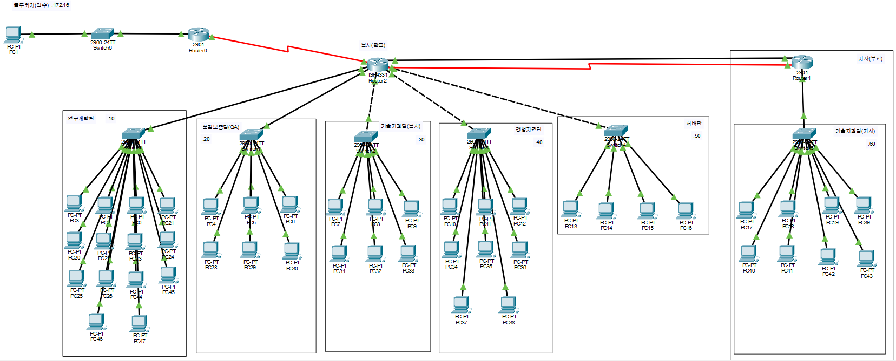

# SafeCore 네트워크 보안 프로젝트

보안 솔루션 기업 세이프코어(가상)의 본사, 지사, 인수 회사 망을 Cisco Packet Tracer로 설계했습니다. 공격과 장애를 직접 재현하고, 대책이 동작하는지 명령 출력과 캡처로 검증한 개인 프로젝트입니다.

## 핵심 성과

| 성과 | 근거 |
|------|------|
| 장애 대응 시간 단축: 주 회선 장애 때 마지막 라우팅 신호부터 예비 경로 전환까지 RIPv2 402초에서 475초 사이 → OSPF 약 9초에서 14초 사이 | 같은 조건(본사 Vlan70 차단)에서 지사 라우터 시계로 측정 [6일차](02_작업%20계획/6일차_작업계획서.md) |
| 인수 회사로 새는 내부 경로 11개 → 1개(서버팜만), 연구개발팀 접근 차단 확인 | 재분배 전후 경로표, 인수 회사 PC에서 연구개발 PC ping `Destination host unreachable` [7일차](02_작업%20계획/7일차_작업계획서.md) |
| 경로 하이재킹을 재현하고 ACL로 데이터 유출 차단 | 인수 회사가 서버팜 /25를 광고하자 본사 traceroute 첫 홉이 인수 회사로 바뀜, ACL 적용 후 차단 4건 [7일차](02_작업%20계획/7일차_작업계획서.md) |
| 본사와 지사 회선 이중화를 정적, RIPv2, OSPF 세 방식으로 구축하고 비교 | 방식마다 주 회선을 끊고 전환과 복구를 확인 [라우팅 비교](03_설계도/라우팅_비교.md) |
| 시뮬레이터 미지원 기능을 먼저 시험하고 대체 설계 | `prefix-list`, `route-map`, `distribute-list` 미지원을 `?`로 확인한 뒤 경로 선언과 ACL로 대체 [7일차 학습문서](04_학습문서/7일차_학습문서.md) |

## 전체 구성



| 구간 | 구성 |
|------|------|
| 본사(판교) | 라우터 SC-HQ-R1(ISR4331), 부서 5개(연구개발, QA, 기술지원, 경영지원, 서버팜)를 VLAN과 전용 포트로 분리 |
| 지사(부산) | 라우터 SC-BR-R1(2901), 기술지원팀 |
| 본사와 지사 | 주 회선(이더넷) + 예비 회선(시리얼), OSPF area 0, 회선별 MD5 인증 |
| 인수 회사 블루워치 | 보안관제 기업, EIGRP 20, 본사와 시리얼로 연결, 서버팜 경로만 전달, ACL로 나가는 트래픽 제한 |

상세 주소와 인터페이스는 [네트워크 설계서](03_설계도/네트워크_설계서.md)에 있습니다.

## 보안 시나리오

| 위협 | 대책 | 검증 결과 |
|------|------|-----------|
| 본사와 지사 회선 하나가 끊겨 지사가 본사 서버를 못 씀 | 예비 시리얼 회선, OSPF cost로 자동 전환 | 장애 시 비용 65인 시리얼로 전환, 복구 시 자동 복귀 [캡처](99_첨부파일/7일차_18_주회선장애_지사OE2_시리얼.png) |
| 허가되지 않은 라우터가 이웃이 되어 경로를 주입 | OSPF, EIGRP 인터페이스 MD5 인증 | 한쪽만 설정하거나 키가 틀리면 이웃이 끊기고 같은 키로 복구 [캡처](99_첨부파일/7일차_14_인증_본사만_이웃끊김.png) |
| 사무실 LAN으로 라우팅 정보가 나감 | `passive-interface default`, 이웃 구간만 개방 | LAN 포트 passive, 이웃 유지 확인 [6일차](02_작업%20계획/6일차_작업계획서.md) |
| 인수 회사에 내부 망 구조와 연구개발 대역 노출 | 재분배 대신 서버팜 대역만 EIGRP에 선언 | 인수 회사 경로 11개 → 1개, 연구개발 PC 접근 차단 [캡처](99_첨부파일/7일차_6_블루워치PC_연구개발_차단.png) |
| 인수 회사가 좁은 경로(/25)를 광고해 서버팜 트래픽 탈취 | 인수 회사 방향 나가는 ACL(인수 회사 LAN 목적지만 허용) | 빼앗긴 트래픽이 본사에서 차단됨(4건). 경로 훼손과 통신 끊김은 막지 못함 [캡처](99_첨부파일/7일차_11_ACL_차단횟수.png) |

## 한계와 다음 단계

- 연구개발팀과 다른 부서 사이 차단(ACL), 인수 회사의 서버 단위 접근 제한은 아직 적용하지 않았습니다.
- 장비 관리 접속은 텔넷이고, 지사 라우터와 인수 회사 장비에는 비밀번호가 없습니다. SSH와 장비 보안을 적용할 예정입니다.
- 고객지원 포털 외부 공개(NAT)와 연구개발팀 재택 VPN은 계획 단계입니다.
- Packet Tracer는 경로 필터를 지원하지 않고, 재분배된 외부 경로를 갱신하지 않습니다. 실제 장비 기준 설정은 미검증으로 기록했습니다.

## 기술 요소

| 분야 | 내용 |
|------|------|
| 스위칭 | VLAN, 액세스 포트, SVI, 미사용 포트 차단, 관리 IP와 텔넷, 트렁크와 VTP와 Router-on-a-Stick(실습 후 원복) |
| 라우팅 | 정적 경로, floating static, RIPv2, OSPF(area 0, cost, DR/BDR), EIGRP, 재분배 |
| 보안 | OSPF와 EIGRP MD5 인증, passive-interface, 확장 ACL, enable secret |
| 도구 | Cisco Packet Tracer, Cisco IOS CLI, Git |

## 일차별 기록

| 일차 | 한 일 | 문서 |
|------|-------|------|
| 1 | 요구사항 분석, 부서 구성, 보안 요구사항 정의 | [프로젝트 계획서](01_요구사항/프로젝트_계획서.md) |
| 2 | 부서별 IP 할당과 서브넷팅 | [2일차](02_작업%20계획/2일차_작업계획서.md) |
| 3 | VLAN, 부서 게이트웨이, 본사와 지사 정적 라우팅 | [3일차](02_작업%20계획/3일차_작업계획서.md) |
| 4 | 예비 시리얼 회선, floating static route 이중화 | [4일차](02_작업%20계획/4일차_작업계획서.md) |
| 5 | RIPv2 전환, 신규 네트워크 자동 학습, 정적과 비교 | [5일차](02_작업%20계획/5일차_작업계획서.md) |
| 6 | OSPF 전환, 장애 감지 시간 비교, 인터페이스 MD5 | [6일차](02_작업%20계획/6일차_작업계획서.md) |
| 7 | 인수 회사 EIGRP 연결, 재분배, 경로 하이재킹 재현과 ACL, EIGRP MD5 | [7일차](02_작업%20계획/7일차_작업계획서.md) |

## 폴더 구조

```
00_구축결과/     Packet Tracer 시뮬레이션 파일
01_요구사항/     프로젝트 계획서(요구사항, 보안 요구사항)
02_작업 계획/    일차별 작업 계획서(목표, 확인 방법, 결과)
03_설계도/       네트워크 설계서, 라우팅 비교
04_학습문서/     일차별 학습 문서(명령어와 이유, 실패와 원인, 면접 대비)
99_첨부파일/     캡처
CLAUDE.md        Claude Code 작업 규칙과 현재 상태(다른 컴퓨터에서 이어 하기용)
작업_이어하기_가이드.md   다른 컴퓨터에서 작업을 이어 가는 순서
```
